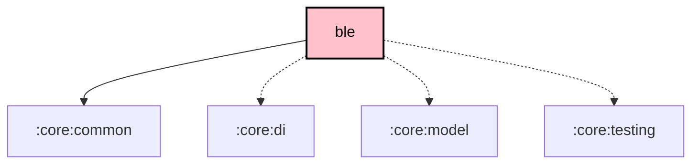

# `:core:ble`

## Overview

The `:core:ble` module contains the foundation for Bluetooth Low Energy (BLE) communication in the Meshtastic Android app. It uses the **Kable** multiplatform BLE library to provide one Coroutine-based implementation for Android and Desktop. The iOS target compiles against no-op stubs; `createPeripheral` throws there.

This module abstracts platform-specific BLE operations behind common Kotlin interfaces (`BleDevice`, `BleScanner`, `BleConnection`, `BleConnectionFactory`, `BluetoothRepository`, `MeshtasticRadioProfile`), so business logic in `commonMain` stays platform-agnostic and testable.

## Key Components

### 1. `BleConnection`
The connection contract, implemented over Kable's `Peripheral` by `KableBleConnection` and created through `KableBleConnectionFactory`.

- **Features:**
    - **Connection & Await:** `connect` and `connectAndAwait` connect and wait for a terminal `BleConnectionState`.
    - **Unified Profile Helper:** `profile` runs service discovery and characteristic setup for one service in a single block, with a timeout (30 s by default).
    - **Observability:** Exposes `connectionState` and `deviceFlow` as `StateFlow`s for reactive UI and service updates.
    - **Platform Setup:** The `expect`/`actual` functions in `KablePlatformSetup.kt` (`platformConfig`, `negotiatedMaxWriteLength`, connection priority, GATT cache refresh) carry the platform differences: on Android, `autoConnect` for bonded devices without a fresh advertisement and a 512-byte MTU request; on Desktop, direct connections.

### 2. `BluetoothRepository`
A singleton repository for the global state of Bluetooth on the device, implemented by `AndroidBluetoothRepository` and, on Desktop, `KableBluetoothRepository`.

- **Features:**
    - **State Management:** Exposes a `StateFlow<BluetoothState>` reflecting whether Bluetooth is enabled, permissions are granted, and which devices are bonded. `isSupported` is false on hardware with no Bluetooth LE.
    - **Permission Handling:** On Android 12 and later, checks `BLUETOOTH_SCAN` and `BLUETOOTH_CONNECT`. Earlier versions grant the Bluetooth permissions at install, so the check passes.
    - **Bonding:** `bond` creates a bond with a peripheral and waits for the result, with a 30 s timeout on Android.

### 3. `BleScanner`
`scan(timeout, serviceUuid, address)` returns a `Flow<BleDevice>`, implemented over Kable's `Scanner` by `KableBleScanner`. A scan that cannot start fails with `BleScanStartException`, whose `BleScanStartFailureReason` names the cause.

### 4. `MeshtasticRadioProfile`
The Meshtastic GATT service as flows: `fromRadio`, `logRadio` and `sendToRadio`, implemented by `KableMeshtasticRadioProfile` (`BleService.toMeshtasticRadioProfile()`). UUIDs live in `MeshtasticBleConstants`.

### 5. `retryBleOperation` and `classifyBleException`
`retryBleOperation` (`BleRetry.kt`) runs a BLE operation with capped exponential backoff. `classifyBleException` and `isSessionFatalBleException` (`BleExceptionClassifier.kt`) sort failures into transient ones worth a retry and session-fatal ones that force a reconnect.

## Integration

The `:core:ble` module is used by `BleRadioTransport` in [`:core:network`](../network/README.md) to implement the `RadioTransport` contract for Bluetooth devices.

## Usage

Kable comes from the version catalog as `libs.kable.core`; `gradle/libs.versions.toml` pins its version.

## Architecture

The module follows a clean multiplatform architecture approach:

- **Repository Pattern:** `BluetoothRepository` mediates data access.
- **Coroutines & Flow:** All asynchronous operations use Kotlin Coroutines and Flows.
- **Dependency Injection:** Koin, through `CoreBleModule` (common, provides `BleLoggingConfig`) and `CoreBleAndroidModule` (Android).

## Testing

Platform-neutral tests live in `commonTest` and run on the JVM and Android host targets; bonding and scan-limiter tests live in `androidHostTest`.

```shell
./gradlew :core:ble:allTests
```

## Dependency Graph

<!--region graph-->

<!--endregion-->
