# `:core:common`

## Overview

**Targets:** Android · JVM (Desktop) · iOS

The `:core:common` module contains low-level utility functions, extensions, and common data structures that do not depend on any other Meshtastic-specific modules. It is designed to be highly reusable across the project.

## Key Components

### 1. `util` package
Contains general-purpose extensions and helpers:
- **Coroutines**: `handledLaunch`, which launches with a central exception handler that reports through `Exceptions`.
- **Time**: `nowMillis`, `nowInstant` and friends (`TimeUtils.kt`), `formatDuration` (`DurationFormatter.kt`), and `DateFormatter` for display dates.
- **Exceptions**: `Exceptions.report`, `ignoreException` and `exceptionReporter`, the shared error-reporting helpers.
- **`NumberFormatter`**: Locale-aware number formatting (pre-format floats before Compose display).
- **Units**: `MeasurementSystem`, `TemperatureUnit`, `LocaleUnitsProvider` (the system locale's units with the in-app override folded in) and the `format*Localized` functions.
- **`UrlUtils` / `CommonUri`**: URL helpers, and a typealias for uri-kmp's `Uri`.

### 2. `util/MetricFormatter.kt`
Centralized utility for display strings: temperature, voltage, current, percent, humidity, pressure, SNR, RSSI, wind speed, rainfall and weight. Ensures consistent unit spacing and formatting across all UI surfaces.

### 3. `log` and `state` packages
`ExpectedCondition` and `shouldReportAsException` decide which failures reach crash reporting, and `ErrorReportThrottle` rate-limits them. `RadioOperationLock` lets a long-running operation (such as a firmware update) claim the connected node; `HiddenFeaturesUnlock` and `LaunchOptions` hold process-scoped flags.

### 4. `BuildConfigProvider`, `ApplicationCoroutineScope`, `ServiceScope`
Interfaces for build-time configuration and the two process-lifetime coroutine scopes, bound by the app hosts.

## Dependency Graph

```mermaid
graph TB
  :core:common[common]:::kmp-library

classDef android-application fill:#CAFFBF,stroke:#000,stroke-width:2px,color:#000;
classDef android-application-compose fill:#CAFFBF,stroke:#000,stroke-width:2px,color:#000;
classDef compose-desktop-application fill:#CAFFBF,stroke:#000,stroke-width:2px,color:#000;
classDef android-feature fill:#FFD6A5,stroke:#000,stroke-width:2px,color:#000;
classDef android-library fill:#9BF6FF,stroke:#000,stroke-width:2px,color:#000;
classDef android-library-compose fill:#9BF6FF,stroke:#000,stroke-width:2px,color:#000;
classDef android-test fill:#A0C4FF,stroke:#000,stroke-width:2px,color:#000;
classDef jvm-library fill:#BDB2FF,stroke:#000,stroke-width:2px,color:#000;
classDef kmp-feature fill:#FFD6A5,stroke:#000,stroke-width:2px,color:#000;
classDef kmp-library-compose fill:#FFC1CC,stroke:#000,stroke-width:2px,color:#000;
classDef kmp-library fill:#FFC1CC,stroke:#000,stroke-width:2px,color:#000;
classDef unknown fill:#FFADAD,stroke:#000,stroke-width:2px,color:#000;

```

<!--region graph-->

<!--endregion-->
