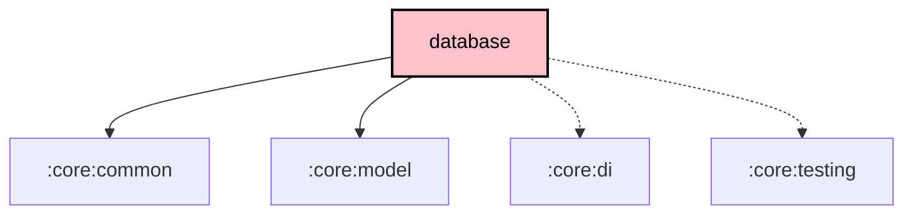

# `:core:database`

This module provides the local Room database persistence layer for the application using Room Kotlin Multiplatform (KMP).

## Key Components

-   **`MeshtasticDatabase`**: The main Room database class, defined in `commonMain`, with a `DatabaseBuilder.kt` per platform.
-   **`DatabaseManager`**: Opens one database per connected device (named `meshtastic_database_<hash>`) with LRU eviction, and publishes the active one through `DatabaseProvider`. DAO writes go through `withDb`, reads through `withReadDb`, and long-lived Flows through `observeCurrentDb`, which also recovers a wedged Room pool.
-   **`DatabaseMerger`**: Folds one device's database into another when the same node is reached over a second transport. `DatabaseBackupService` exports and restores a database file.
-   **DAOs (Data Access Objects)**:
    -   `NodeInfoDao`: Manages storage and retrieval of node information (`NodeEntity`). Contains critical logic for handling Public Key Conflict (PKC) resolution and preventing identity wiping attacks.
    -   `PacketDao`: Handles storage of mesh packets, including text messages, waypoints, and reactions.
-   **Entities**:
    -   `NodeEntity`: Represents a node on the mesh.
    -   `Packet`: Represents a stored packet.
    -   `ReactionEntity`: Represents emoji reactions to packets.

## Security Considerations

### Public Key Conflict (PKC) Handling
The `NodeInfoDao` implements specific logic to protect against impersonation and "wipe" attacks:
-   **Wipe Protection**: Receiving an `is_licensed=true` packet (which normally clears the public key for compliance) will **not** clear an existing valid public key if one is already known. This prevents attackers from sending fake licensed packets to wipe keys from the DB.
-   **First key wins**: If a different valid key arrives for a node that already has one, the stored key stays, `keyMatch` is set to false and the refused key is kept in `newPublicKey`, matching firmware's `NodeDB::updateUser`. Only the connected device's own node, installed over the local link, may replace its key. Older rows recorded a mismatch as `ERROR_BYTE_STRING`, which the DAO treats as no key.
-   **Impersonation on insert**: A new node number arriving with a key another node already holds maps back to the existing node.

## Dependency Graph

<!--region graph-->

<!--endregion-->
