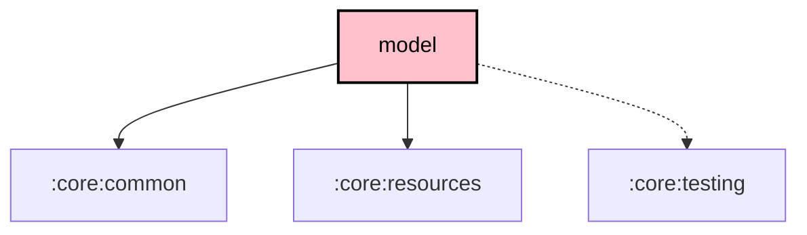

# `:core:model` (Meshtastic Domain Models)

## Overview
The `:core:model` module is a **Kotlin Multiplatform (KMP)** library containing the domain models and data classes used throughout the application and its API. These models are platform-agnostic and shared across Android, JVM (Desktop) and the iOS compile target.

## Multiplatform Support
Models are plain `commonMain` Kotlin types — `@Serializable` (kotlinx.serialization) data classes and
`@JvmInline value class`es — with no Android `Parcelable` dependency, so they are shared verbatim
across Android, JVM, and iOS.

## Key Models

- **`DataPacket`**: Represents a mesh packet (text, telemetry, etc.).
- **`Node`**: Contains detailed information about a node (position, SNR, battery, etc.).
- **`NodeAddress` / `ContactKey`**: Type-safe node addressing (`Broadcast`/`Local`/`ByNum`/`ById`) and contact-key parsing, replacing stringly-typed `"^all"`/`"!hex"` handling.
- **`DeviceHardware`**: Represents supported Meshtastic hardware devices and their capabilities.
- **`Channel`**: Represents a mesh channel configuration.
- **`util/`**: Meshtastic URL handling (`ChannelSet`, `SharedContact`, `dispatchMeshtasticUri`), `UnitConversions`, and proto extension helpers.

The module `api`-exports the `org.meshtastic:protobufs` artifact and the TAKPacket-SDK (with the SDK's own transitive protobufs excluded), so consumers get both without declaring them.

## Usage
This module is a core dependency of most feature modules.

```kotlin
// In commonMain
implementation(projects.core.model)
```

## Structure
- **`commonMain`**: Contains the majority of domain models and logic.
- **`jvmAndroidMain`**: `actual` implementations shared by Android and Desktop (date-time, POSIX time zones, random).
- **`androidMain`**: `UriBridge.kt`, which adapts `android.net.Uri` to the shared URL dispatch.
- **`commonTest`** / **`jvmTest`**: Unit tests, run by `./gradlew :core:model:allTests`.
- **`androidDeviceTest`**: Instrumented tests for channel and shared-contact URLs, which need a device or emulator.


## Dependency Graph

<!--region graph-->

<!--endregion-->
