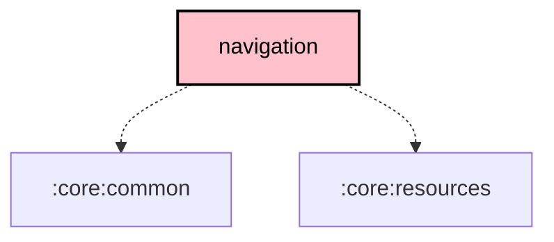

# `:core:navigation`

## Overview
The `:core:navigation` module defines the type-safe Navigation 3 route model for Android and Desktop using Kotlin Serialization.

## Key Components

### 1. `Routes.kt`
Contains serializable `NavKey` route classes/objects used by shared feature graphs.

### 2. `DeepLinkRouter.kt`
Matches Meshtastic deep-link URIs against Navigation 3 `UriDeepLinkMatcher` patterns and synthesizes a typed backstack (for example `/nodes/1234/device-metrics`).

### 3. `NavigationConfig.kt`
Defines `MeshtasticNavSavedStateConfig`, which registers each sealed route hierarchy with `subclassesOfSealed` so Navigation 3 backstacks can be persisted and restored. A new route inside an existing hierarchy is registered at compile time; a new hierarchy needs its own line.

### 4. Shell helpers
`TopLevelDestination` lists the five top-level tabs shared by the Android and Desktop shells, `MultiBackstack` (`rememberMultiBackstack`) keeps one backstack per tab, `NavBackStackExt.kt` adds `replaceLast`, `popUnlessRoot` and `replaceAll`, and `rumViewName` derives the analytics view name for a route.

## Features
- **Type-Safety**: Uses serializable `NavKey` routes instead of ad-hoc string routes.
- **Deep-link synthesis**: Converts incoming URIs into typed backstacks via `DeepLinkRouter`.
- **Centralized definition**: Routes and saved-state serializers are declared in one place to avoid feature-module cycles.

## Usage
Feature modules depend on this module to define their entry points and navigate via `NavBackStack<NavKey>`.

```kotlin
import androidx.navigation3.runtime.NavBackStack
import androidx.navigation3.runtime.NavKey
import org.meshtastic.core.navigation.NodesRoute

fun openNodeDetail(backStack: NavBackStack<NavKey>, destNum: Int) {
    backStack.add(NodesRoute.NodeDetail(destNum))
}
```


## Dependency Graph

<!--region graph-->

<!--endregion-->
