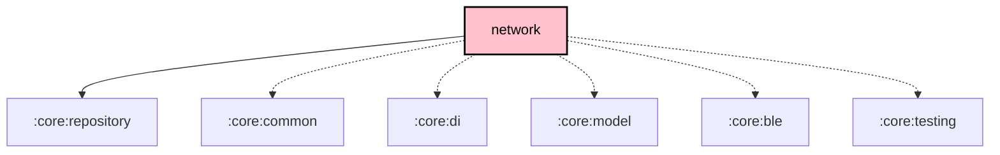

# `:core:network`

## Overview
The `:core:network` module handles all internet-based communication: firmware metadata, device hardware definitions and the other shared resources from `api.meshtastic.org`, plus the MQTT client and local network discovery. It also maps each radio address to the SDK link that serves it, and supplies the virtual radios used by Demo Mode and capture replay.

## Key Components

### 1. `Ktor` Client
The module uses **Ktor** as its HTTP client. `ApiService` (`service/`) defines the requests against `HttpClientDefaults.API_BASE_URL`, plus the nightly build index. `HttpClientDefaults` also holds the nightly, release and device-model hosts, and every host builds its API client with `installApiDefaults`, which installs the shared plugins and leaves the engine to the host.

### 2. Remote Data Sources
- **`FirmwareReleaseRemoteDataSource`**: Fetches the firmware release list (`github/firmware/list`), release manifests and the nightly build index.
- **`DeviceHardwareRemoteDataSource`**: Fetches definitions for supported Meshtastic hardware devices.
- **`DeviceLinksRemoteDataSource`**, **`EventFirmwareRemoteDataSource`**, **`BootloaderOtaQuirksRemoteDataSource`**, **`MaintenanceUf2RemoteDataSource`**, **`MqttRootsRemoteDataSource`**, **`DeviceModelRemoteDataSource`**: The other `api.meshtastic.org` resources, and the flasher's GLB device models.

### 3. Transports
The [Meshtastic SDK](https://github.com/meshtastic/meshtastic-sdk) owns framing, the PhoneAPI session and every TCP, WebSocket, serial and BLE link; this module only chooses and builds them.
- **`BaseRadioTransportFactory`** (`radio/`): Address admission and dispatch on the address prefix. An unknown prefix opens `NopRadioTransport`; `r` opens the mock unless a platform supplies a capture (only `AndroidRadioTransportFactory` does, from a debug-build asset).
- **`AndroidSdkTransportFactory`**, **`DesktopSdkTransportFactory`**, **`WebSdkRadioTransportFactory`**: Build the SDK PhoneAPI session for each platform's links. The browser refuses raw TCP; Web Serial reuses an existing port grant through `WebSerialRadioLink`, and Web Bluetooth reuses Kable's grant.
- **`TransportLifecycleGate`** (`radio/`): Serializes admitted transport operations against a terminal, idempotent teardown.
- **`MockRadioTransport`**, **`ReplayRadioTransport`**, **`NopRadioTransport`**: Demo Mode, capture replay and the no-device transport. `VirtualRadioLink` and `VirtualRadioSessionFactory` give the simulated peers firmware-side framing, so they run through the same SDK session as a physical radio.

### 4. Repositories
- **`MQTTRepository`**: The MQTT client used to proxy mesh traffic to and from a broker, over TCP or WebSockets.
- **`NetworkRepository`**: Network availability and discovered Meshtastic services (Android NSD, JmDNS on Desktop).

> **BLE:** the SDK's BLE transport runs the link; pairing, scanning and GATT repair come from the Kable primitives in [`:core:ble`](../ble/README.md). An address with the `x` (or `!`) prefix selects it.

## Dependency Graph

<!--region graph-->

<!--endregion-->
