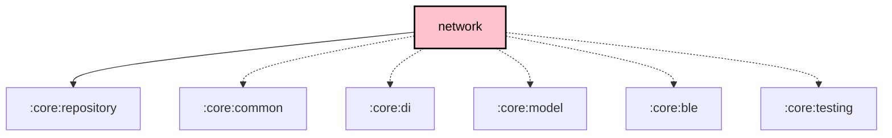

# `:core:network`

## Overview
The `:core:network` module handles all internet-based communication: firmware metadata, device hardware definitions and the other shared resources from `api.meshtastic.org`, plus the MQTT client and local network discovery. It also provides the radio transport layer (`TcpTransport`/`TcpRadioTransport`, `SerialTransport`, `SerialRadioTransport`, `BleRadioTransport`).

## Key Components

### 1. `Ktor` Client
The module uses **Ktor** as its HTTP client. `ApiService` (`service/`) defines the requests against `HttpClientDefaults.API_BASE_URL`, plus the nightly build index. `HttpClientDefaults` also holds the nightly, release and device-model hosts.

### 2. Remote Data Sources
- **`FirmwareReleaseRemoteDataSource`**: Fetches the firmware release list (`github/firmware/list`), release manifests and the nightly build index.
- **`DeviceHardwareRemoteDataSource`**: Fetches definitions for supported Meshtastic hardware devices.
- **`DeviceLinksRemoteDataSource`**, **`EventFirmwareRemoteDataSource`**, **`BootloaderOtaQuirksRemoteDataSource`**, **`MaintenanceUf2RemoteDataSource`**, **`DeviceModelRemoteDataSource`**: The other `api.meshtastic.org` resources, and the flasher's GLB device models.

### 3. Transports
- **`TcpTransport`** (`transport/`) + **`TcpRadioTransport`** (`radio/`): Multiplatform TCP transport and its `RadioTransport` adapter.
- **`SerialTransport`** (`jvmMain`): Desktop USB/serial transport powered by jSerialComm. Android uses `SerialRadioTransport` over usb-serial-for-android instead.
- **`BleRadioTransport`** (`radio/`): The `RadioTransport` implementation for Bluetooth devices.
- **`MockRadioTransport`**, **`ReplayRadioTransport`**, **`NopRadioTransport`**: Demo Mode and no-op transports that reach no node.
- **`BaseRadioTransportFactory`**: Common factory for instantiating the KMP transports; `AndroidRadioTransportFactory` creates the Android-only ones.

### 4. Repositories
- **`MQTTRepository`**: The MQTT client used to proxy mesh traffic to and from a broker, over TCP or WebSockets.
- **`NetworkRepository`**: Network availability and discovered Meshtastic services (Android NSD, JmDNS on Desktop).

> **BLE:** the `RadioTransport` implementation (`BleRadioTransport`) lives **here** in `radio/`; it delegates to the lower-level Kable connection primitives (`BleConnection`, `BleScanner`, `BluetoothRepository`, …) provided by [`:core:ble`](../ble/README.md). `BaseRadioTransportFactory` instantiates it when an address with the `x` (or `!`) prefix is resolved.

## Dependency Graph

<!--region graph-->

<!--endregion-->
