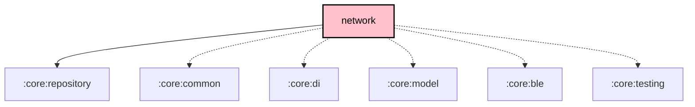

# `:core:network`

## Overview
The `:core:network` module handles all internet-based communication: firmware metadata, device hardware definitions and the other shared resources from `api.meshtastic.org`, plus the MQTT client and local network discovery. It also provides the radio transport layer (`TcpTransport`/`TcpRadioTransport`, `WebSocketRadioTransport`, `SerialTransport`, `SerialRadioTransport`, `BleRadioTransport`).

## Key Components

### 1. `Ktor` Client
The module uses **Ktor** as its HTTP client. `ApiService` (`service/`) defines the requests against `HttpClientDefaults.API_BASE_URL`, plus the nightly build index. `HttpClientDefaults` also holds the nightly, release and device-model hosts, and every host builds its API client with `installApiDefaults`, which installs the shared plugins and leaves the engine to the host.

### 2. Remote Data Sources
- **`FirmwareReleaseRemoteDataSource`**: Fetches the firmware release list (`github/firmware/list`), release manifests and the nightly build index.
- **`DeviceHardwareRemoteDataSource`**: Fetches definitions for supported Meshtastic hardware devices.
- **`DeviceLinksRemoteDataSource`**, **`EventFirmwareRemoteDataSource`**, **`BootloaderOtaQuirksRemoteDataSource`**, **`MaintenanceUf2RemoteDataSource`**, **`MqttRootsRemoteDataSource`**, **`DeviceModelRemoteDataSource`**: The other `api.meshtastic.org` resources, and the flasher's GLB device models.

### 3. Transports
- **`TcpTransport`** (`transport/`) + **`TcpRadioTransport`** (`radio/`): Multiplatform TCP transport and its `RadioTransport` adapter.
- **`WebSocketRadioTransport`** (`radio/`): Firmware's WebSocket phone API (`w` addresses, default path `/api/v1/ws`; released firmware does not serve it yet) over Ktor, CIO off the web and the browser's engine on wasm (`webSocketHttpClient`). No client installs HTTP logging; the transport's own log label carries only the scheme, host and port (a public host anonymized), never the path, query or credentials.
- **`ReconnectBackoff`** (`transport/`): The reconnect schedule TCP and WebSocket share.
- **`WasmJsRadioTransportFactory`** (`wasmJsMain`) + **`WasmJsSerialTransport`**: The web factory, over Web Bluetooth, Web Serial and WebSocket; it refuses raw TCP.
- **`SerialTransport`** (`jvmMain`): Desktop USB/serial transport powered by jSerialComm. Android uses `SerialRadioTransport` over usb-serial-for-android instead.
- **`StreamFrameCodec`** (`transport/`): START1/START2 + 16-bit length framing for serial and TCP. A payload over 512 bytes is dropped with a size-only warning and the link stays up.
- **`BleRadioTransport`** (`radio/`): The `RadioTransport` implementation for Bluetooth devices.
- **`MockRadioTransport`**, **`ReplayRadioTransport`**, **`NopRadioTransport`**: Demo Mode and no-op transports that reach no node.
- **`BaseRadioTransportFactory`**: Common factory that dispatches every address on its prefix. BLE, WebSocket, mock and no-device are built here on every platform; an unknown prefix opens `NopRadioTransport`, and `r` opens the mock unless a platform supplies a capture (only `AndroidRadioTransportFactory` does, from a debug-build asset). TCP and serial are platform hooks.

### 4. Repositories
- **`MQTTRepository`**: The MQTT client used to proxy mesh traffic to and from a broker, over TCP or WebSockets. A downlink message whose encoded `ToRadio` exceeds the 512-byte phone API frame limit is dropped, and a channel whose name holds `+`, `#` or `/` gets no subscription. A publish is sent only when its topic is the connection's root topic, a `/` and a non-empty remainder, with no wildcard; the root is compared as configured, the same string the subscriptions use.
- **`NetworkRepository`**: Network availability and discovered Meshtastic services (Android NSD, JmDNS on Desktop).

> **BLE:** the `RadioTransport` implementation (`BleRadioTransport`) lives **here** in `radio/`; it delegates to the lower-level Kable connection primitives (`BleConnection`, `BleScanner`, `BluetoothRepository`, …) provided by [`:core:ble`](../ble/README.md). `BaseRadioTransportFactory` instantiates it when an address with the `x` (or `!`) prefix is resolved.

## Dependency Graph

<!--region graph-->

<!--endregion-->
