# `:core:nfc`

## Overview
The `:core:nfc` module provides Near Field Communication (NFC) capabilities for the application. It is an Android library, since NFC hardware APIs are Android-specific. The shared NFC contracts are the `LocalNfc*` composition locals in `core:ui`.

## Key Components

### 1. `NfcScannerEffect`
A Composable side-effect that puts the NFC adapter in reader mode while composed and reports the URI of the next NDEF tag.

### 2. `NfcWriterEffect`
Writes a shared-contact or channel-set URL to the next NDEF tag tapped against the phone, formatting the tag first when it is `NdefFormatable`.

### 3. `NfcEmulatorEffect`, `NfcTagEmulation` and `MeshtasticHostApduService`
Host card emulation: while `NfcEmulatorEffect` is composed, `NfcTagEmulation` holds the armed URL and `MeshtasticHostApduService` (registered in `androidApp`'s manifest) serves it as a read-only NFC Forum Type 4 tag. An unarmed phone presents no tag.

### 4. Composition locals (core:ui/commonMain)
`LocalNfcScannerProvider`, `LocalNfcWriterProvider` and `LocalNfcEmulatorProvider` carry the three effects into shared code, with `LocalNfcScannerSupported` and `LocalNfcEmulationSupported` as capability flags. `MainActivity` provides them.

## Dependency Graph

```mermaid
graph TB
  :core:nfc[nfc]:::android-library

classDef android-application fill:#CAFFBF,stroke:#000,stroke-width:2px,color:#000;
classDef android-application-compose fill:#CAFFBF,stroke:#000,stroke-width:2px,color:#000;
classDef compose-desktop-application fill:#CAFFBF,stroke:#000,stroke-width:2px,color:#000;
classDef android-feature fill:#FFD6A5,stroke:#000,stroke-width:2px,color:#000;
classDef android-library fill:#9BF6FF,stroke:#000,stroke-width:2px,color:#000;
classDef android-library-compose fill:#9BF6FF,stroke:#000,stroke-width:2px,color:#000;
classDef android-test fill:#A0C4FF,stroke:#000,stroke-width:2px,color:#000;
classDef jvm-library fill:#BDB2FF,stroke:#000,stroke-width:2px,color:#000;
classDef kmp-feature fill:#FFD6A5,stroke:#000,stroke-width:2px,color:#000;
classDef kmp-library-compose fill:#FFC1CC,stroke:#000,stroke-width:2px,color:#000;
classDef kmp-library fill:#FFC1CC,stroke:#000,stroke-width:2px,color:#000;
classDef unknown fill:#FFADAD,stroke:#000,stroke-width:2px,color:#000;

```

<!--region graph-->

<!--endregion-->
