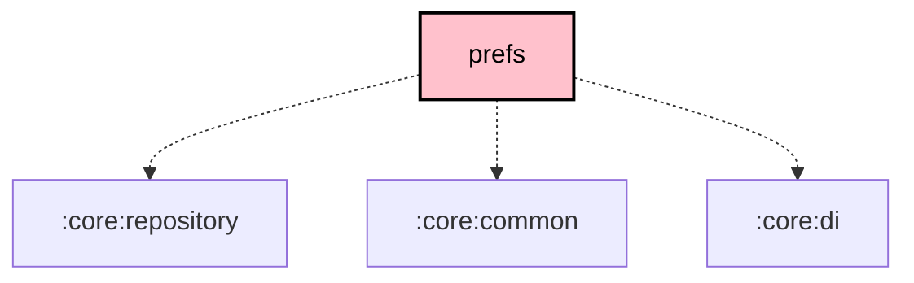

# `:core:prefs`

## Overview
The `:core:prefs` module provides a type-safe preferences layer backed by DataStore (multiplatform). On Android, legacy `SharedPreferences` are automatically migrated to DataStore on first access via `SharedPreferencesMigration`.

## Key Components

### 1. DataStore Providers (`CorePrefsAndroidModule`)
Provides one `DataStore<Preferences>` singleton per preference domain (analytics, app, map, mesh, radio, UI, etc.), each under its own type (`AnalyticsDataStore`, `AppDataStore`, … in `PrefsDataStores.kt`) rather than a Koin string qualifier. Each DataStore uses an injected `CoroutineDispatchers.io` scope and includes a `SharedPreferencesMigration` from the legacy preference file. The Desktop host provides the same types from `desktopApp`.

### 2. Specialized Prefs
Each `*PrefsImpl` here implements an interface from `:core:repository`'s `AppPreferences.kt`:
- **`RadioPrefsImpl`**: The last connected device address and name.
- **`UiPrefsImpl`**: UI preferences (for example theme, units override, locale, node sort and filters).
- **`MapPrefsImpl`**: Mapping preferences (for example map style and layer visibility).
- Others for analytics, notifications, mesh, the Local TAK Server (`TakPrefsImpl`), discovery, custom emoji, and AppFunctions.

## Dependency Graph

<!--region graph-->

<!--endregion-->
