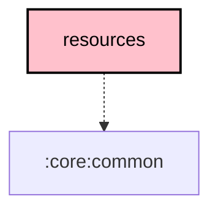

# `:core:resources`

## Overview
The `:core:resources` module is the centralized source for all UI strings and localizable resources. It uses the **Compose Multiplatform Resource** library to provide a type-safe way to access strings.

## Key Features

- **Single Source of Truth**: All UI strings must be defined in this module, not in the `androidApp`/`desktopApp` hosts or in feature modules.
- **Type-Safety**: Generates a public `Res` object in `org.meshtastic.core.resources` that allows accessing strings like `Res.string.your_key` with compile-time checking.
- **Two string files**: `values/strings.xml` is hand-written; run `python3 scripts/sort-strings.py` after adding to it. `values/schema_strings.xml` holds the protobuf field labels (`schema_*` keys), is generated by `./gradlew :schema-strings:sync`, and is never edited by hand.
- **Locales**: Crowdin writes the `values-*` translations. The `generateSupportedLocales` task turns those directories into the generated `supportedLocaleTags` list the language pickers read.
- **Helpers**: `UiText` carries a string resource or a raw string from non-UI layers to the UI; `getString`/`getStringSuspend` and `formatDuration` resolve text outside composition.
- **Other resources**: drawables and `files/` (device illustrations, and the HDR environment map for the 3D device viewer), plus the Android notification icon and alert sound under `androidMain/res`, prefixed `meshtastic_`.

## Usage
The library provides a standard way to access strings in Jetpack Compose.

```kotlin
import org.jetbrains.compose.resources.stringResource
import org.meshtastic.core.resources.Res
import org.meshtastic.core.resources.your_string_key

Text(text = stringResource(Res.string.your_string_key))
```


## Dependency Graph

<!--region graph-->

<!--endregion-->
