# `:core:service`

## Overview

**Targets:** Android · JVM (Desktop) · iOS

The `:core:service` module runs the mesh service: the shared orchestrator that wires the mesh service graph, the controllers that send commands to the node, and the Android foreground service and its notifications, workers and receivers.

## Key Components

### 1. `MeshServiceOrchestrator` and `MeshService`
`MeshServiceOrchestrator` (commonMain) starts and stops the mesh service graph. Android's foreground `MeshService` hosts it; the Desktop app starts it from `Main.kt` while its window is composed.

### 2. `ServiceRepositoryImpl`
The shared implementation of `:core:repository`'s `ServiceRepository`, exposing reactive `Flow`s for connection status, errors and arriving packets. `AndroidServiceRepository` is its Android Koin binding.

### 3. `SharedRadioInterfaceService`
The multiplatform connection orchestrator: connect, reconnect loop, device-address state and Bluetooth/network toggles, delegating the byte transport to a platform `RadioTransportFactory`. It publishes the `ConnectionState` from `:core:model` (`Connected`, `Connecting`, `Disconnected`, `DeviceSleep`).

### 4. `RadioControllerImpl`
The in-process `RadioController` composition root (Desktop, iOS, and single-process Android). It assembles four focused sub-controllers — `AdminControllerImpl`, `MessagingControllerImpl`, `NodeControllerImpl`, `QueryControllerImpl` — via Kotlin interface delegation, and owns the cross-cutting concerns (connection state, packet-id, location, device-address switching). Commands are direct suspend calls to `CommandSender`; admin sends are fire-and-forget (the device is the source of truth). Config writes use the `editSettings { }` transaction.

### 5. Platform pieces
`androidMain` holds the notifications (`MeshNotificationManagerImpl`, `NotificationChannels`), WorkManager workers (`SendMessageWorker`, `MeshLogCleanupWorker`), `BootCompleteReceiver`, conversation shortcuts, and the encrypted stores for security-key backups and the lockdown passphrase. `jvmMain` holds the Desktop equivalents of the file, location and key stores.

## Dependency Graph

```mermaid
graph TB
  :core:service[service]:::kmp-library
  :core:service -.-> :core:prefs
  :core:service --> :core:repository
  :core:service -.-> :core:common
  :core:service -.-> :core:database
  :core:service -.-> :core:di
  :core:service -.-> :core:model
  :core:service -.-> :core:navigation
  :core:service -.-> :core:network
  :core:service -.-> :core:ble
  :core:service -.-> :core:resources
  :core:service -.-> :core:takserver
  :core:service -.-> :core:testing

classDef android-application fill:#CAFFBF,stroke:#000,stroke-width:2px,color:#000;
classDef android-application-compose fill:#CAFFBF,stroke:#000,stroke-width:2px,color:#000;
classDef compose-desktop-application fill:#CAFFBF,stroke:#000,stroke-width:2px,color:#000;
classDef android-feature fill:#FFD6A5,stroke:#000,stroke-width:2px,color:#000;
classDef android-library fill:#9BF6FF,stroke:#000,stroke-width:2px,color:#000;
classDef android-library-compose fill:#9BF6FF,stroke:#000,stroke-width:2px,color:#000;
classDef android-test fill:#A0C4FF,stroke:#000,stroke-width:2px,color:#000;
classDef jvm-library fill:#BDB2FF,stroke:#000,stroke-width:2px,color:#000;
classDef kmp-feature fill:#FFD6A5,stroke:#000,stroke-width:2px,color:#000;
classDef kmp-library-compose fill:#FFC1CC,stroke:#000,stroke-width:2px,color:#000;
classDef kmp-library fill:#FFC1CC,stroke:#000,stroke-width:2px,color:#000;
classDef unknown fill:#FFADAD,stroke:#000,stroke-width:2px,color:#000;

```

<!--region graph-->

<!--endregion-->
