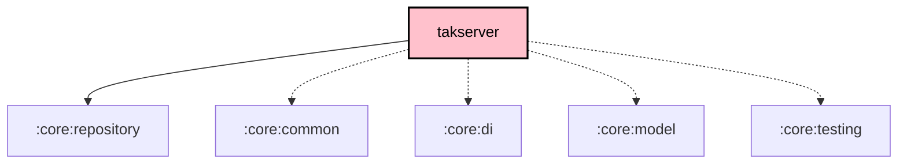

# `:core:takserver`

## Overview

The `:core:takserver` module implements the **Meshtastic ↔ TAK (Team Awareness Kit) bridge**. It embeds an mTLS TCP server (port 8089) compatible with ATAK (Android), iTAK (iOS), and WinTAK clients, enabling mesh-networked position sharing and GeoChat with TAK-enabled devices.

**Targets:** Android · JVM (Desktop) · iOS. `expect`/`actual` splits cover the TCP server, file I/O, zip archiving and test-fixture loading. Compression runs through the multiplatform TAKPacket-SDK on every target. On iOS the server is a stub that reports `isSupported = false`.

## Key Responsibilities

- Serve an mTLS TCP listener (port 8089) compatible with the CoT (Cursor-on-Target) protocol
- Convert Meshtastic protobuf packets (`TAKPacketV2`) to CoT XML events and vice versa
- Generate ATAK Data Package `.zip` exports (team contacts, map overlays)
- Compress CoT payloads with zstd in the TAK SDK format, through the TAKPacket-SDK
- Buffer up to 50 CoT messages for 5 minutes when no TAK clients are connected; drain on reconnect
- Drop duplicate CoT deliveries from the mesh (`CotDeliveryDedup`)
- Optionally publish every qualifying mesh node to TAK clients as a CoT contact (`MeshToCotBroadcaster`)
- Provide TAK preference XML for ATAK client provisioning

## Source Structure

```text
src/
├── commonMain/kotlin/org/meshtastic/core/takserver/
│   ├── TAKServer.kt                 ← interface + expect createTAKServer()
│   ├── TAKServerManager.kt          ← interface + TAKServerManagerImpl (offline queue)
│   ├── TAKMeshIntegration.kt        ← bridges mesh service ↔ TAK server
│   ├── MeshToCotBroadcaster.kt      ← mesh nodes → CoT contacts (Mesh to CoT)
│   ├── MeshNodeCoTConversion.kt     ← node eligibility, UID, callsign, remarks
│   ├── CotDeliveryDedup.kt          ← drops duplicate mesh deliveries
│   ├── CotSanitizer.kt              ← delegates to the SDK's mesh sanitizer
│   ├── CoTConversion.kt             ← Position/User → CoTMessage extension fns
│   ├── CoTXml.kt / CoTXmlParser.kt / CoTXmlFrameBuffer.kt
│   ├── CoTXmlDataClasses.kt
│   ├── CoTDetailStripper.kt
│   ├── TAKModels.kt                 ← CoTMessage, TAKClientInfo, TAKConnectionEvent
│   ├── TAKPacketConversion.kt
│   ├── TAKPacketV2Conversion.kt
│   ├── TAKDefaults.kt
│   ├── TAKDataPackageGenerator.kt
│   ├── RouteDataPackageGenerator.kt
│   ├── TAKPrefXmlDataClasses.kt
│   ├── TakV2TypeMapper.kt
│   ├── TakConversionHelpers.kt
│   ├── XmlUtils.kt
│   ├── AtakFileWriter.kt            ← expect
│   ├── TakSdkCompressor.kt          ← SDK parse + compress (zstd TAK-SDK frame)
│   ├── TakV2Compressor.kt           ← TAKPacketV2 ↔ wire bytes bridge
│   ├── ZipArchiver.kt               ← expect
│   ├── TakFixtureLoader.kt          ← expect (test fixtures)
│   ├── TakMeshTestRunner.kt
│   └── di/
│       └── CoreTakServerModule.kt
├── jvmAndroidMain/
│   ├── kotlin/                      ← actual TAKServerJvm, TAKClientConnection, TakCertLoader, ZipArchiver, fixture loader
│   └── resources/                   ← tak_certs/ (server.p12, client.p12, ca.pem), tak_test_fixtures/*.xml
├── androidMain/kotlin/              ← actual AtakFileWriter (Android)
├── jvmMain/kotlin/                  ← actual AtakFileWriter (Desktop)
└── iosMain/kotlin/                  ← actual TAKServerIos (unsupported stub), AtakFileWriter, ZipArchiver, fixture loader
```

## Notable APIs

### `TAKServer` (interface)

```kotlin
interface TAKServer {
    val isSupported: Boolean
    val connectionCount: StateFlow<Int>
    var onMessage: ((CoTMessage, TAKClientInfo?) -> Unit)?
    var onClientConnected: (() -> Unit)?

    suspend fun start(scope: CoroutineScope): Result<Unit>
    fun stop()
    suspend fun broadcast(cotMessage: CoTMessage)
    suspend fun broadcastRawXml(xml: String)
    suspend fun hasConnections(): Boolean
}
```

The mTLS listener binds on port 8089 using a bundled `server.p12` / `ca.pem` identity, compatible with the ATAK Data Package provisioning flow.

### `TAKServerManager` (interface)

```kotlin
interface TAKServerManager {
    val isSupported: Boolean
    val isRunning: StateFlow<Boolean>
    val isStarting: StateFlow<Boolean>
    val connectionCount: StateFlow<Int>
    val hasStartError: StateFlow<Boolean>
    val inboundMessages: SharedFlow<InboundCoTMessage>
    val clientConnected: SharedFlow<Unit>

    fun start(scope: CoroutineScope)
    fun stop()
    fun broadcast(cotMessage: CoTMessage)
    fun broadcastRawXml(xml: String)
}
```

`TAKServerManagerImpl` adds an **offline queue**: buffers up to 50 CoT messages for 5 minutes when no clients are connected and drains them automatically on the next `onClientConnected` callback.

### `CoTMessage`

```kotlin
@Serializable
data class CoTMessage(
    val uid: String,
    val type: String,              // e.g. "a-f-G-U-C" (friendly ground unit)
    val time: Instant,
    val stale: Instant,
    val latitude: Double, val longitude: Double, val hae: Double,
    val contact: CoTContact?,
    val group: CoTGroup?,
    val status: CoTStatus?,
    val track: CoTTrack?,
    val chat: CoTChat?,
    val remarks: String?,
    // ...
)

// Factory helpers
CoTMessage.pli(uid, callsign, latitude, longitude, ...)   // Position Location Information
CoTMessage.chat(senderUid, senderCallsign, message, chatroom)
```

### CoT Conversion

```kotlin
// Meshtastic proto → CoT
org.meshtastic.proto.Position.toCoTMessage(uid, callsign, team, role, battery, staleMinutes, remarks): CoTMessage
org.meshtastic.proto.User.toCoTMessage(position, team, role, battery, uid, callsign, staleMinutes, remarks): CoTMessage
```

## Dependency Graph

```text
core:takserver
  ├── api → core:repository     (exported)
  ├── core:common, core:di, core:model, org.meshtastic:protobufs (Maven)
  ├── okio, atomicfu, kotlinx.serialization.json
  ├── xmlutil-core, xmlutil-serialization
  ├── ktor-client-core, ktor-network   (TCP socket)
  └── kotlinx.datetime, kermit         (zstd rides on the SDK's transitive kzstd)
```

## Local TAK Server Feature

The Local TAK Server can be enabled from the app's Settings screen. When running, ATAK/iTAK clients on the same network can connect to `<device-ip>:8089` and their position reports are automatically bridged onto the mesh. CoT arriving from the mesh on ports 72/78 is forwarded to every connected TAK client.

### Mesh to CoT (node contacts)

Separately opt-in (`TakPrefs.isMeshToCotEnabled`, default off, shown as "Mesh to CoT Converter" under the server toggle). When enabled alongside the server, `MeshToCotBroadcaster` synthesizes a CoT contact for each node in the node database so regular Meshtastic nodes appear on the ATAK map without the legacy Meshtastic TAK Plugin, which needs an AIDL service API this app does not provide.

Nodes qualify when they have identified themselves, were heard inside the online window (2 h), and hold a valid position; the local node is excluded because ATAK renders it as self.

Output is aligned against Meshtastic-Apple's `TAKMeshtasticBridge.createCoTFromNode` so the same physical node presents identically on both platforms:

| Field | Value | Notes |
| --- | --- | --- |
| `uid` | `MESHTASTIC-%08X` | **Upper-case hex is load-bearing.** ATAK keys contacts by UID and compares case-sensitively; lower-casing it makes an Android-bridged node a *separate* contact from the same iOS-bridged node, so the mesh appears duplicated when both phones bridge one TAK network. |
| `callsign` | `SHORT - Long Name` | Falls back through whichever names are populated. |
| team / role | `Green` / `Team Member` | Remote nodes never report a TAK team. |
| stale | 15 min | Paired with the 5-min refresh below. |
| `remarks` | `Battery … \| Voltage … \| Chan Util … \| Air Util Tx … \| RSSI … \| SNR …` | Labels, order, and precision match Apple (voltage at two decimals, the rest at one). |

Two deliberate divergences from Apple, both in `remarks`:

- **Zero is reported, not suppressed.** Apple gates each field on a non-zero value (`if voltage > 0`, `if rssi != 0`, …) and substitutes 100% for an unreported battery. Here, absence is detected via nullability and the SNR/RSSI sentinels instead — 0 dB SNR and 0 dBm RSSI are real measurements, and 0% battery is precisely the reading an operator needs to see rather than have hidden.
- **`Air Util Tx` is additive** — no Apple counterpart.

`Node.validPosition` (the repo-wide helper) also requires *both* coordinates non-zero and in range, where Apple accepts either being non-zero; a node sitting exactly on the equator or prime meridian is therefore dropped here. Kept for consistency with every other position filter in the codebase.

Nothing on this path crosses the mesh, so none of it is subject to the LoRa MTU or the TAKPacket wire format. Three behaviors are load-bearing: broadcasts are suppressed while no client is attached (they would otherwise evict real mesh CoT from the 50-entry offline queue), a connecting client triggers a full replay, and every node is re-sent periodically so stationary markers do not expire at `MESH_NODE_STALE_MINUTES`.

## TAKPacket-SDK consumer & version-bump playbook

This module consumes the external [TAKPacket-SDK](https://github.com/meshtastic/TAKPacket-SDK) (`org.meshtastic:takpacket-sdk`, KMP since 0.7.0; pinned as `takpacket-sdk` in `gradle/libs.versions.toml`) for the V2 wire format. The SDK does CoT-XML ↔ `TAKPacketV2` ↔ zstd-compressed bytes; it owns the dictionaries and the schema. The `TAKPacketV2` proto types themselves come from the `org.meshtastic:protobufs` Maven artifact (pinned as `meshtastic-protobufs`, api()-exported by `:core:model`).

**Two V2 wire paths — keep both in mind when the SDK changes:**

- **Path A (primary, SDK-delegated):** `TakSdkCompressor` / `TakV2Compressor` call the SDK's parser/builder/compressor. This path is insulated from proto field renames *as long as* the SDK and `meshtastic-protobufs` versions are bumped together.
- **Path B (fallback):** `TAKPacketV2Conversion.kt` builds and reads the Wire-generated `TAKPacketV2` **directly** (the send fallback when the SDK parser or compressor fails). It references proto fields by name, so it **breaks at compile time** on any schema change and must be updated in lockstep.

**When bumping to a new (wire-breaking) SDK version:**
1. `gradle/libs.versions.toml` → bump `takpacket-sdk` (and, if the schema moved, `meshtastic-protobufs` to the matching protobufs release).
2. **Leave `:core:model`'s exclude block intact** (`core/model/build.gradle.kts`): the SDK still declares a transitive, older `org.meshtastic:protobufs` pin, so `:core:model` api()-exports the SDK with `exclude(group = "org.meshtastic", module = "protobufs" / "protobufs-jvm" / "protobufs-android")` — that keeps the app's single protobufs version authoritative and prevents duplicate-class / proto-ABI breakage. (The `.toString()` string-notation there is load-bearing: catalog dependencies are immutable, so `exclude {}` only works on the string copy.)
3. Update **Path B** (`TAKPacketV2Conversion.kt`) and the **bridge** (`TakV2Compressor.kt`) for any renamed/removed/added wire fields.
4. Test: `./gradlew :core:takserver:allTests :core:takserver:compileKotlinJvm` (full KMP validation; `:core:takserver:jvmTest` works as a faster focused check) — against a locally published SDK add `-PuseMavenLocal` (gated in `settings.gradle.kts`); against a published version add `--refresh-dependencies` instead.

**Wire facts (don't re-introduce phantom changes):** PLI is **implicit** — no payload variant + an `a-f-*` cot type is a PLI. `DrawnShape` vertices are two packed `repeated sint32` delta columns. **`course` stays `deg×100`, `uid` stays a string, `stale_seconds` stays tag 16** — deliberate; do not "fix" them in `TAKPacketV2Conversion.kt`.

**Debug "TAK Mesh Test (Debug)" card:** `TakMeshTestRunner` sends the bundled `tak_test_fixtures/*.xml` through the real mesh pipeline (strip → parse → dispatch) on both the V2 (port 78) and legacy V1 (port 72) dispatch paths. They ride the SDK path, so they need no edits across wire breaks — they ARE the regression surface.

## Dependency Graph

<!--region graph-->

<!--endregion-->
