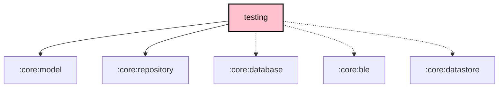

<!--
 * Copyright (c) 2026 Meshtastic LLC
 *
 * This program is free software: you can redistribute it and/or modify
 * it under the terms of the GNU General Public License as published by
 * the Free Software Foundation, either version 3 of the License, or
 * (at your option) any later version.
 *
 * This program is distributed in the hope that it will be useful,
 * but WITHOUT ANY WARRANTY; without even the implied warranty of
 * MERCHANTABILITY or FITNESS FOR A PARTICULAR PURPOSE.  See the
 * GNU General Public License for more details.
 *
 * You should have received a copy of the GNU General Public License
 * along with this program.  If not, see <https://www.gnu.org/licenses/>.
-->

# `:core:testing`

## Overview
The `:core:testing` module is a dedicated **Kotlin Multiplatform (KMP)** library that provides shared test fakes, doubles, rules, and utilities. It is designed to be consumed by the `commonTest` source sets of all other KMP modules to ensure consistent and unified testing behavior across the codebase.

By centralizing fakes and mocking utilities here, we prevent duplication of test setups and enforce a standard approach to testing ViewModels, Repositories, and pure domain logic.

## Handling Platform-Specific Setup (Robolectric)

Some KMP modules interact with Android framework components (e.g., `android.net.Uri`, `androidx.room`, `DataStore`) that require Robolectric to run on the JVM. To maintain a unified test suite while providing platform-specific initialization, follow the **Subclassing Pattern**:

### 1. Create an Abstract Base Test in `commonTest`
Place your test logic in an abstract class in `src/commonTest`. Do NOT use `@BeforeTest` for setup that requires platform-specific context.

```kotlin
abstract class CommonMyViewModelTest {
    protected lateinit var viewModel: MyViewModel
    
    // Call this from subclasses
    fun setupRepo() {
        // ... common setup logic
    }
    
    @Test
    fun testLogic() { /* ... */ }
}
```

### 2. Implement the JVM Subclass in `jvmTest`
A simple subclass is usually enough for pure JVM targets.

```kotlin
class MyViewModelTest : CommonMyViewModelTest() {
    @BeforeTest
    fun setup() {
        setupRepo()
    }
}
```

### 3. Implement the Android Subclass in `androidHostTest`
Use `@RunWith(RobolectricTestRunner::class)` and call `setupTestContext()` to initialize `ContextServices.app`. `setupTestContext()` is an `expect fun` and a no-op on the JVM, so shared setup in `commonTest` can also call it directly.

```kotlin
@RunWith(RobolectricTestRunner::class)
@Config(sdk = [34])
class MyViewModelTest : CommonMyViewModelTest() {
    @BeforeTest
    fun setup() {
        setupTestContext() // From :core:testing, initializes Robolectric context
        setupRepo()
    }
}
```

## Key Components

- **Test Doubles / Fakes**: Provides in-memory implementations of core contracts (e.g., `FakeNodeRepository`, `FakeMeshLogRepository`, `FakeRadioController`, `FakeServiceRepository`, `FakeRadioInterfaceService`) and a fake BLE stack (`FakeBleConnection`, `FakeBleScanner`, `FakeBluetoothRepository`) to isolate components under test. Many extend `BaseFake`.
- **Test data and logs**: `TestDataFactory` builds nodes and packets; `CapturingLogWriter` records Kermit output for assertions.
- **Coroutines Testing**: `runWithRenderScope` runs a test with a child scope on the test scheduler, and `runUntilSettled` drains the scheduler until a condition holds, for state that Compose resources load off the scheduler. The module also `api`-exports kotlinx-coroutines-test and Turbine.
- **Mokkery**: The `meshtastic.kmp.library` convention plugin applies the Mokkery compiler plugin to every KMP module, so `commonTest` can mock without depending on this module for it.

## Usage
Add this module to your `commonTest` source set dependencies in your KMP module's `build.gradle.kts`:

```kotlin
kotlin {
    sourceSets {
        commonTest.dependencies {
            implementation(projects.core.testing)
        }
    }
}
```

## Dependency Graph

<!--region graph-->

<!--endregion-->
