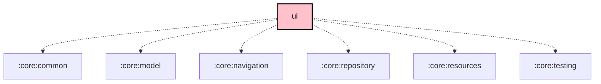

# `:core:ui`

## Overview
The `:core:ui` module contains Compose Multiplatform components, themes, and utility functions shared across the Android and Desktop apps (and the iOS compile target). It ensures a consistent look and feel following Material 3 guidelines.

## Key Components

### 1. Alert Dialogs (`org.meshtastic.core.ui.component.AlertDialogs.kt`)
- **`MeshtasticDialog`**: The base dialog component for all alerts.
- **`MeshtasticResourceDialog`**: For dialogs whose title and message are both string resources.
- **`MeshtasticTextDialog`**: For dialogs with a resource title and a raw-text message.

### 2. Common UI Elements
- **`LastHeardInfo`**: Displays when a node was last seen.
- **`TelemetryInfo.kt`**: Compact telemetry readouts (`TemperatureInfo`, `HumidityInfo`, `PressureInfo`, `PowerInfo`, `AirQualityInfo`, `UptimeInfo`, and others).
- **`TransportIcon`**: Shows the connection type (BLE, USB, TCP).
- **`MainAppBar`**: The standard top app bar used in the app.
- **`NodeItem`** / **`NodeChip`**: Node list rows and chips.

### 3. App shell and theme
- **`MeshtasticAppShell`**, **`MeshtasticNavigationSuite`**, **`MeshtasticNavDisplay`**: The adaptive navigation shell shared by Android and Desktop, on Navigation 3.
- **`AppTheme`** (`theme/`): The Material 3 theme, colors and typography.
- **`AlertManager`** / **`SnackbarManager`** (`util/`): App-wide alert and snackbar queues.
- **`Local*` composition locals** (`util/`): Platform capabilities the hosts provide to shared code, such as the barcode scanner, NFC, and map views.

### 4. Preferences
Standardized Material 3 preference components for settings screens:
- `RegularPreference`
- `SwitchPreference`
- `DropDownPreference`
- `SliderPreference`
- `EditTextPreference`

### 5. Utilities
- **`util/ModifierExtensions.kt`**: `Modifier.thenIf`, a conditional modifier.
- **`util/ProtoExtensions.kt`**: Helpers over protobuf models: position time formatting, `MeshPacket.toPosition`, and channel-set import and diffing.

## Usage
Most components are designed to be used with the **Compose Multiplatform Resource** library for strings.

```kotlin
import org.meshtastic.core.ui.component.MeshtasticResourceDialog
import org.meshtastic.core.resources.Res
import org.meshtastic.core.resources.okay

MeshtasticResourceDialog(
    titleRes = Res.string.your_title,
    messageRes = Res.string.your_message,
    confirmTextRes = Res.string.okay,
    onConfirm = { /* ... */ },
    onDismiss = { /* ... */ },
)
```


## Dependency Graph

<!--region graph-->

<!--endregion-->
