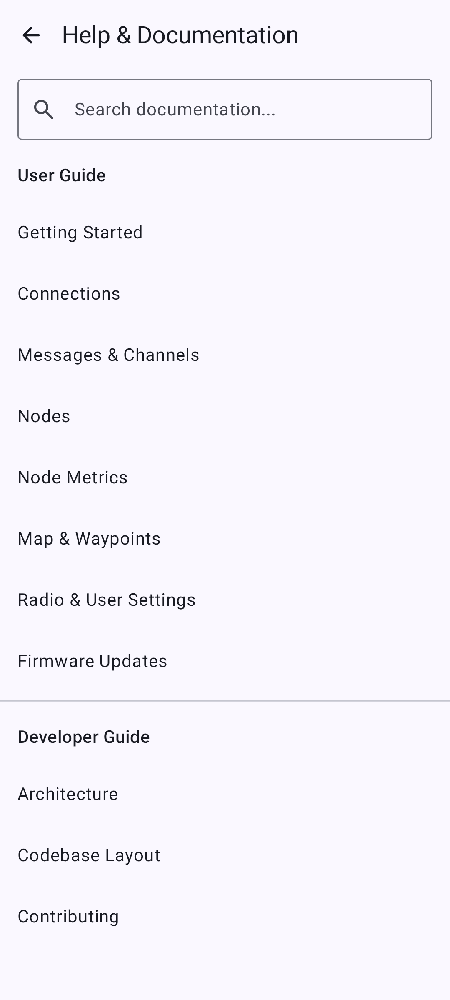
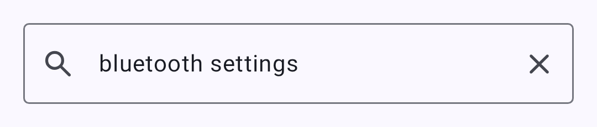
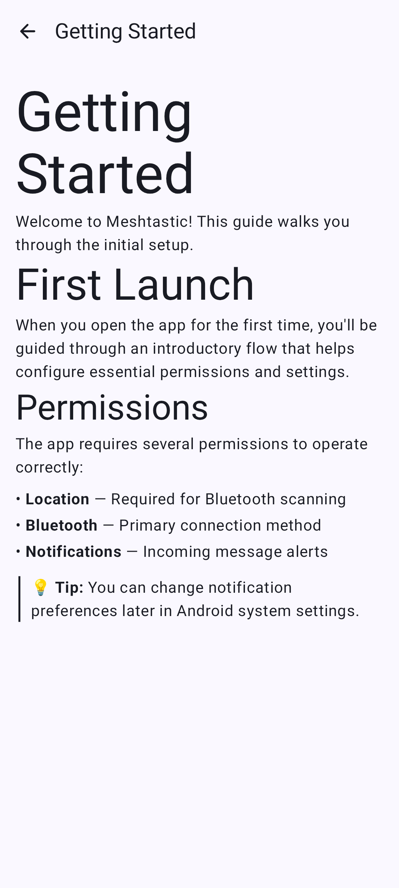

# Desktop App

This page covers installing the Meshtastic desktop app, connecting a node, and how it differs from Android. The desktop app shares its core codebase with Android via Kotlin Multiplatform, so most features work identically across Linux, macOS, and Windows.

## Installation

### Linux

- Download the `.deb`, `.rpm`, or `.AppImage` package from the [releases page](https://github.com/meshtastic/Meshtastic-Android/releases). Each comes in an x86_64 and an arm64 (aarch64) build.
- The AppImage carries its own update information, so AppImageUpdate and other zsync-based updaters can update it in place to the latest production release.
- Or install from Flathub: `flatpak install flathub org.meshtastic.MeshtasticDesktop`
- Or build from source using `./gradlew :desktopApp:run`

### macOS

- Download the `.dmg` package from the [releases page](https://github.com/meshtastic/Meshtastic-Android/releases). It is built for Apple silicon only.
- Or build from source

### Windows

- Download the `.msi` or `.exe` installer from the [releases page](https://github.com/meshtastic/Meshtastic-Android/releases). Both are x64 builds.
- Or build from source

## Connecting Your Radio

All three transports live on the **Connect** tab, the same as on Android. Pick one with the transport selector. See [Connections](connections) for the full walkthrough.

### USB Serial (Primary)

The most reliable connection method on desktop:

Connect your node by USB, select **USB** in the transport selector, and click the node's serial port in the list. The list refreshes on its own as ports appear and disappear.

### TCP/IP

For network-connected nodes, select **Network** in the transport selector, then either:

1. Turn on **Scan for network devices** and click a node the scan finds, or
2. Click **Add device manually…** and enter the node's IP address or hostname and port (default: `4403`).

### Bluetooth (BLE)

Bluetooth Low Energy is supported on desktop via the [Kable](https://github.com/JuulLabs/kable) library:

1. Ensure your system has a Bluetooth adapter, and select **Bluetooth** in the transport selector.
2. Click **Scan for Bluetooth devices**, then select your node from the list.

## Feature Parity

| Feature                                               | Android | Desktop | Notes                                                                                                                                                                                                                                           |
| ----------------------------------------------------- | ------- | ------- | ----------------------------------------------------------------------------------------------------------------------------------------------------------------------------------------------------------------------------------------------- |
| Messaging                                             | ✓       | ✓       | Full parity                                                                                                                                                                                                                                     |
| Node List                                             | ✓       | ✓       | Full parity                                                                                                                                                                                                                                     |
| الخريطة                                               | ✓       | ✓       | Interactive MapLibre map, with base map and overlay pickers and custom tile sources. Offline terrain (hillshade and contours) can be downloaded; offline base-map packs and local `.mbtiles` archives cannot |
| Map layers (`.kml`/`.kmz`/GeoJSON) | ✓       | ✓       | Same layer store and sheet as Android; imported files draw on the desktop map                                                                                                                                                                   |
| Site Planner                                          | ✓       | ✓       | Computes the coverage estimate in the app and adds it to the map as a layer, as on Android                                                                                                                                                      |
| الإعدادات                                             | ✓       | ✓       | Full parity                                                                                                                                                                                                                                     |
| Bluetooth (BLE)                    | ✓       | ✓       | Via Kable on desktop                                                                                                                                                                                                                            |
| Firmware Update                                       | ✓       | ✓       | In-app USB, BLE, and Wi-Fi (ESP32) update work the same as Android. The USB maintenance flow — nRF52/RP2040 factory erase and bootloader upgrade — is Android-only                                           |
| Notifications                                         | ✓       | ✓       | Native OS notifications                                                                                                                                                                                                                         |
| Widgets                                               | ✓       | ✗       | Android-only                                                                                                                                                                                                                                    |
| AI Assistant (Chirpy)              | ✓\*     | ✗       | Google flavor Android only                                                                                                                                                                                                                      |
| App Functions (system AI)          | ✓†      | ✗       | Google flavor Android only                                                                                                                                                                                                                      |

\*Chirpy AI requires Android 14+ on Google flavor builds with supported hardware.

†App Functions exposes app actions to the Android system AI on Google flavor builds. See [App Functions](app-functions).

## UI Differences

The desktop app uses the same Compose Multiplatform UI with adaptations for larger screens and desktop interaction.

### Keyboard Shortcuts

Shortcuts use **⌘** (Command) on macOS and **Ctrl** on Windows and Linux. (The Super / Windows key is not bound.)

| Shortcut     | Action                 |
| ------------ | ---------------------- |
| **⌘/Ctrl+Q** | Quit the app           |
| **⌘/Ctrl+,** | Open Settings          |
| **⌘/Ctrl+1** | Switch to Messages tab |
| **⌘/Ctrl+2** | Switch to Nodes tab    |
| **⌘/Ctrl+3** | Switch to Map tab      |
| **⌘/Ctrl+4** | Switch to Connect tab  |
| **⌘/Ctrl+/** | Open About             |

### Window & System Tray

- **Window resizing** — responsive layout adapts to window dimensions
- **System tray** — closing the window minimizes to the system tray for background mesh operation, provided the tray icon can be clicked to bring the window back. On Linux that needs a desktop environment with a StatusNotifierItem tray. Where there is no such tray, closing quits the app instead
- **Tray menu** — right-click the tray icon for **Show Meshtastic** or **Quit**
- **Mouse interaction** — hover states and standard desktop navigation

### Notification Preferences

The desktop app provides in-app toggles for controlling which notifications are shown. Find them in the **App Notifications** section of the Settings screen: **Direct message notifications**, **New node notifications**, **Low battery notifications**, **Reaction notifications**, and **Waypoint notifications**.

## Built-in Documentation Browser

The desktop app includes a built-in documentation browser for quick access to help content without leaving the app.



The browser searches page titles and keywords across all documentation:



Individual doc pages render with full formatting:



## Building from Source

```shell
git clone https://github.com/meshtastic/Meshtastic-Android.git
cd Meshtastic-Android
./gradlew :desktopApp:run
```

Requirements:

- JDK 25 to run Gradle (Gradle can provision it itself via foojay)
- JetBrains Runtime (JBR) 25 installed where Gradle's toolchain detection finds it. The desktop app compiles against it and bundles it, and foojay does not offer it, so Gradle cannot download it
- No Android SDK required for desktop-only builds

## Known Limitations

- Offline base-map downloads and local `.mbtiles` archives are not available on desktop. Offline terrain is — see [Map & Waypoints](map-and-waypoints).
- `.kml`/`.kmz`/GeoJSON layer import works — see
  [Map & Waypoints](map-and-waypoints#map-layers). Custom network tile sources work
  too — see [Map & Waypoints](map-and-waypoints#adding-your-own-tile-source)
- The USB maintenance flow — nRF52/RP2040 factory erase and bootloader upgrade — is Android-only, and the
  desktop app does not offer it. Use the [Web Flasher](https://flasher.meshtastic.org) instead
- Some Android-specific features (widgets, specific notification channels) are unavailable
- Performance may vary on low-spec hardware running Compose Desktop
- BLE bonding is not supported on desktop (pairing works without bonding)

## Related Topics

- [Connections](connections) — connection methods overview
- [Firmware Updates](firmware) — in-app USB, BLE, and Wi-Fi update all work the same as on Android
- [Map & Waypoints](map-and-waypoints) — base maps, layers, custom tile sources, and what the desktop map does not do
