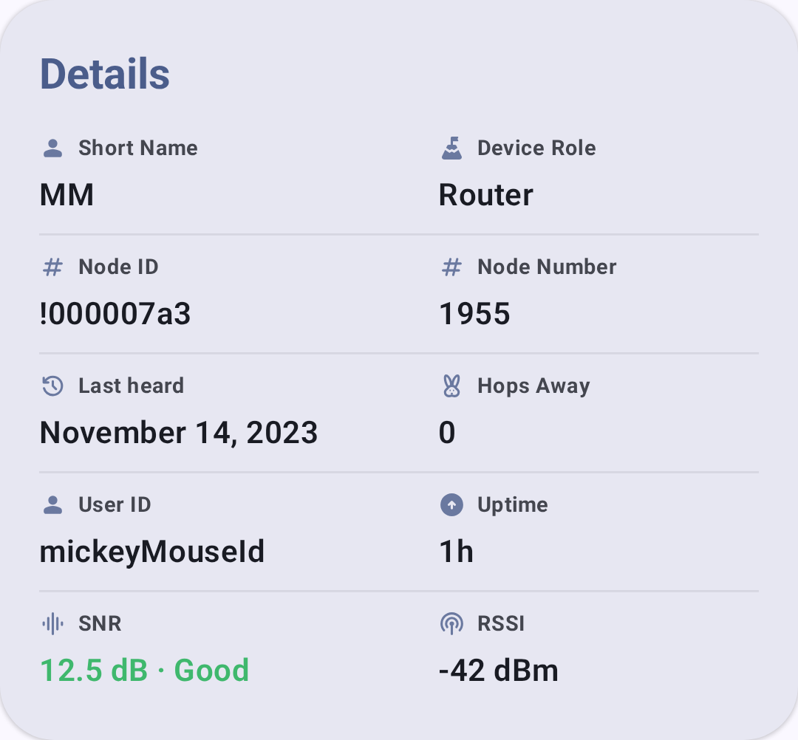
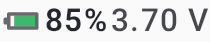
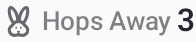
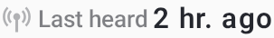
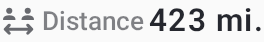

# Knoten

The Nodes screen lists every node visible on your mesh.

## Node list

The node list shows every node your node has heard, including:

- **Node name** — the node's long name, or the display name you gave it (see [Display names](#display-names))
- **Short name** — 4-character identifier
- **Signal quality** — SNR, RSSI, and a quality word, shown only for nodes your node heard directly. In the Complete layout a node reached through a relay shows its hop count here instead; a node heard only over MQTT shows neither
- **Last heard** — time since last communication
- **Distance** — estimated distance (if positions are shared)
- **Battery** — remote node battery level (if telemetry is enabled)

### Choosing what the list shows

The list has two densities, set at **Settings → Node Layout**. **Complete** shows every field a node has reported and hides the ones it hasn't. **Compact** fits more nodes on screen and lets you pick the fields yourself — **Power**, **Last Heard Time**, **Relative Last Heard Time**, **Distance and Bearing**, **Hops Away**, **Signal (Direct Only)**, **Channel**, and **Device & Role**. The **Environment Metrics** toggle applies to both densities. A preview above the toggles shows the effect before you leave the screen.

### Node Status indicators

| Indicator                                             | Meaning                                                                             |
| ----------------------------------------------------- | ----------------------------------------------------------------------------------- |
| Green last-heard time                                 | Node heard within the last 2 hours                                                  |
| Plain last-heard time                                 | Node not heard for over 2 hours                                                     |
| Orange last-heard time with a crossed-out signal icon | Not heard since your node's LoRa settings changed, so it can't be reached from here |
| Struck-through name                                   | Node you have ignored                                                               |
| ⭐ Favorite                                            | Node you marked as a favorite.                                      |

There is no separate "away" tier, but the orange unreachable state takes precedence over the
green one: a node can be online and still be unreachable on your current settings. Nodes known
only over MQTT are never shown as unreachable. The orange state needs your node on firmware 2.8.1
or newer, the first release that reports which nodes it has heard on its current LoRa settings.

### Node roles

Nodes can be configured with different roles that affect their mesh behavior:

| Rolle                  | Beschreibung                                                                                                                                           |
| ---------------------- | ------------------------------------------------------------------------------------------------------------------------------------------------------ |
| Client                 | Standard end-user node                                                                                                                                 |
| Client Base            | Treats favorited-node traffic as Router Late priority; all other traffic as Client                                                                     |
| Client Mute            | Receives but doesn't retransmit                                                                                                                        |
| Client - Versteckt     | Like Client Mute, plus hides from node list                                                                                                            |
| Router                 | Prioritizes message forwarding; stays awake to relay                                                                                                   |
| Router mit Verzögerung | Infrastructure node that rebroadcasts once, but only after all other modes (provides supplemental coverage)                         |
| ~~Router Client~~      | ⚠️ **Deprecated** (removed in firmware 2.3.15) — no longer selectable; use Router or Client instead |
| ~~Repeater~~           | ⚠️ **Deprecated** (removed in firmware 2.7.11) — no longer selectable; use Router instead           |
| Tracker                | Optimized for position reporting at regular intervals                                                                                                  |
| Sensor                 | Optimized for telemetry reporting                                                                                                                      |
| TAK                    | Interoperates with TAK systems (sends/receives CoT)                                                                                 |
| TAK Tracker            | TAK position reporting only                                                                                                                            |
| Tracker                | Sends its position to the default channel as a text message at regular intervals, to help recover a lost node                                          |

### Choosing a role

Most users should keep the default **Client** role. Consider a different role when:

- **Router** — You have a node in a fixed, elevated location with reliable power (rooftop, hilltop). Routers stay awake continuously to relay messages for others and are essential for extending mesh coverage. Don't use Router on battery-powered handheld nodes.
- **Router Late** — An infrastructure node that always rebroadcasts packets once but only after all other routing modes have had their turn. Provides supplemental coverage for local clusters without competing with primary routers.
- **Client Base** — Behandelt Datenverkehr von/zu Ihren bevorzugten Knoten mit der Priorität „Router Late“ (wodurch sichergestellt wird, dass diese Nachrichten eine zusätzliche Relaisabdeckung erhalten), während der übrige Verkehr wie bei einem normalen Client gehandhabt wird.
- **Client Mute** — You want to receive mesh traffic but not contribute to relaying. Useful for monitoring-only nodes or to reduce congestion in dense areas.
- **Tracker** — An unattended node whose sole purpose is broadcasting its GPS position (e.g., a vehicle, pet, or asset). Sleeps between broadcasts to conserve battery.
- **Sensor** — An unattended node reporting environmental telemetry (temperature, humidity, air quality). Similar power profile to Tracker.
- **TAK / TAK Tracker** — Only needed if interoperating with ATAK/WinTAK systems. See [TAK Integration](tak) for details.

> 💡 **Tip:** The mesh works best when most nodes are **Client** or **Router**. Too many Client Mute nodes reduce mesh resilience; too many Routers in a dense area can cause congestion. A good rule of thumb: one Router per 5–10 Clients in your area.

### Security indicators

Each node carries one security icon beside its name in the node list. Tap it to read what it means, and choose **Show All Meanings** in that dialog for the full legend. The detail screen shows the same state in words, as a **Security** row that opens the same dialog.

| Symbol                                                    | Meaning                                                                                                                                                                                                                                                                                     | Shown for                                                                                         |
| --------------------------------------------------------- | ------------------------------------------------------------------------------------------------------------------------------------------------------------------------------------------------------------------------------------------------------------------------------------------- | ------------------------------------------------------------------------------------------------- |
| Person with a shield check (green)     | **Verified contact** — you verified this node's key in person by exchanging contact QR codes, so its identity is confirmed. The strongest trust the list shows. Your own connected node carries it too                                                      | Any firmware version                                                                              |
| Nodes icon with a shield check (green) | **Signed node** — this node signs its broadcasts with its identity key, so its identity is consistent over time, but you haven't verified it in person. On firmware 2.8 the icon appears from the version alone, before any signed broadcast has been heard | Firmware 2.8 or newer, and any node whose signed broadcast your node has verified |
| 🔒 Closed lock (green)                 | **Public Key Encryption**: a public key is on file and matches, so direct messages to this node are encrypted                                                                                                                                                               | Firmware before 2.8, or no reported version                                       |
| 🔓 Open lock (yellow)                  | **No public key**: no public key has been received for this node, so it can't be direct messaged. Use **Request User Info** on the node detail page to ask for one                                                                                          | Firmware before 2.8, or no reported version                                       |
| Crossed-out key (red)                  | **Public key mismatch** — a different key arrived for this node after one was stored. Investigate before trusting                                                                                                                                                           | Any firmware version                                                                              |

Every node on firmware 2.8 or newer signs its broadcasts, so on that firmware the signed state is the baseline and the locks aren't shown.

Direct messages always use public-key encryption, so your node needs the other node's public key before it can send one. It refuses the send rather than falling back to channel encryption. Keys arrive inside node info, which is why an open lock usually clears itself once that node is heard from properly.

A mismatch never replaces the key you already hold. The app keeps the first key it recorded and refuses the new one, as the firmware does, so a stray or hostile node info can't silently break encrypted messaging to a contact. To clear a mismatch, first confirm through another trusted channel that the key change was intentional — a factory reset causes one. Then touch & hold the node, choose **Remove**, and let the two nodes exchange keys again the next time yours hears it.

## Quick Actions

From the node list, you can:

- **Tap** a node to view its detail page
- **Touch & hold** for quick actions:
  - **Add to favorites** or **Remove from favorites**
  - **Mute notifications** or **Unmute**, shown only once that node has reported firmware 2.7.18 or newer
  - **Message**, to open a direct message
  - **Trace Route**, which stays disabled for 30 seconds after any traceroute request
  - **Open Compass**, for a node with a position
  - **Open mesh view**, for a node with a position on a phone that supports the [AR mesh view](map-and-waypoints#ar-mesh-view)
  - **Ignore** or **Remove from ignored**
  - **Remove**

While a node is ignored, its favorite, message, trace route, and remove actions are disabled.

Touch & hold **your own node** instead and you get one action, **Update status**, which opens the
User settings screen with the cursor already in the Status Message field. It appears only while the
node is connected and running firmware 2.7.20 or newer with the Status Message module included. See
[Settings — Radio & User](settings-radio-user) for the field itself.

## Sharing a contact

On a node's detail screen, tap **Share Contact** to produce a link and a QR code for that node. From the same dialog, **Share link** opens the Android share sheet (on desktop it copies the link instead), **Write to NFC tag** saves it to a writable NFC tag, and **Copy** puts it on the clipboard. While that dialog is open and in front of you, the phone also offers the same link to any NFC reader, so someone can take the contact by tapping their phone against yours with no tag involved.

Sharing your own contact this way marks it as verified in person, so whoever imports it sees the **Verified contact** icon rather than the signed one. Relaying someone else's contact passes on only what your app had already recorded about them.

To add someone else's contact, use the import button on the node list and choose **Scan Shared Contact QR Code**, **Scan Shared Contact NFC**, or **Input Shared Contact URL**. The app asks you to confirm with **Import Shared Contact?**, and warns you when the contact is one you already have.

## Display names

You can give any node a local display name that replaces its long name in the node list, node details, messages, notifications, maps and the node tracker widget. Set it from the node's long-press menu (**Set display name**) or from the **Display name** card in node details. Saving an empty name clears it. Names are limited to 36 bytes of UTF-8, the same limit as the Apple app.

The avatar always shows the node's broadcast short name. While a display name is set, node details shows the node's broadcast long name in a **Long Name** row under the name, so the real name stays readable.

Display names are stored only on this device. They are never sent over the mesh or handed to another app, so QR codes, contact sharing, opening a position in a maps app, and the message, node database and GPX exports all use the node's real name. App backups do include display names, the same as notes. Removing a node also removes its display name.

Your own node can have a display name too, from its **Display name** card. The **Edit name** item in your own node's long-press menu does something different: it opens [Settings - Radio & User](settings-radio-user), where you change the name your node broadcasts to everyone.

## Filtering & sorting

### Text search

Type in the **Filter** field to filter nodes by long name, short name, node ID (in hex or decimal), or status message. The list updates as you type, and the line above the field counts the nodes online, shown, and in total.

### Filter toggles

The sort button at the end of the search field opens a menu with the sort options under **Sort by** and these toggles under **Filter by**.

| Filter                      | Beschreibung                                                                                                                                                                                                                                                                                                                 |
| --------------------------- | ---------------------------------------------------------------------------------------------------------------------------------------------------------------------------------------------------------------------------------------------------------------------------------------------------------------------------- |
| **Hide offline nodes**      | Show only nodes heard within the last 2 hours                                                                                                                                                                                                                                                                                |
| **Only show direct nodes**  | Show only nodes your node heard directly over LoRa, with no relay in between. Nodes heard over MQTT are left out                                                                                                                                                                                             |
| **Include unknown**         | Show nodes that haven't sent user info yet. **On by default**, so a node heard before its info arrives stays visible; these carry a badge marking them incomplete, and can't be direct messaged until their user info brings a public key                                                                    |
| **Exclude infrastructure**  | Hide infrastructure-role nodes (Router, Router Late, Client Base, and legacy Repeater nodes) and any node that can't be messaged, whatever its role                                                                                                                                                       |
| **Exclude MQTT**            | Hide nodes heard only via MQTT internet bridge                                                                                                                                                                                                                                                                               |
| **Hide unheard nodes**      | Hide nodes your own node hasn't heard since its LoRa settings changed. Off by default, and it does nothing unless your node runs firmware 2.8.1 or newer                                                                                                                     |
| **Signed only**             | Show only nodes whose signed broadcasts your node has actually heard and verified. Stricter than the icon: a node on 2.8 shows as signed by its firmware version before any signed broadcast arrives, and a contact verified in person on older firmware isn't signed at all |
| **Encrypted only**          | Show nodes with a matching public key on file, the key an encrypted direct message needs. A node with a key mismatch is excluded                                                                                                                                                                             |
| **Only show ignored Nodes** | Replace the list with the nodes you have ignored. Every other node is hidden while this is on, and a banner appears at the top of the list to take you back                                                                                                                                                  |

### Nodes not heard on your current Settings

When your node's LoRa settings change — a different preset, region or frequency slot — nodes heard
under the old settings are still in the list but can no longer be reached. On firmware 2.8.1 or
newer, the app marks them with an orange last-heard time and a crossed-out signal icon, and shows a
banner at the top of the list: **N nodes not heard on your current LoRa settings**. The count leaves
out your favorites, your own node, and nodes heard only over MQTT.

The banner offers two actions:

- **Keep** dismisses the banner and leaves every node in place. The app remembers the choice for
  each of those nodes, so the banner returns only for nodes you haven't kept. A kept node that your
  node hears again is forgotten, and is counted again after a later settings change.
- **Remove** asks you to confirm, then deletes every node the banner counted.

**Remove** is a bulk delete and there is no undo, so use **Keep** if you expect to switch back to
the old settings. Removed nodes reappear if your node hears them again.

The **Hide unheard nodes** filter does the same hiding without deleting anything.

### Sort options

| Sortieren                                     | Beschreibung                                                       |
| --------------------------------------------- | ------------------------------------------------------------------ |
| **Last heard**                                | Most recently heard nodes first                                    |
| **A-Z**                                       | Sorted by node long name                                           |
| **Distance**                                  | Nearest nodes first (requires position sharing) |
| **Hops away**                                 | Fewest relay hops first                                            |
| **Channel**                                   | Grouped by channel index                                           |
| **via MQTT**                                  | Grouped by MQTT vs. node-heard                     |
| **via Favorite** (default) | Favorited nodes first, then the rest                               |

## Nodes per hop

Tap the hop-histogram icon in the node list's app bar to open **Nodes per Hop**, a bar chart of how many nodes sit at each hop distance (0 = direct, 1 = one relay away, and so on). Filter the chart to a last-heard window — **All**, **1 Hour**, **8 Hours** or **24H** — to compare the last hour with a longer period and gauge how busy and spread out your local mesh is.

## Node detail

Tapping a node opens the detail view with comprehensive information. See [Node Metrics](node-metrics) for full details on metrics and telemetry.

Signal quality is rated against your modem preset. The same SNR can be good on a long-range preset and poor on a faster one. Traceroute and neighbor-info SNR colors use that preset too. RSSI text has its own strength colors; it affects the quality rating only when a noise-floor reading is also available.

The Details card carries the node's short name, role, status message, IDs, last heard time, hops away, uptime, SNR and RSSI, the transport it was last heard over, its **Security** state, and its public key:

Inline status indicators show key metrics at a glance:

| Indicator      | Bildschirmfoto                                                |
| -------------- | ------------------------------------------------------------- |
| Signal quality |      |
| Akkustand      |    |
| Hop count      |          |
| Zuletzt gehört |   |
| Distanz        |  |

### Hardware support status

When a node's hardware is recognized, the detail view names the device and marks its support status, taken from the Meshtastic device registry rather than the app:

| Mark                                 | Bedeutung                                                                                                                                       |
| ------------------------------------ | ----------------------------------------------------------------------------------------------------------------------------------------------- |
| Rosette (green)   | **Supported** — hardware the Meshtastic project actively supports                                                                               |
| Wrench (sky blue) | **Independent maker hardware** — built and tested by an independent maker, shown as its own rung whether or not the project has promoted it yet |
| Unverified (red)  | **Supported by Meshtastic Community** — hardware the project does not actively support, including legacy boards                                 |

The label always accompanies the mark, so the status is never conveyed by color alone.

### 3D device model

When the Meshtastic web flasher has a 3D model of the node's hardware, the device picture on the detail screen carries a 3D badge. Tap it to open the model full screen, where a drag turns it. On Google Play builds, **View in your space** places the model on a real surface at real size through ARCore, and on Android 10 and later the shutter button saves the view to Pictures/Meshtastic. F-Droid and desktop builds show the model without the AR view.

### Device links ("I want one")

Sobald die Hardware eines Knotens erkannt wird, zeigt die Detailansicht einen ausklappbaren Bereich mit der Bezeichnung **„Ich möchte eins“** an. Dieser enthält Links zu Bezugsquellen oder weiterführenden Informationen zu dem jeweiligen Gerät – etwa zur Produktseite des Herstellers, zu Produktvarianten sowie zu Angeboten auf regionalen Marktplätzen (wie AliExpress, Amazon und unterstützten Händlern), gefiltert nach Ihrem Land. Each link opens through the `msh.to` redirect service. Devices with no matching links don't show the section.

A full, browsable directory of every link is also available at **Settings → Device Links**. The item is hidden while you have Settings open for a remote node.

Some of these are affiliate links. Both places say so above the links: product links may be affiliate links, and purchases may earn Meshtastic a commission.

### Remote shell

**Open terminal**, in the node's **Administration** card, opens a shell on a Linux node running `meshtasticd` 2.8.2 or later, carried over the mesh. The node accepts it only from a node whose public key is in its **Security → Admin key** list, the same list remote administration uses. The app starts that admin session first if there isn't one, and the card's title shows whether it is active. The row can appear on any `meshtasticd` node before the app knows its firmware version; an older node refuses the shell when it opens. The terminal takes the whole window. If the node never answers, the screen says so after a minute.

The mesh carries a few hundred bytes a second, and the terminal is built around that:

- Once the node has echoed the first character of a line, what you type appears **underlined** at the cursor until the node echoes it back. At a prompt that doesn't echo, such as a password, nothing you type is shown; in line mode the command box masks its text and keeps it out of history.
- The subtitle shows the measured round trip. When the node stops answering, a line at the top of the terminal says how long ago it was last heard.
- The two rows of extra keys give **ESC**, **TAB**, arrows, **HOME**, **END**, **PGUP** and **PGDN**. **CTRL** and **ALT** are sticky: tap once to apply to the next key, twice to lock, a third time to release. **CTRL** then **c** interrupts a running command. A hardware keyboard's Ctrl and Alt work as usual.
- **Line mode**, in the **⋮** menu, gives you a command box: each command goes out in one transmission, **↑** and **↓** recall earlier commands without asking the node, and chips offer common commands for a `meshtasticd` host. It is the cheapest way to use the shell on a busy mesh.
- The **⋮** menu also pastes from the clipboard and changes the text size.

Color, progress lines and `clear` display as they would in a desktop terminal. Full-screen programs such as `vi` or `top` redraw the whole screen for each key, which the mesh cannot carry, so the terminal shows a notice instead.

## When no nodes appear

The list stays empty until your node hears another node.

- **No device connected** — the app isn't connected to a node. See [Connections](connections).
- **Searching for nodes** — the node is connected and listening, but nothing has arrived yet. Check that its region and modem preset match the mesh around you, and leave **Include unknown** on so a node that hasn't yet sent its name still appears. See [Settings — Radio & User](settings-radio-user).
- A node you expect is missing — check the filter toggles. **Only show direct nodes**, **Exclude MQTT**, and **Exclude infrastructure** each hide a whole category of node.

## Related Topics

- [Node Metrics](node-metrics) — detailed telemetry dashboards for each node
- [Messages & Channels](messages-and-channels) — send a direct message to a node
- [Map & Waypoints](map-and-waypoints) — view node positions geographically
- [Local Mesh Discovery](discovery) — traceroute and neighbor info for topology exploration
- [Signal Meter](signal-meter) — understand what the signal bars mean
