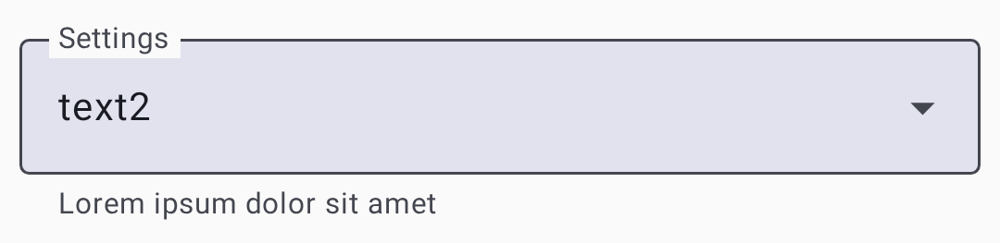
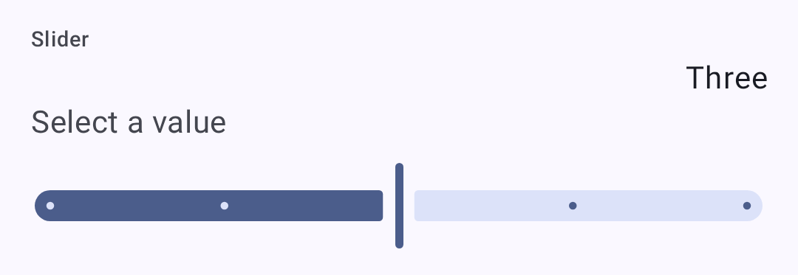
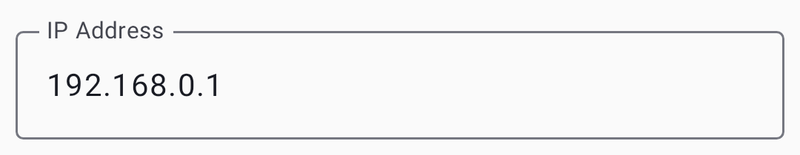

# Seaded — raadio ja kasutaja

Configure your node's user identity, region and LoRa parameters, position and power behavior, network and Bluetooth connectivity, and security settings.

## How these screens work

Everything here is on the **Settings** screen. **User**, **LoRa**, **Channels** and **Security** are
listed there directly, under **Configuration**. **Device**, **Position**, **Power**, **Network**,
**Display** and **Bluetooth** are one level down, under **Settings → Device configuration**.
**Network** appears only on nodes with Wi-Fi or Ethernet, and **Bluetooth** only on nodes with Bluetooth.

The **Search settings** field at the top of the **Settings** screen finds a setting by its name, its
description, or a related term such as _ttl_ for **Hop Limit**. Choosing a result opens the screen
that holds the setting, scrolls to it, and highlights it for a moment. While you administer a
remote node, the results leave out this phone's own app settings.

With no node connected, the screens still open and show the settings last read from your own node,
under the line _Connect to a radio to change these settings._ The controls stay disabled until a
node connects.

Seaded kasutavad standardseid eelistuste juhtelemente – rippmenüüsid, lülitid ja liugurid:

| Control  | Screenshot                                                                                                  |
| -------- | ----------------------------------------------------------------------------------------------------------- |
| Dropdown |  |
| Toggle   |                         |
| Slider   |       |

## Kasutaja seaded

### Kasutajaprofiil

On **Settings → User**. The screen also shows the read-only **Node ID** and **Hardware model**.

| Sätted                                                 | Kirjeldus                                                                                                                                                                                                                                                                                                                                                                                                                                                                                 | Vaikimisi           |
| ------------------------------------------------------ | ----------------------------------------------------------------------------------------------------------------------------------------------------------------------------------------------------------------------------------------------------------------------------------------------------------------------------------------------------------------------------------------------------------------------------------------------------------------------------------------- | ------------------- |
| Litsentseeritud raadioamatöör (Ham) | Turn on if you hold an amateur radio license. Turning it on is staged behind a confirmation dialog, because licensed mode removes the channel encryption keys and sends all traffic as plaintext. On your own node it then relabels **Long Name** as **Call sign** (up to 7 characters) and adds a separate, optional **Long Name** that is appended to the call sign. Over remote admin the field stays **Long Name** | Väljas              |
| Täis nimi                                              | The name your node broadcasts. Up to 24 bytes on firmware 2.8 or newer, and 39 on older firmware. To rename another node only on this device, see [Display names](nodes#display-names)                                                                                                                                                                                                                                                    | Set by the firmware |
| Lühi nimi                                              | Up to four characters                                                                                                                                                                                                                                                                                                                                                                                                                                                                     | Set by the firmware |
| Oleku teavitus                                         | A short, public free-text status other nodes display alongside your node, up to 80 bytes, cleared with the **✕** in the field. The node broadcasts it to the mesh when you change it and again every 12 hours. Needs firmware 2.7.20 or newer, and is absent otherwise                                                                                                                                                    | Empty               |
| Ei võta sõnumeid vastu                                 | Marks the node as unmonitored or infrastructure, one nobody should try to message. This app shows it with an icon in the node list. Firmware 2.6.9 or newer is needed to change it                                                                                                                                                                                                                                        | Väljas              |

### Applying changes

The footer appears as soon as you change something. **Discard** throws the change away, and the other button writes it to the node: it reads **Save & restart** on the screens the firmware applies with a reboot — Position, Network, Bluetooth, Security, and most module screens — and **Save** everywhere else.

The status message is saved with the same **Save**, but it never reboots the node — and, like the
rest of this screen, it can be edited on a remote node you administer. For your own node there is a
shortcut while it is connected: touch & hold your node in the [node list](nodes.md) and choose
**Update status**. Older firmware and a disconnected node have no shortcut — the field itself is
still the way in.

## Seadme sätted

On **Settings → Device configuration → Device**. These settings set the node's role on the mesh and its local hardware behavior.

| Sätted                           | Kirjeldus                                                                                                                                                                                                                                                                                                                                                                                                                                        | Vaikimisi                            |
| -------------------------------- | ------------------------------------------------------------------------------------------------------------------------------------------------------------------------------------------------------------------------------------------------------------------------------------------------------------------------------------------------------------------------------------------------------------------------------------------------ | ------------------------------------ |
| Button GPIO / Buzzer GPIO        | Advanced: which pins the user button and the PWM buzzer are wired to                                                                                                                                                                                                                                                                                                                                                             | 0 (board default) |
| Seadme roll                      | Node behavior: **Client**, **Client Mute**, **Client Hidden**, **Client Base**, **Router**, **Router Late**, **Tracker**, **Sensor**, **TAK**, **TAK Tracker**, or **Lost and Found**. The description of the selected role appears under the field. Choosing **Router** or **Router Late** opens a dialog where you confirm you have read the device-role guidance before **Accept** is enabled | Klient                               |
| Disable LED Heartbeat            | Controls the blinking status LED. Despite the label, the switch is on while the LED blinks                                                                                                                                                                                                                                                                                                                                       | On (LED blinks)   |
| Topeltpuudutus nupuna            | Treat a double tap on a supported accelerometer as a button press                                                                                                                                                                                                                                                                                                                                                                                | Väljas                               |
| Sõlme teabe edastamise intervall | How often the node re-announces itself. A dropdown of fixed intervals: **Unset**, then 3 to 72 hours                                                                                                                                                                                                                                                                                                             | 3 hours                              |
| Kordusülekannete režiim          | Which packets the node relays: **All**, **All Skip Decoding**, **Local Only**, **Known Only**, **None**, or **Core Portnums Only**. The description of the selected mode appears under the field. **None** isn't allowed with the Router roles                                                                                                                                                   | Kõik                                 |
| Ajavöönd                         | POSIX time-zone string for dates on the node's screen and in its log. **Use phone time zone** fills it from this phone, and the **✕** clears it                                                                                                                                                                                                                                                                                  | Empty                                |
| Kolmekordne klõps Ad Hoc Ping    | Send a position on the primary channel when the user button is triple-clicked                                                                                                                                                                                                                                                                                                                                                                    | On                                   |

## LoRa sätted

On **Settings → LoRa**. These settings decide where and how the node transmits. Region, preset and the manual modem settings are on the **Options** card. The rest are on **Advanced**.

> ⚠️ **Important:** Operating without the correct region may violate local radio regulations. Lisateabe saamiseks vaadake [regiooni seadistamise juhendit](https://meshtastic.org/docs/getting-started/initial-config) aadressil meshtastic.org.

| Sätted                             | Kirjeldus                                                                                                                                                                                                                                                                                                                                                                                                                                                                                                                                             | Vaikimisi                                                                                                                                          |
| ---------------------------------- | ----------------------------------------------------------------------------------------------------------------------------------------------------------------------------------------------------------------------------------------------------------------------------------------------------------------------------------------------------------------------------------------------------------------------------------------------------------------------------------------------------------------------------------------------------- | -------------------------------------------------------------------------------------------------------------------------------------------------- |
| Bandwidth (kHz) | Manual mode only: the channel bandwidth in kHz, typed in directly. On the 2.4 GHz region the app offers a list of the bandwidths your node supports instead, headed by **Default (812.5 kHz)**. A stored value that isn't on that list shows as _Unsupported_ and blocks saving until you pick a supported one                                                                                                                                     | From preset                                                                                                                                        |
| Kodeerimiskiirus                   | Manual mode only: 5 to 8, the denominator of 4/n. More redundancy costs airtime                                                                                                                                                                                                                                                                                                                                                                                                                                       | From preset                                                                                                                                        |
| Coding Rate Override               | Preset mode only, firmware 2.7.18 or newer: raises the preset's coding rate for more error correction while keeping its bandwidth and spread factor. Only rates above the preset's own are offered, and a preset already at 4/8 has none. Nodes on the same preset still hear each other, but every packet takes longer on air and uses more of the duty cycle. Switching to a preset that already meets the override resets it to the preset default | Preset default                                                                                                                                     |
| Tühista sagedus                    | Overrides the computed operating frequency outright, in MHz. It doesn't offset the calculated value. While it is 0 the field shows the computed frequency with **Auto** beside it                                                                                                                                                                                                                                                                                                                                     | 0 (use calculated)                                                                                                              |
| Sageduspesa                        | Which slot within the region's band to use. At 0 the region picks the slot, usually from the primary channel name, and the field shows that slot with **Auto** beside it                                                                                                                                                                                                                                                                                                                                                              | 0 (automatic)                                                                                                                   |
| Hüpete arv                         | How many times a message may be repeated before it stops being forwarded, 0 to 7                                                                                                                                                                                                                                                                                                                                                                                                                                                                      | 3                                                                                                                                                  |
| Keela MQTT                         | Drop packets that arrived from MQTT rather than over the air. The firmware turns this on for you whenever you set a region that has a duty-cycle limit — the EU bands, Thailand, and Ukraine 433                                                                                                                                                                                                                                                                                                                                      | Off, until you set a duty-cycle-limited region                                                                                                     |
| MQTT kasutuses                     | Allow your packets to be forwarded to MQTT by gateways                                                                                                                                                                                                                                                                                                                                                                                                                                                                                                | Väljas                                                                                                                                             |
| Töötsükli tühistamine              | Ignores the region's duty-cycle limit. Illegal in most regions; turn it on only where your license permits                                                                                                                                                                                                                                                                                                                                                                                                                            | Väljas                                                                                                                                             |
| PA ventilaator keelatud            | Turn off the power-amplifier fan. Shown only on hardware that has one                                                                                                                                                                                                                                                                                                                                                                                                                                                                 | Väljas                                                                                                                                             |
| Eelseadistused                     | Speed and range tradeoff, listed by full name such as **Long Range - Fast**. See [Modem presets](#modem-presets)                                                                                                                                                                                                                                                                                                                                                                                                                      | Long Fast. When a node on firmware 2.8 or newer is first set to the United States region, the app picks Long Turbo |
| Regioon                            | Regulatory region for frequency bands. You must set this before transmitting. On firmware 2.8 or newer, the first region set also creates the node's identity key and gives it a new node number                                                                                                                                                                                                                                                                                                      | Määramata (tuleb seadistada)                                                                                                    |
| RX võimendatud võimendus           | Extra receive gain on SX126x radios; costs a little current                                                                                                                                                                                                                                                                                                                                                                                                                                                                                           | On                                                                                                                                                 |
| Levitustegur                       | Manual mode only: 5 to 12. Higher spreads further but slower. On SX127x (RF95) radios the firmware doesn't accept 5 or 6 and uses 11 instead                                                                                                                                                                                                                                                                                                                                       | From preset                                                                                                                                        |
| Edastus lubatud                    | Turning this off makes the node receive-only                                                                                                                                                                                                                                                                                                                                                                                                                                                                                                          | On                                                                                                                                                 |
| Saatevõimsus                       | In dBm. 0 uses the highest power legal for the region, which suits most nodes                                                                                                                                                                                                                                                                                                                                                                                                                                                         | 0 (regiooni maks)                                                                                                               |
| Kasuta eelseadistust               | Turn it off to set **Spread Factor**, **Coding Rate** and **Bandwidth** by hand instead of taking them from the modem preset                                                                                                                                                                                                                                                                                                                                                                                                                          | On                                                                                                                                                 |

The preset list is also filtered to what your region legally permits, so a preset allowed in one
region doesn't appear in another. Changing region can therefore leave your current preset
illegal — the app repairs it for you, switching to the region's own default rather than leaving an
unusable setting in place. The region list itself is filtered by what your firmware supports, so
the regions added in 2.8 appear only on 2.8 or later, alongside whichever region the node already has set.

Some regions are amateur radio allocations whose presets only licensed operators may use. On firmware 2.8 or newer the app knows which regions those are and grays the whole **Presets** list out until **Licensed amateur radio (Ham)** is turned on for the node you are configuring; the text under the field says so while it is grayed out.

### Modem presets

The Lite, Narrow, Medium Turbo, and Tiny presets need firmware 2.8 or newer — the app hides them on older nodes.

This table uses the short names. The **Presets** dropdown spells each one out, such as **Long Range - Fast**, **Short Range - Turbo** and **Lite - Slow**.

The **SNR Limit** values are negative on purpose. LoRa can decode signals _below_ the noise floor, so a more-negative limit means the preset tolerates a weaker, noisier signal (more range). See [How the Signal Meter Works](signal-meter) for the full explanation.

| Preset         | Range                   | Kiirus                    | SNR limiit | Parim                                                                                                                                                                                                         |
| -------------- | ----------------------- | ------------------------- | ---------- | ------------------------------------------------------------------------------------------------------------------------------------------------------------------------------------------------------------- |
| Short Turbo    | ~1 km   | 21,9 kbps                 | −7,5 dB    | Dense urban with line-of-sight; data-heavy applications                                                                                                                                                       |
| Short Fast     | ~3 km   | 10,9 kbps                 | −7,5 dB    | Linnaosad; hooned mõne kvartali raadiuses                                                                                                                                                                     |
| Short Slow     | ~5 km   | 6.25 kbps | −10 dB     | Äärelinna lühimaa; mõõdukas hoonestustihedus                                                                                                                                                                  |
| Medium Fast    | ~5 km   | 3.52 kbps | −12,5 dB   | Suburban areas; moderate building density                                                                                                                                                                     |
| Medium Slow    | ~8 km   | 1.95 kbps | −15 dB     | Suburban/rural; moderate range with slower speed                                                                                                                                                              |
| Long Turbo     | ~10 km  | 1.34 kbps | −17,5 dB   | Sarnane ulatus kui Pikk Kauge, aga 500 kHz ribalaiusega; kiirem läbilaskevõime                                                                                                                                |
| Long Fast      | ~10 km  | 1,1 kbps                  | −17,5 dB   | **General use (default)** — balanced range and speed                                                                                                                                       |
| Long Moderate  | ~20 km  | 0,34 kbps                 | −17,5 dB   | Maapiirkond, mõningase maastikuga; aeg-ajalt kasutatav                                                                                                                                                        |
| Lite Fast      | ~5 km   | 1.76 kbps | −12,5 dB   | EL 866 MHz SRD sagedusala (125 kHz ribalaius); võrreldav Medium Fast                                                                                                                       |
| Lite Slow      | ~10 km  | 0.98 kbps | −15 dB     | EL 866 MHz SRD sagedusala (125 kHz ribalaius); võrreldav Long Fast                                                                                                                         |
| Narrow Fast    | ~5 km   | 2.28 kbps | −7,5 dB    | EL 868 MHz sagedusala (62,5 kHz sagedusriba); väldib häireid teiste seadmetega                                                                                                             |
| Narrow Slow    | ~10 km  | 1.30 kbps | −10 dB     | EL 868 MHz sagedusala (62,5 kHz ribalaius); võrreldav Long Fast                                                                                                                            |
| Medium Turbo   | ~5 km   | 7.0 kbps  | −12,5 dB   | Like Medium Fast but with 500 kHz bandwidth; not legal in every region. Needs firmware 2.8 or newer                                                                           |
| Tiny Fast      | ~10 km  | 0.68 kbps | −7,5 dB    | Amateur bands that cap occupied bandwidth; these presets use 15.6 kHz. Needs firmware 2.8 or newer, an SX126x or SX127x radio, and a TCXO of ±5 ppm or better |
| Tiny Slow      | ~20 km  | 0.33 kbps | −10 dB     | Same band restrictions as Tiny Fast, longer range. Same firmware, node, and TCXO requirements                                                                                                 |
| Long Slow      | ~30 km  | 0,18 kbps                 | −20 dB     | Deprecated. Still selectable, but may be removed in a future firmware release                                                                                                                 |
| Very Long Slow | ~40+ km | 0,09 kbps                 | −20 dB     | Deprecated. Firmware 2.6.5 and newer no longer support it                                                                                                     |

#### Choosing a modem preset

The modem preset controls the fundamental tradeoff between **range** and **data rate**:

- **Slower presets** use more spreading, making signals decodable at weaker signal levels (lower SNR limit). See tähendab pikemat ulatust, aga vähem baite sekundis.
- **Faster presets** pack more data per transmission but require a stronger signal to decode.

**Practical guidance:**

- **Linnavõrk (palju sõlmi, lühikesed vahemaad):** Kasutage valikut **Long Fast** (vaikimisi) või **Short Fast**. Suurem kiirus tähendab väiksemat eetriaega, kui kanalit jagavad paljud sõlmed.
- **Rural/sparse mesh (few nodes, long distances):** Use **Long Moderate**. Range matters more than speed when nodes are far apart.
- **Vastavus EL 866/868 MHz regulatsioonidele:** Kasuta **Lite Fast**, **Lite Slow**, **Narrow Fast** või **Narrow Slow** – need on optimeeritud kitsama ribalaiusega EL SRD/868 MHz sagedusaladele.
- **Fikseeritud taristuühendused:** Kasutage **Short Turbo** või **Long Turbo** spetsiaalsete punkt-punkti ühenduste jaoks, millel on head antennid ja otsenähtavus.
- **Mixed environments:** Stick with **Long Fast** — it's the community default and ensures compatibility with others in your area.

All nodes on the same channel must use the same modem preset. Nodes with mismatched presets can't communicate even if they share the same frequency and encryption key.

The range estimates in the [Modem Presets](#modem-presets) table assume flat terrain and modest antennas. Kõrguse eelis (mäetipp, katus) suurendab märgatavalt efektiivset ulatust. A well-placed Router with Long Fast can often outperform a ground-level node with Long Slow.

## Ekraani sätted

On **Settings → Device configuration → Display**. These control the **node's own screen**, not the app's.

| Sätted                            | Kirjeldus                                                                                                                                                                      | Vaikimisi                                      |
| --------------------------------- | ------------------------------------------------------------------------------------------------------------------------------------------------------------------------------ | ---------------------------------------------- |
| Kasuta 12 tunni formaati          | Show the node's clock as 12-hour rather than 24-hour                                                                                                                           | Väljas                                         |
| Suund alati põhi                  | Locks the compass rose north-up instead of rotating it with your heading. Independent of **Compass Orientation** — neither replaces the other                  | Väljas                                         |
| Paks pealkiri                     | Draw the screen's heading text in bold                                                                                                                                         | Väljas                                         |
| Karusselli intervall              | How often the node moves to its next screen on its own: **Unset** (never), or 15 seconds to 15 minutes                                      | Määramatta                                     |
| Kompassi suund                    | Rotation offset for the compass rose: **0°**, **90°**, **180°** or **270°**, each with an **Inverted** variant                                                 | 0°                                             |
| Ekraani režiim                    | Screen layout: **Default 128x64 screen layout**, **Optimized for 2 color displays**, **Inverted top bar for 2 color displays**, or **TFT Full Color Displays** | Default, or color on nodes with a color screen |
| Ekraani ühikud                    | **Metric** or **Imperial** on the node's screen                                                                                                                                | Meetriline                                     |
| Keera ekraani                     | Flip the display for an inverted mounting                                                                                                                                      | Väljas                                         |
| OLED tüüp                         | Overrides automatic OLED detection: **Detect Automatically**, **SSD1306**, **SH1106**, **SH1107**, **SH1107 128x128**, or **SH1107 Rotated**                   | Detect Automatically                           |
| Ekraan sisse lülitatud            | How long the display stays lit after a button press or a received message: 15 seconds to 1 hour, or **Always On**                                              | 10 minutes                                     |
| Ärata puudutusega või liigutusega | Light the screen when the node is tapped or moved. Needs an accelerometer                                                                                      | Väljas                                         |

## Asukoha sätted

On **Settings → Device configuration → Position**. These settings decide where the node's position comes from and how often it is shared.

| Sätted                                                 | Kirjeldus                                                                                                                                                              | Vaikimisi                                                                                                               |
| ------------------------------------------------------ | ---------------------------------------------------------------------------------------------------------------------------------------------------------------------- | ----------------------------------------------------------------------------------------------------------------------- |
| Levitamise inteintervall                               | The longest the node goes without broadcasting its position: **Unset**, or 1 minute to 72 hours                                                        | 1 tund                                                                                                                  |
| Määratud asukoht                                       | Broadcast a manually entered **Latitude**, **Longitude** and **Altitude** instead of a live GPS fix. **Set from current phone location** fills them in | Väljas                                                                                                                  |
| GPS Enable GPIO / GPS Receive GPIO / GPS Transmit GPIO | Advanced: the pins an add-on GPS module is wired to. Hidden on boards whose maker wired the GPS, unless a pin already holds a value    | 0                                                                                                                       |
| GPS-režiim (riistvara)              | **Enabled**, **Disabled**, or **Not Present**. Hidden while **Fixed Position** is on                                                                   | Depends on the hardware                                                                                                 |
| Nutikas kaugus                                         | In meters. With **Smart Position** on, how far you must move before a broadcast is considered                                                          | 100 m                                                                                                                   |
| Nutikas intervall                                      | With **Smart Position** on, the shortest gap between broadcasts once the distance is met                                                                               | 5 minutes                                                                                                               |
| Asukoha lipp                                           | A group of checkboxes choosing which fields ride along with a position, such as altitude, its reference and precision, satellites in view, and timestamp               | **Altitude**, **Altitude is Mean Sea Level**, **Vehicle speed**, **Vehicle heading**, **DOP**, **Number of satellites** |
| Nutikas asukoht                                        | Broadcast based on movement rather than purely on the clock                                                                                                            | On                                                                                                                      |
| GPS-i küsimise intervall                               | How often the node asks its GPS for a fix. Hidden while **Fixed Position** is on                                                                       | 2 minutes                                                                                                               |

## Toite sätted

On **Settings → Device configuration → Power**. These settings trade battery life against availability.

| Sätted                                       | Kirjeldus                                                                                                                                                                                  | Vaikimisi  |
| -------------------------------------------- | ------------------------------------------------------------------------------------------------------------------------------------------------------------------------------------------ | ---------- |
| ADC kordaja tühistamine                      | Turn on a manual correction for battery-voltage readings                                                                                                                                   | Väljas     |
| Asenda ADC kordistaja suhe                   | The correction factor itself, shown only while the override is on                                                                                                                          | —          |
| Aku INA_2XX I2C aadress | Address of an external INA-series power sensor, if fitted                                                                                                                                  | 0          |
| Minimaalne ärkveloleku aeg                   | The shortest time the node stays awake once woken                                                                                                                                          | 10 seconds |
| Luba energiasäästurežiim                     | Sleep as much as possible. On the Tracker and Sensor roles this includes the LoRa radio. Not for a node you use with the app, or one without a user button | Väljas     |
| Väljalülitamine voolukatkestuse korral       | How long after external power is removed before the node powers off. **Unset** disables it, and values under 30 seconds are raised to 30                                   | Määramatta |
| Super sügava une kestus                      | How long the deepest sleep state lasts                                                                                                                                                     | —          |
| Oota Bluetoothi ​​kestust                    | How long to wait for a phone to connect before sleeping                                                                                                                                    | 1 minut    |

## Võrgu sätted

On **Settings → Device configuration → Network**, on nodes with Wi-Fi or Ethernet. When the node is
on a network, a **Current connections:** card at the top shows its **Wi-Fi IP:** or **Ethernet IP:**.

> ⚠️ **Warning:** Turning on **WiFi Enabled** or **Ethernet Enabled** ends the Bluetooth connection between your phone and the node. Reconnect over the network afterwards from the [Connections](connections) screen, or turn Wi-Fi off again from the node's own screen or over USB. Saving this screen also always reboots the node.

| Sätted                      | Kirjeldus                                                                                                                                                                                                                                                                                                                                                      | Vaikimisi                 |
| --------------------------- | -------------------------------------------------------------------------------------------------------------------------------------------------------------------------------------------------------------------------------------------------------------------------------------------------------------------------------------------------------------- | ------------------------- |
| IPv4 režiim                 | **DHCP**, or **Static** with the four address fields that follow                                                                                                                                                                                                                                                                                               | DHCP                      |
| Ethernet lubatud            | Use a wired connection. Shown only on hardware that has Ethernet                                                                                                                                                                                                                                                                               | Väljas                    |
| IP / Gateway / Subnet / DNS | The static address, shown only when **Address Mode** is **Static**                                                                                                                                                                                                                                                                                             | —                         |
| NTP server                  | Time synchronization server                                                                                                                                                                                                                                                                                                                                    | `meshtastic.pool.ntp.org` |
| Parool                      | Network password. Appears only once **WiFi Enabled** is on                                                                                                                                                                                                                                                                                     | —                         |
| rsyslog server              | Kauglogimise server                                                                                                                                                                                                                                                                                                                                            | —                         |
| SSID                        | Network name to connect to. Appears only once **WiFi Enabled** is on. **Scan Wi-Fi QR code** fills it and **Password** from a standard Wi-Fi QR code; on Android, holding the phone against a Wi-Fi NFC tag while this screen is open fills them the same way, and the app offers to open system settings if NFC is turned off | —                         |
| UDP levitamine              | Share mesh traffic with other nodes over the local network                                                                                                                                                                                                                                                                                                     | Väljas                    |
| Wi-Fi lubatud               | Connect the node to Wi-Fi                                                                                                                                                                                                                                                                                                                                      | Väljas                    |

## Sinihamba sätted

On **Settings → Device configuration → Bluetooth**, on nodes with Bluetooth.

| Sätted             | Kirjeldus                                                                                                                     | Vaikimisi                                                             |
| ------------------ | ----------------------------------------------------------------------------------------------------------------------------- | --------------------------------------------------------------------- |
| Sinihammas lubatud | Turn the node's Bluetooth on or off                                                                                           | On, except on some nodes with a color screen                          |
| Fixed Pin          | PIN code for pairing, used with `FIXED_PIN`. Must be **exactly six digits** — the field rejects anything else | 123456                                                                |
| Sidumine           | Listed by firmware name: `RANDOM_PIN`, `FIXED_PIN`, or `NO_PIN`                                               | `RANDOM_PIN` on nodes with a screen, `FIXED_PIN` on nodes without one |

## Turva sätted

On **Settings → Security**. The screen is grouped into cards: **Packet authenticity**, **Direct Message Key** (your node's key pair), **Admin Keys**, **Logs**, and **Administration**.

| Sätted                  | Kirjeldus                                                                                                                                                                                                                                                      | Vaikimisi                    |
| ----------------------- | -------------------------------------------------------------------------------------------------------------------------------------------------------------------------------------------------------------------------------------------------------------- | ---------------------------- |
| Administraatori võti    | Public keys permitted to administer this node remotely, up to three                                                                                                                                                                                            | Puudub                       |
| Taastevõtmed            | Save an encrypted backup of the node's keys on this phone. Only for your own node, and not in the desktop app                                                                                                                                  | —                            |
| Silumislogi API lubatud | Output live debug logging over serial, and view and export position-redacted node logs over Bluetooth                                                                                                                                                          | Väljas                       |
| Kustuta taastevõtmed    | Remove the stored key backup from this phone                                                                                                                                                                                                                   | —                            |
| Hallatud režiim         | Locks the whole Configuration list, not just channels — every setting on the node becomes read-only and only an admin can change anything. Only selectable once an **Admin Key** is set                                                        | Väljas                       |
| Salajane võti           | Your node's private key (handle securely). Shown redacted when you are viewing another node over remote admin — the firmware doesn't send it                                                                                | Generated by the node        |
| Kaitsetase              | How unsigned packets are treated: **Strict — Require authentication**, **Balanced — Prefer authenticated**, or **Compatible — Accept unsigned**. Needs firmware that supports packet signing; **Strict** asks for confirmation | Compatible                   |
| Avalik võti             | Sinu sõlme avalik võti (kirjutuskaitstud)                                                                                                                                                                                                   | Derived from the private key |
| Loo uus privaatvõti     | Issues a new keypair for this node, behind a confirmation. Every peer that knew your old key must learn the new one                                                                                                                            | —                            |
| Taasta võtmed           | Kirjuta varundatud võtmed tagasi sõlme (saadaval siis, kui varukoopia on olemas)                                                                                                                                                            | —                            |
| Jadapordi konsool       | Serial console over the Stream API                                                                                                                                                                                                                             | On                           |

### Lockdown Mode

Lockdown encrypts the device's storage and requires a passphrase for each connection. It needs
supporting firmware; the row doesn't appear otherwise.

> ⚠️ **Warning:** There is no passphrase recovery. Losing it means erasing the device to get it
> back, which destroys its keys, channels and settings.

Enabling it asks you to set and confirm a passphrase, and to acknowledge that **it locks the debug
(SWD) port on hardware where the lockout takes effect**. That part isn't reversible from the app.
Turning lockdown off later decrypts your storage and reboots the device, but the port stays locked.
Reopening it takes a full chip erase with a debug probe, which destroys everything on the device.

Alongside the passphrase you set the limits that end a session automatically:

| Field                                      | What it does                                                                              |
| ------------------------------------------ | ----------------------------------------------------------------------------------------- |
| Käivitusi alles                            | How many device boots the unlocked state survives. Starts at 50           |
| Tunde kuni kehtivusaja lõpuni              | Wall-clock lifetime of the unlocked state                                                 |
| Seansi limiit (minutid) | A per-boot uptime cap on the unlocked state. 0, the default, means no cap |

Once active, the row reads _Active — storage encrypted, this connection authenticated_ when
unlocked, or _Active — enter your passphrase to unlock this connection_ when not. **Lock Now**
ends the current session immediately. Repeated wrong passphrases are rate-limited with a
back-off before you can try again.

## Seotud teemad

- [Seaded — moodulid ja admin](settings-module-admin) — valikulised funktsioonimoodulid ja seadme haldamine
- [Signal Meter](signal-meter) — how modem presets affect signal quality thresholds
- [LoRa konfiguratsioon](https://meshtastic.org/docs/configuration/radio/lora) — üksikasjalik LoRa sätete juhend aadressil meshtastic.org
- [Esialgne konfiguratsioon](https://meshtastic.org/docs/getting-started/initial-config) — piirkonna seadistamise juhend meshtastic.org lehel
