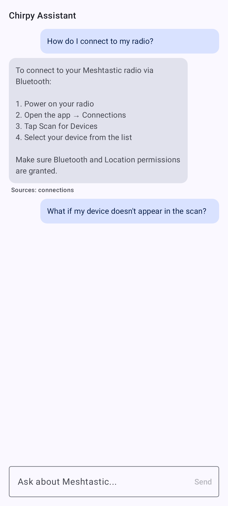

# Ohjeet ja sovelluksen sisäinen dokumentaatio

Sama käyttöohje sisältyy myös **sovellukseen**, joten voit lukea sitä offline-tilassa poistumatta Meshtasticista. Avaa se kohdasta **Asetukset → Ohjeet & dokumentaatio**.

## Selaaminen

Dokumentaation selain näyttää kaikki käyttöohjeen sivut. Tap a page to read it; images and cross-links work as they do here.

### Haku

Tap the search field at the top of the docs browser to open a full-screen search view. Type to filter pages by title and keywords — results update as you type, under the same field. The back arrow, or the keyboard's search action, closes the view. The field hides while you scroll down the page list and comes back when you scroll up.

Dokumentaatiosivu avattuna selaimessa:

### Pages in your language

With the app set to a language other than English, a page that has a community translation opens in that language, labeled **Community translated** under its title. On the Google-flavor Android build, a page with no community translation opens in English and is then machine-translated on the phone, labeled **Auto-translated**. F-Droid and desktop builds show such a page in English.

## Chirpy — tekoälyn avustaja

**Chirpy** vastaa Meshtasticia koskeviin luonnollisella kielellä esitettyihin kysymyksiin käyttäen lähteenään tätä sovellukseen sisältyvää dokumentaatiota. Napauta Chirpy-painiketta dokumentaatioselaimessa, kirjoita kysymyksesi, niin se vastaa ja linkittää aiheeseen liittyville sivuille.

Chirpy on käytettävissä vain Androidin Google-versiossa. On F-Droid and desktop builds the assistant button does not appear at all — the same is true on a phone whose hardware cannot run the on-device model. Selaaminen ja ohjeselaimen oma haku toimivat normaalisti kaikilla alustoilla.

> 🔒 **Tietosuoja:** Tuetuissa puhelimissa, joissa käytetään Google-versiota, Chirpy toimii **laitteella** Gemini Nanon avulla — kysymyksesi eivät koskaan poistu puhelimestasi. Pieni kielimalli ladataan ensimmäisellä käyttökerralla.

## Aiheeseen liittyvät aiheet

- [Käännä sovellus](translate) — miten nämä sivut lokalisoidaan muille kielille
- [Sovelluksen toiminnot](app-functions) — erillinen järjestelmätekoälyintegraatio (ei sama kuin Chirpy)
