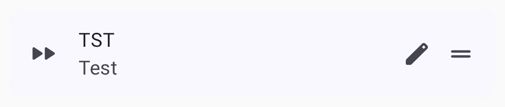
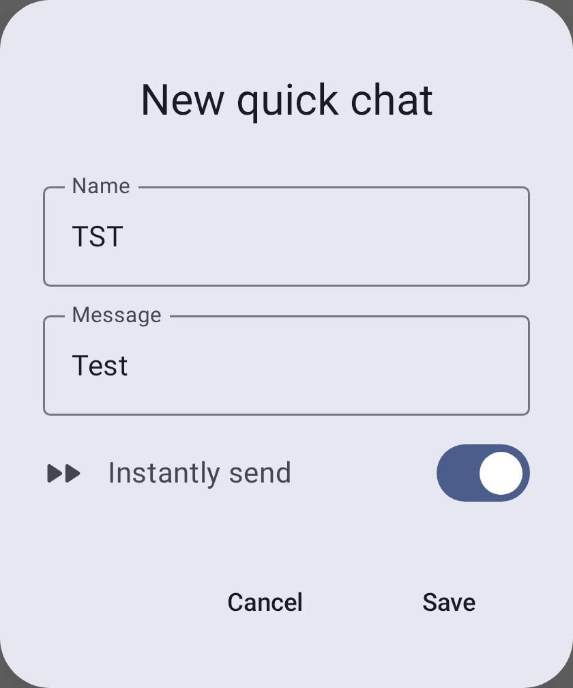
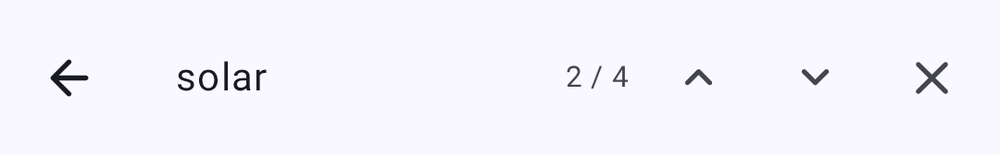

# Viestit ja kanavat

Meshtastic tukee kahta viestintätilaa: **kanavaviestit** ja **suoraviestit**.

## Kanavat

Kanavat ovat jaettuja viestintäryhmiä. Kaikki radiot, jotka on määritetty samalla kanava-avaimella, voivat lukea ja lähettää viestejä kyseisellä kanavalla.

### Oletuskanava

Every Meshtastic node comes with a default **LongFast** channel. Se on salattu tunnetulla oletusavaimella, joten kuka tahansa, joka käyttää Meshtasticia samalla esiasetuksella, voi lukea sen.

### Kanavan turvallisuus

Each channel carries a lock icon that shows how well it is protected. Tap the icon to see the same explanation inside the app.

| Ikoni                              | Mitä se tarkoittaa                                                                                                                                    |
| ---------------------------------- | ----------------------------------------------------------------------------------------------------------------------------------------------------- |
| Green closed lock                  | The channel is securely encrypted, with either a 128-bit or a 256-bit AES key.                                                        |
| Yellow open lock                   | The channel is not securely encrypted — it uses no key at all, or a well-known one-byte key — and it does not carry precise location. |
| Red open lock                      | Not securely encrypted, and the channel carries precise location data.                                                                |
| Red open lock with a warning badge | Not securely encrypted, carrying precise location data, and uplinking that data to the internet over MQTT.                            |

Key length alone does not change the icon: a 128-bit key and a 256-bit key both show the green lock.

> 🔒 **Tietoturva:** Määritä yksityistä viestintää varten aina yksilöllinen PSK. Oletuskanava on tarkoituksella avoin, jotta uudet käyttäjät löytävät mesh-verkon — luo erillinen salattu kanava arkaluontoiselle viestinnälle.

### Kanavan lisääminen

1. Connect to your node. The **Channels** row stays grayed out until the app has a connection — see [Connections](connections).
2. Go to **Settings**, then tap **Channels** under **Configuration**.
3. Tap the **+** button to add a channel. The editor opens on the new entry.
4. Set the channel name and the **PSK**, and choose whether the channel uses MQTT uplink and downlink. Naming a new channel generates a fresh 256-bit key for you; the refresh icon beside **PSK** generates another one.
5. Tap **Save** to close the editor. The change is still only on your phone.
6. Tap **Send** at the bottom of the channel list to write the changes to the node. **Cancel**, or leaving the screen without tapping **Send**, throws them away.
7. Optional: share the channel URL or QR code with the people who need access.

Tapping an existing channel opens the same editor, where you can change the name, the PSK, MQTT uplink and downlink, and position precision. Every edit on this screen — adding, editing, deleting, or dragging a channel into a new order — waits on **Send** the same way.

### Archived Channels

A conversation belongs to the channel it was held on, not to the slot that channel occupied. When a channel leaves your node — you scan a different channel QR, replace a channel's key, or switch the modem preset — its conversation is **archived** rather than deleted or merged into whatever takes the slot.

An archived conversation:

- stays in the **Channels** list under the name the channel had, below the channels on your node, marked with a history icon;
- keeps its full message history, searchable as usual;
- is read-only — you cannot send, reply, or react, because the channel is no longer on the node to send on, and it is not offered as a share target;
- comes back automatically if you re-add that exact channel, taking its messages back to the live slot.

Changing the modem preset archives the channel too: the preset is part of a default channel's identity, so **LongFast** and **MediumFast** are different channels even though neither the name nor the key changed. Changing only the region does not archive anything.

To remove an archived conversation for good, swipe it left in the conversation list, or touch & hold it and delete it from the action bar.

## Yksityisviestit

Direct messages (DMs) go to one specific node. When both nodes hold each other's public keys, your node encrypts the message to the other node's public key, so no one else on the mesh can read it — not even nodes that share your channel.

Your node must already hold the other node's public key before it can send a DM. Keys travel inside node info, which nodes broadcast periodically, so the key usually arrives on its own once you have heard from that node. Until it does, a node that has its own key pair — the default — refuses the send rather than falling back to channel encryption, and the message shows **Recipient key unavailable**.

A public-key conversation carries an encryption icon in its top bar. A green closed lock means the direct message is protected by public-key encryption; a red crossed-out key means the node's public key changed and no longer matches the one your node stored. Tap the icon for the details. This icon describes the conversation's encryption, so it keeps the locks at every firmware version rather than showing the signed or verified badges from the node list.

### Yksityisviestin lähettäminen

1. Open the **Messages** tab and select a conversation, or touch & hold a node in the node list and choose **Message**.
2. Kirjoita viesti ja napauta **Lähetä**.

On a hardware keyboard, Enter sends the message and Shift+Enter starts a new line. The on-screen keyboard's Enter key always starts a new line.

### Keskusteluluettelon hallinta

**Viestit**-välilehdellä näkyvät keskustelusi. Jokainen rivi näyttää tärkeimmät tiedot yhdellä silmäyksellä, ja voit toimia suoraan riviltä:

- **Lähettämättömät luonnokset säilyvät.** Kirjoita viesti keskusteluun ja poistu lähettämättä sitä, niin teksti on edelleen tallessa, kun palaat. Rivillä näkyy viimeisimmän viestin sijasta `Draft: …` — lähettämätön luonnos pitää rivin ylimpänä.
- **Lukematon**-merkki: Laskuri näkyy rivillä, kunnes avaat keskustelun.
- **Pyyhkäise oikealle mykistääksesi** (pyyhkäise uudelleen poistaaksesi mykistyksen) ja **pyyhkäise vasemmalle poistaaksesi**. Poistaminen kysyy ensin vahvistuksen, mykistäminen näyttää **Kumoa**-toiminnon sisältävän ilmoituspalkin.
- **Kosketa pitkään valitaksesi** yhden tai useamman keskustelun ja käytä sitten toimintopalkkia niiden **kiinnittämiseen**, **merkitsemiseen lukemattomiksi**, mykistämiseen tai poistamiseen yhdessä. When every selected conversation is already
  pinned, **Pin** becomes **Unpin**. Pinned conversations carry a pin marker and rise to the top
  of **their own section**.
- **Luettelo on jaettu Kanaviin ja Suoraviesteihin**, joilla kummallakin on oma kutistettava otsikkonsa ja jotka lajitellaan erikseen — siksi kiinnitetty suoraviesti nousee oman osionsa alkuun, ei Kanavat-osion yläpuolelle.

### Keskustelukuplat

Android 11:ssä ja uudemmissa versioissa viesti-ilmoituksen voi avata kelluvana **kuplana**, joka pysyy muiden sovellusten päällä. Napauta ilmoituksen kuplakuvaketta ottaaksesi keskustelun käyttöön kuplana. Android muistaa valinnan keskustelukohtaisesti, ja järjestelmän Kuplat-asetukset määrittävät, tarjotaanko niitä lainkaan.

### Viestin tilat

Tilateksti näkyy vain **omissa** lähtevissä viesteissäsi (muiden lähettämissä saapuvissa viesteissä ei näytetä tilaa):

| Tila                                                           | Merkitys                                                                                                                                                                                                                                 |
| -------------------------------------------------------------- | ---------------------------------------------------------------------------------------------------------------------------------------------------------------------------------------------------------------------------------------- |
| Lähetetään...  | Queued or already handed to your node, not yet resolved either way. Both stages share this text, but the icon and color change as it progresses — a yellow upload cloud while queued, a blue arrow once your node has it |
| Toimitettu vastaanottajalle                                    | An acknowledgment came back for a direct message                                                                                                                                                                                         |
| Delivered to recipient · proven                                | The strongest confirmation. The acknowledgment carried a proof that only the recipient could have produced. Needs firmware 2.8.1 or newer                                |
| Delivery proof failed                                          | Something acknowledged the message without the key only the recipient holds, so the acknowledgment doesn't show that the recipient received it                                                                                           |
| Toimitettu mesh-verkkoon                                       | Kanavalähetyksessä viesti on saavuttanut mesh-verkon (kanavalähetyksille ei lähetetä vastaanottajakohtaista kuittausta)                                                                                               |
| Välitetty, mutta vastaanottaja ei ole vahvistanut vastaanottoa | Suorassa viestissä tämä näytetään varoitusvärillä — viesti on välitetty eteenpäin, mutta vastaanottokuittausta ei ole vielä saatu                                                                                                        |
| Reititetään SF++ ketjun kautta…                                | Reititetty tai puskuroitu varastoi & välitä Plus Plus -ketjussa                                                                                                                                                      |
| Vahvistettu SF++-ketjussa                                      | Toimitus vahvistettu varastoi & välitä++ -ketjun kautta                                                                                                                                                              |
| Virhe                                                          | Viestin toimitus epäonnistui — napauta tilaa nähdäksesi tarkan syyn (katso [Toimitusvirheet](#delivery-errors))                                                                                                       |

Tap the status under a failed message, or under a direct message marked **Relayed, not confirmed by recipient**, and choose **Resend** to send it again. The message keeps its place in the conversation and its status starts over. **Resend** isn't offered for **Channel/key mismatch** or **Message is too large to send**, which a second attempt can't fix, or in an archived conversation.

### Toimitusvirheet

Kun viestin toimitus epäonnistuu, virheilmaisin näyttää, mikä meni pieleen:

| Virhe                                     | Merkitys                                                                                                                                                                                | Toimenpiteet                                                                                                                                             |
| ----------------------------------------- | --------------------------------------------------------------------------------------------------------------------------------------------------------------------------------------- | -------------------------------------------------------------------------------------------------------------------------------------------------------- |
| Ei reittiä                                | Kohderadioon ei ole reittiä                                                                                                                                                             | Vastaanottaja voi olla offline-tilassa tai verkon kantaman ulkopuolella. Yritä myöhemmin tai siirry lähemmäksi.          |
| Ei radioliitäntää                         | Lähetykseen ei ole käytettävissä radioliitäntää                                                                                                                                         | Check that your node is connected and available.                                                                                         |
| Toimitus mesh-verkkoon epäonnistui        | Uudelleenyritykset käytetty loppuun. Sama ilmoitus kattaa kolme eri syytä — välityksen hylkäys (NAK), aikakatkaisu tai uudelleenyritysten loppuminen | Siirry lähemmäs, paranna signaalia tai odota olosuhteiden paranevan. Napauta virhettä nähdäksesi tarkan syyn.            |
| Lähetysrajoitus saavutettu                | Mesh-verkko rajoittaa lähetysnopeuttasi                                                                                                                                                 | Odota hetki ennen seuraavan viestin lähettämistä.                                                                                        |
| Ei valtuuksia                             | Kohde hylkäsi pyynnön                                                                                                                                                                   | Tarkista, että käytössä on oikea kanava ja oikeat avaimet kyseiselle radiolle.                                                           |
| Vastaanottaja tarvitsee avaimesi          | Suoraviestin salausta ei voitu suorittaa loppuun, koska toisella radiolla ei vielä ole julkista avaintasi                                                                               | Vaihda radiotiedot — julkinen avain välittyy niiden mukana. Yleistä ensimmäisessä suoraviestissä uudelle yhteystiedolle. |
| Vastaanottajan avain ei ole käytettävissä | Vastaanottajan julkinen avain puuttuu                                                                                                                                                   | Odota, että radion tiedot saapuvat, tai pyydä vastaanottajaa lähettämään ne.                                                             |
| Salattua viestiä ei voitu lähettää        | Tämän suoraviestin salaus epäonnistui                                                                                                                                                   | Varmista, että molemmat radiot ovat vaihtaneet avaimet ja että niissä on yhteensopiva laiteohjelmisto.                                   |
| Ylläpitoistunto on vanhentunut            | Etähallintaistunnon aikakatkaisu                                                                                                                                                        | Avaa etäradion asetukset uudelleen aloittaaksesi uuden istunnon.                                                                         |
| Ylläpitoavainta ei ole valtuutettu        | Kohderadio ei hyväksy järjestelmänvalvojan avaintasi                                                                                                                                    | Varmista, että ylläpitoavain on sama molemmissa radioissa.                                                                               |
| Kanavan tai avaimen ristiriita            | Kohteen kanava tai avain ei täsmää                                                                                                                                                      | Varmista, että molemmat radiot käyttävät samaa kanavaa ja PSK:ta.                                                        |
| Viesti on liian suuri lähetettäväksi      | Viesti ylittää sallitun enimmäiskoon                                                                                                                                                    | Lyhennä viestiä ja yritä uudelleen.                                                                                                      |
| Ei sovellusvastausta                      | Sovellus tai liitännäinen ei vastannut pyyntöön                                                                                                                                         | Yritä uudelleen tai tarkista kohdesovelluksen tai moduulin tila.                                                                         |
| Käyttöasteen rajoitus                     | Alueellinen lähetysajan raja saavutettu                                                                                                                                                 | Odota, että käyttöasteikkuna nollautuu.                                                                                                  |
| Virheellinen pyyntö                       | Virheellinen tai puutteellinen pyyntö                                                                                                                                                   | Jos ongelma jatkuu, päivitä tai käynnistä sovellus uudelleen ja yritä sitten uudelleen.                                                  |

> 💡 Vinkki: Useimmat toimitusvirheet korjaantuvat itsestään. Jos radio on ajoittain tavoitettavissa, mesh yrittää uudelleen. For persistent **No route** errors, check that intermediate Router nodes are online.

## Viestiominaisuudet

### Pikachatti

Pre-configured messages for rapid communication, useful when typing is impractical (gloves, small screen, urgent):

- The quick chat row is hidden until you turn it on. Open a conversation, tap the overflow menu in the top bar, then tap **Show quick chat menu**. **Hide quick chat menu** puts the row away again.
- The row carries one built-in entry, the 🔔 alert bell. It appends an alert message that includes a bell character, which clients that support it flag as an alert. Every other button on the row is one you created.
- Add, edit, reorder, and delete your own entries from the same overflow menu — tap **Quick chat options**.

Each quick chat entry has a **Name** — the button label, capped at five characters, forced to uppercase, and filled in for you from the message text — and the **Message** it carries. A switch decides what tapping the button does. A new entry starts on **Instantly send**, so a tap sends the message straight away; turn the switch off and the label changes to **Append to message**, which puts the text in the input field for you to edit first.

### Viestien haku

Search covers the full history of any conversation, from the chat screen:

1. Avaa keskustelu (kanava tai suoraviesti).
2. Napauta **hakukuvaketta** yläpalkissa.
3. Kirjoita **Etsi viestejä** -kenttään. Haku toimii kirjoittaessa ja käy läpi kaikki tallennetut viestit kyseisessä keskustelussa.
4. Käytä **N / M** -laskuria ja edellinen/seuraava -nuolia siirtyäksesi osumien välillä, jotka on korostettu keskustelussa.

Search stays within the conversation you opened it from and doesn't reach other channels or contacts. It matches the messages stored on your phone, so it works offline.

### Message filter

The conversation's overflow menu also reaches the message filter, which hides messages containing words you list. **Message Filter** opens its settings, **Show N filtered** reveals what it hid in this conversation, and **Disable filter here** turns it off for this conversation alone. See [Settings — Modules & Admin](settings-module-admin) for the word list.

### Viestikuplat

Viestit näkyvät chat-kuplina — lähetetyt viestit oikealla, vastaanotetut vasemmalla. Jokainen kupla näyttää lähettäjän, aikaleiman ja toimitustilan. Vastaukselliset viestit sisältävät alkuperäisen viestin esikatselun vastauksen yläpuolella.

### Tekstin muotoilu

Viestit tukevat kevyttä rivinsisäistä **Markdown**-muotoilua. Vastaanotetut viestit näyttävät muotoilun ilman Markdown-syntaksimerkkejä:

| Kirjoita            | Syntaksi                      | Näkyy muodossa        |
| ------------------- | ----------------------------- | --------------------- |
| Lihavoitu           | **lihavoitu**                 | **lihavoitu**         |
| Kursivoitu          | `*kursivoitu*`                | _kursivoitu_          |
| Yliviivattu         | `~~yliviivattu~~`             | ~~yliviivattu~~       |
| Rivinsisäinen koodi | `` `koodi` ``                 | tasalevyinen `koodi`  |
| Linkki              | `[nimi](https://example.com)` | napautettava **nimi** |

Kun kirjoitat viestiä, napauta viestikenttää ja kirjoita vähintään kolme merkkiä, niin kentän alle avautuu **muotoilutyökalurivi**. Valitse teksti ja napauta muotoilua lisätäksesi sen ympärille merkinnät (napauta uudelleen poistaaksesi ne). Jos tekstiä ei ole valittuna, muotoilu lisää tyhjän merkkiparin ja sijoittaa kohdistimen niiden väliin. Linkkipainike avaa valintaikkunan URL-osoitteen syöttämistä varten. Kirjoittaessasi kentässä näkyy muotoiltu teksti, mutta lähetettävä viesti sisältää edelleen Markdown-merkit.

Formatting is carried as literal characters on the mesh, the same bytes the Apple client sends. Clients that don't support Markdown (older apps, plain firmware clients) show the raw `**`/`~~` characters. URLs, email addresses, and phone numbers are auto-linked whether or not you use Markdown.

### Maininnat

Kirjoita viestiä laatiessasi `@` mainitaksesi radion — valitsin ehdottaa kirjoittaessasi vastaavia yhteystietoja. Vastaanotetussa viestissä maininta näkyy korostettuna tunnisteena, jossa näkyy radion nimi. Napauta sitä siirtyäksesi suoraan kyseisen radion tietosivulle.

### Reaktiot

Reagoi viesteihin emojeilla:

- **Kosketa pitkään** viestiä tai kaksoisnapauta sitä, niin viestin yläpuolelle avautuu pikareaktiopalkki. Palkin avaaminen ei lähetä mitään.
- Tap an emoji in the bar to send it; tap **More reactions** to open the full picker, or anywhere outside
  the bar to dismiss it without sending. Reaktio on oikea mesh-paketti, joten se lähetetään vasta, kun valitset emojin.
- Reaktiot näkyvät viestin alapuolella
- Useampi käyttäjä voi reagoida samaan viestiin
- Voit reagoida omiin ja muiden viesteihin

Reactions use less mesh bandwidth than full text messages.

### Vastaaminen

**Pyyhkäise viestiä oikealle** vastataksesi siihen — viestinkirjoituskenttä avautuu siten, että kyseinen viesti on lainattuna.
Kun pyyhkäisy ylittää vastauskynnyksen, toiminto aktivoituu. Jos vapautat ennen sitä, viesti palautuu paikalleen eikä mitään tapahdu.
Reply is also in the actions sheet, reached by touching & holding and then tapping **More message actions**.

### Päiväerottimet

Viestit ryhmitellään päivän mukaan. Kahden viimeisimmän päivän ensimmäisen viestin yläpuolella olevassa erottimessa lukee **Tänään** tai **Eilen**, ja sitä vanhemmissa viesteissä näytetään päivämäärä.

### Siirry viimeisimpiin

Keskustelua ylöspäin vierittäessä näkyviin tulee painike, jolla voit siirtyä uusimpaan viestiin. Kun uusia viestejä saapuu sinun ollessasi ylempänä keskustelussa, siinä näytetään uusimman lähettäjän nimi sekä muiden lukemattomien viestien määrä. Lukumäärä tarkoittaa viestejä, ei henkilöitä — jos yhdeltä henkilöltä on viisi lukematonta viestiä, siinä näkyy hänen nimensä ja **+4**.

### Viestitoiminnot

Touch & hold or double-tap a message to open the quick reaction bar, then tap **More message actions**
(the overflow icon on that bar) to open the actions sheet. The emoji row runs across the top of the
sheet — that is where reactions live. Beneath it, **Signed · verified** appears on a message whose
signature your node checked against the sender's key, and **Delivery proven**, **Delivery proof
failed**, or **Delivery proof unchecked** appears when the acknowledgment for your message carried
a delivery proof. The message's timestamp and delivery status follow, then these actions:

- **Vastaa** — lainaa viesti vastaukseesi
- **Copy** — copy the message text to the clipboard
- **Translate** — translate a received message into your device language, and toggle between the original and translated text (Google Play build only; uses on-device translation). The first translation into a language asks to download a one-time language model and tells you its size, then translates once the download finishes. If the download fails, or the message is already in your language, the app says so instead of translating
- **Select** — start multi-select, so you can act on several messages at once
- **Delete** — remove the message from this phone. It works on any message in the conversation, yours or not, and does not remove it from anyone else's node or phone

### Viestien prioriteetti

Sovellus lähettää kaikki kirjoittamasi viestit samalla oletusprioriteetilla — valittavana ei ole hätä- tai hälytysprioriteettia, eikä mikään sovelluksessa nosta suoraviestiä kanavalähetyksen edelle. Any prioritizing between them happens in firmware, not here. (Sovellus merkitsee osan omasta sisäisestä liikenteestään, kuten järjestelmänvalvojan paketit ja reitiselvityspaketit, luotettaviksi tai taustaliikenteeksi, mutta sitä ei voi hallita viestinkirjoituskentästä.)

### Viestirajoitukset

- **Enimmäispituus:** 200 tavua (noin 200 merkkiä ASCII-tekstille)
- The 200-byte cap applies to the in-app composer — the mesh payload limit itself is 233 bytes, so messages from other senders (e.g., App Functions) may arrive slightly longer
- **Rajoitusnopeus:** mesh-verkko tasaa lähetysajan oikeudenmukaisesti; suuri viestimäärä voi joutua rajoitetuksi
- **Toimitus:** viestit yritetään lähettää uudelleen automaattisesti, jos kuittausta ei saada

## Parhaat käytännöt

- Käytä kanavia ryhmäviestintään
- Käytä suoraviestejä kahden käyttäjän väliseen yksityiseen viestintään
- Pidä viestit lyhyinä — mesh-verkon kaistanleveys on rajallinen
- Määritä salaus arkaluontoiselle viestinnälle

## Aiheeseen liittyvät aiheet

- [Radiot](nodes) — napauta radiota aloittaaksesi suoraviestin
- [Asetukset — Radio ja käyttäjä](settings-radio-user) — määritä kanavan salaus ja esiasetukset
- [MQTT](mqtt) — välittää kanavaviestit internetiin
- [Kanavien määritys](https://meshtastic.org/docs/configuration/radio/channels) — tarkemmat kanava-asetukset meshtastic.org-sivustolla
