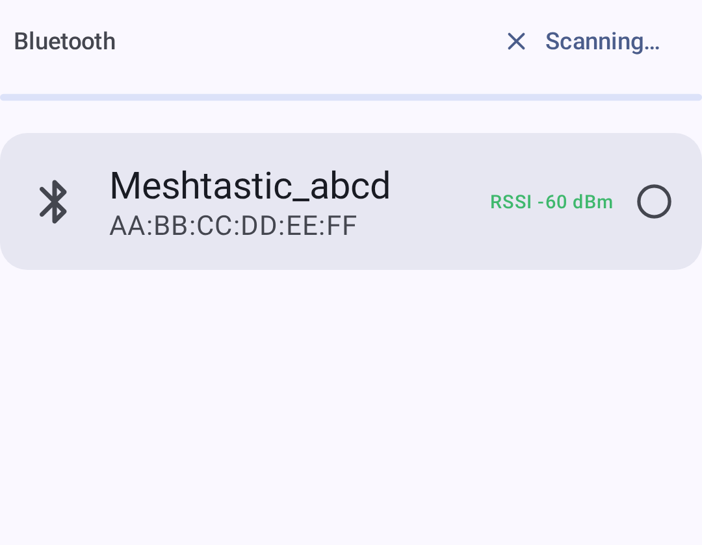
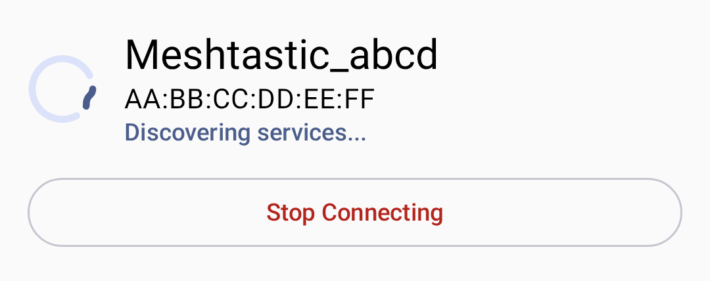
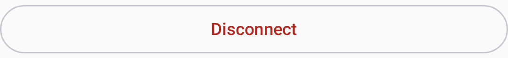

# コネクション

Meshtastic supports multiple transport methods to communicate between your phone or desktop and a node.

## Bluetooth（BLE）

Bluetooth Low Energy は、Android で標準的かつ最も一般的な接続方法です。

### Pairing a Radio

1. Power on your node. Most nodes advertise over Bluetooth as soon as they boot, so there is no pairing mode to enter. Nodes with a color touchscreen ship with Bluetooth switched off, so turn it on from the node's own on-screen menu first.
2. アプリを開き、「**接続**」タブに移動します。
3. Tap **Scan for Bluetooth devices**. Nearby Meshtastic nodes appear in the list.
4. Select your node from the list.
5. Android asks you to pair. If your node has a screen, it shows a six-digit PIN. Type that into the Android dialog. If your node has no screen, the PIN is `123456`.

To change the pairing method, or to turn Bluetooth on for a node that ships with it off, open **Settings → Device configuration → Bluetooth**. See [Settings — Radio & User](settings-radio-user). For more information, see [Bluetooth configuration](https://meshtastic.org/docs/configuration/radio/bluetooth) on meshtastic.org.

接続カードの下にあるセグメント化されたボタン列（接続方式のセレクター）を使って、Bluetooth・ネットワーク・USB の接続方式を切り替えます（一度に 1 つが有効になります）：

On hardware with no Bluetooth LE the selector leaves out **Bluetooth**, and on hardware with no USB host it leaves out **USB**. With **Network** as the only transport left, the selector is hidden.

> 💡 **Tip:** If your node doesn't appear, check that it isn't already connected to another phone, or out of range.

The screen names anything on the app's side that is blocking a scan, with the fix attached:

| What you see                                                | 意味                                                                                                                                                                         |
| ----------------------------------------------------------- | -------------------------------------------------------------------------------------------------------------------------------------------------------------------------- |
| A card asking for **Nearby devices**                        | The permission has not been granted. **Grant permission** requests it; once Android stops prompting, the button becomes **Open settings**. |
| **Bluetooth is off**                                        | The adapter is disabled — the card opens Bluetooth settings.                                                                                               |
| **Bluetooth scanning also needs location services**         | Android 11 and older only: the permission is held but the system location toggle is off.                                                   |
| No card, and **No Bluetooth devices seen** under the header | Nothing on this side is blocking the scan. The node is out of range, off, or already connected elsewhere.                                  |

The explanation lives in that card, not in the scan control: tapping **Scan for Bluetooth devices** after you have declined once asks Android again directly.

### 接続ステータス

The **Connect** tab icon in the navigation bar shows the connection state by color:

| アイコン | 状態            | 説明                                                                                                                      |
| ---- | ------------- | ----------------------------------------------------------------------------------------------------------------------- |
| 🟢   | 接続済           | Active link to the node. The badge shows the transport in use: Bluetooth, Wi-Fi, or USB |
| 🟠   | 接続中           | ハンドシェイク中                                                                                                                |
| 🔴   | 切断            | No active connection. The app retries automatically, with a growing delay between attempts              |
| 🟡   | デバイスはスリープ状態です | The node is in light sleep. The app is waiting for it to wake and reconnect, not failing                |

These are the four states the app models. "Device sleeping" is normal on power-saving configurations and needs no action.

When connecting, a status indicator shows the current connection state — tap **Stop Connecting** to abandon the attempt:

Once connected, the connection card shows the node's name and firmware version, its signal strength over Bluetooth, and its LoRa modem preset and region, for example "Long Range - Fast · United States". A node on custom modem settings shows **Custom** in place of the preset. Tap the preset row to open the LoRa screen.

With no node chosen yet, the connection card reads **No device selected**. A pane with nothing to list says so under its header, with a hint:

| Pane      | What it shows                                                                                                                                                                                                                                                                |
| --------- | ---------------------------------------------------------------------------------------------------------------------------------------------------------------------------------------------------------------------------------------------------------------------------- |
| Bluetooth | **No Bluetooth devices seen**, and "Ensure you're within range of the device." Start a scan from the header.                                                                                                                                 |
| ネットワーク    | **No network devices seen**, and "Ensure you're connected to the same network as the device." Shown only while nothing has been discovered and **Recent Network Devices** is empty. **Add device manually…** stays below it. |
| USB       | **No USB devices detected**, and "Connect a device with a USB data cable to use serial."                                                                                                                                                                     |

### Bluetooth のトラブルシューティング

- **Node not found:** Turn Bluetooth off and back on. On Android 11 and older, also check that system location services are switched on. Those releases do not return scan results without them.
- **Bluetooth scan couldn't start:** Try again, and toggle Bluetooth off and on if it repeats.
- **Connection drops:** Move closer to the node; check for interference.
- **Pairing failed, or pairing did not complete:** Check that the **Nearby devices** permission is granted, then pair again.
- **ペアリングが拒否される：** Android の Bluetooth 設定でデバイスの登録を解除し、やり直します。
- **Could not establish a stable connection after repeated attempts:** The app stopped retrying after three failed handshakes. A node that keeps failing here is usually crashing on reconnect. Power-cycle the node, then tap it again on the **Connect** tab to start a fresh attempt.

## USB シリアル

USB 接続は有線での代替手段で、デスクトップや Bluetooth が使えない場合に便利です。

### セットアップ

1. Connect your node to your phone with a USB data cable. Charge-only cables carry no data lines, and a node on one never appears in the list.
2. The app prompts for USB permission. Tap **Allow**.
3. 接続が自動的に確立されます。

> ℹ️ **Note:** USB connections require OTG support on Android devices.

### Troubleshooting USB

- **USB permission denied:** Unplug the node and plug it back in. Android asks again on reconnect.
- **No node in the list:** Check that the cable carries data rather than only power, and that the phone supports OTG.

## TCP/IP（ネットワーク）

Some Meshtastic nodes support Wi-Fi/Ethernet connectivity, allowing TCP-based connections over your local network. Get the node onto your network first. Connect to it over Bluetooth or USB, open **Settings → Device configuration → Network**, and under **Wi-Fi Options** turn on **WiFi Enabled** and enter the **SSID** and **Password**. The Network screen appears only for nodes whose hardware supports Wi-Fi or Ethernet. Once the node has an address, come back and connect to it over the network.

### ネットワーク経由で接続する

1. Make sure the node is on the same local network as your phone or desktop.
2. On the **Connect** tab, select **Network** in the transport selector.
3. Choose the node one of two ways:
   - **Scan for network devices**: toggle this on to auto-discover nodes that advertise themselves on the local network (mDNS / `_meshtastic._tcp`). 見つかったデバイスがリストに表示されるので、タップして接続します。
   - **Add device manually…**: enter the node's IP address (or hostname) and port (default: `4403`).
4. Previously used network addresses are remembered under **Recent Network Devices** for reconnection (touch & hold to remove one).

Network discovery uses mDNS, which only works when both your phone and the node are on the same subnet. If the phone is not on Wi-Fi at all, the app warns that a network scan may find nothing. On Android 17 and newer, the app needs the **Local network permission** to reach a node on your own Wi-Fi at all, not only to discover it, so typing the address by hand does not work around a denied permission. Grant it from the card on the Network pane, or from the **Permissions** section of **Settings**. A node on a public address, or one reached over a VPN, needs no permission.

### TCP を使う場面

- Node is on the same local network
- Testing with a simulated node
- Bluetooth の電波干渉が問題になる環境

### mPWRD-OS の Wi-Fi プロビジョニング

**Settings → Wi-Fi Provisioning for mPWRD-OS** is a separate, narrower tool. It sends Wi-Fi credentials over Bluetooth to **mPWRD-OS** devices only, using their own protocol. It does not configure Wi-Fi on an ordinary Meshtastic node. It is available on both Android and desktop.

1. Open the screen and wait while the app finds the device over Bluetooth.
2. Tap **Scan for Networks**, then pick a network from **Available Networks**, or turn on **Hidden network** and type the name into **Network Name (SSID)**.
3. Enter the **Password** and tap **Apply**.

If the scan reports **No networks found** or fails outright, move the phone closer to the device and scan again. If **Failed to apply Wi-Fi configuration** comes back, check the password and try again.

## After Your First Connection

Being connected is not the same as being able to transmit.

A node leaves the factory with no LoRa region set, and it does not transmit until you set one. When you connect such a node, the **Connect** tab shows a **Set your region** card; tap it to open the LoRa screen and choose the region you are in.

Once the region is set, the tab warns you if the node is receive-only: a **Transmit is disabled** card, reading "This device can receive but will not send anything over LoRa." Tap it to open the same screen and turn **Transmit Enabled** back on. Only one of the two cards appears at a time. An unset region already stops the node transmitting, so the app names that first and holds the transmit card back until you have set a region.

For more information, see [Settings — Radio & User](settings-radio-user#lora-config).

## Live Update

On Android 16 and newer, the **Connect** tab has a **Live Update** row while you are connected. It puts one thing you choose in the status bar and the service notification:

- **Mesh status:** the connection, how many nodes are online, your unread messages and your node's battery. The status bar shows the nodes online, such as `5/12`.
- **Track a node:** one node's battery, signal, when it was last heard, its hops and its distance from your node. The status bar shows its battery, or how long ago it was heard when it reports no battery. Pick the node from a list with favorites first, then the most recently heard, or search it by name.

Tap the row to start one, switch to the other, or stop it. Only one runs at a time, and it is off until you start it. On a node's details, **Track in Live Update** starts tracking that node directly.

A dropped link keeps it running and shows the connection state until the node is back. Disconnecting, switching nodes, or deleting or ignoring the tracked node stops it. If the row says Live Updates are turned off for Meshtastic, Android shows it as an ordinary notification until you allow them in system settings.

## 再接続の動作

The app reconnects to the last selected node on startup. You can switch transports from the **Connect** tab at any time.

To disconnect, tap the disconnect button on the **Connect** tab:

## Quick Settings Tile

On Android you can add a **Meshtastic** tile to Quick Settings: pull down the notification shade, tap the edit (pencil) button, and drag the tile into place.

- **Connected** - the tile is on and shows your node's short name. Tap it to disconnect, the same as the disconnect button on the **Connect** tab.
- **Connecting** - the tile is on and reads "Connecting". Tap it to cancel.
- **Disconnected** or **Device sleeping** - the tile is off. Tap it to reconnect to the node you last selected.
- **No device selected** - tap the tile to open the **Connect** tab and pick a node.

Disconnecting forgets the selected node, so after a disconnect the tile opens the **Connect** tab. If Android does not let the app reconnect in the background, the tile opens the app instead and the connection starts from there. On a locked phone the tile asks you to unlock first.

## デスクトップでの接続

デスクトップ（Linux／macOS／Windows）では、アプリは次の接続方式に対応しています：

- **Bluetooth（BLE）：** Kable ライブラリを使用。macOS、Linux、Windows で動作します
- **USB シリアル：** 主要な有線接続方法
- **TCP/IP** — for network-connected nodes

プラットフォームごとの詳細やキーボードショートカットについては、[デスクトップアプリ](desktop) を参照してください。

## 関連トピック

- [はじめに](onboarding)：初回起動時のセットアップと権限
- [Settings — Radio & User](settings-radio-user) — Bluetooth, region, and network configuration
- [Messages & Channels](messages-and-channels) — send your first message once the node is connected
- [Nodes](nodes) — see who else is on your mesh
- [デスクトップアプリ](desktop)：デスクトップ固有の接続に関する詳細
- [Supported devices](https://meshtastic.org/docs/hardware/devices) — full list of compatible nodes on meshtastic.org
