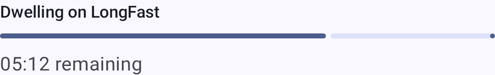
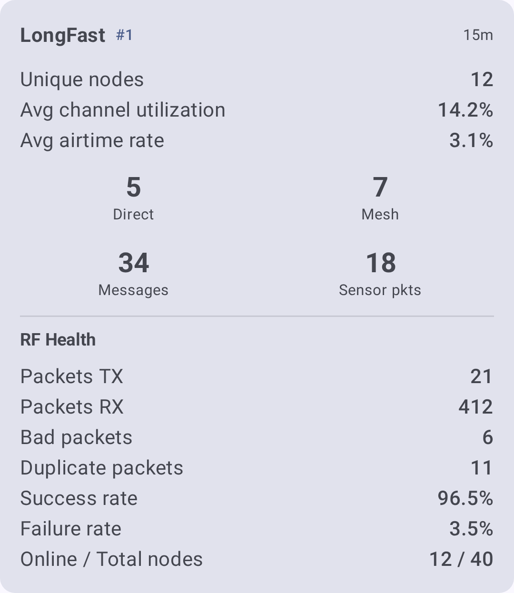

# ローカルメッシュ探索

探索ツールは、メッシュネットワークが**どのように**つながっているか（どのノードが互いに受信できるか、メッセージがどの経路を通るか、ボトルネックや弱いリンクがどこにあるか）を把握するのに役立ちます。

アプリは、互いを補完する 2 つの方法を提供します：

- **Local Mesh Discovery (Scanner)** — an automated mode that cycles your connected node through different LoRa presets, listens on each, and ranks which preset performs best at your location.
- **手動での探索**：ルート追跡、隣接ノード情報、ノードリスト。特定の経路やトポロジーを調べるために、いつでも使えます。

## ローカルメッシュ探索（スキャナー）

ローカルメッシュ探索は、あなたの場所に最適な LoRa モデムプリセットを見つけ、各プリセットでどのノードがアクティブかを確認できる、専用のスキャンモードです。 It cycles your connected node through one or more presets you choose, dwells on each one — listens for a set time — to collect packets, then analyzes and ranks the results.

Connect your node, then open **Settings → Advanced → Local Mesh Discovery**. On Android the **Advanced** section appears only for a locally connected node, never over remote admin, and stays grayed out until the app has finished reading the node's configuration. On a managed device its entries are disabled, except **Debug Panel**, which reads app-local logs and stays available. On desktop, Local Mesh Discovery has its own entry on the Settings screen, with no such gate.

Discovery changes your node's LoRa settings while it scans, then restores your original configuration when it finishes.

Each preset is scanned on the public mesh: the default frequency slot for that preset, decoded with the default public channel. If your node uses a custom frequency slot, the scan uses the default slot and puts your slot back when it finishes. If your primary channel has a custom name or key, the scan switches it to the default public channel before the first preset change and restores your channel when the scan ends, whether it completes, you stop it, or it fails. Channel changes don't reboot the node, so this happens at once at the start and end of the scan.

### Setting up a scan

開始する前に、次のコントロールを設定します：

| コントロール           | 説明                                                                                                                                                                                                                                                       |
| ---------------- | -------------------------------------------------------------------------------------------------------------------------------------------------------------------------------------------------------------------------------------------------------- |
| **LoRa Presets** | スキャンするプリセットを 1 つ以上選択します。探索は、選択した各プリセットに順番に滞在します。                                                                                                                                                                                                         |
| **Dwell Time**   | 各プリセットで受信する時間。 1、5、15、30、45、60、90、120、180 分から選択します。滞在時間を長くすると、より多くのパケットを収集してより明確な状況が分かりますが、時間もかかります。                                                                                                                                                     |
| **画面をスリープさせない**  | Keeps the display on for the scan. The scan itself holds a CPU wake lock for its whole run and posts a **Scanning LoRa presets…** notification, so it keeps collecting with the screen off or the app in the background. |

The **Start Scan** button stays disabled — with an explanation of why — until the scan can run. 無効になる主な理由：

- The node is **not connected**.
- スキャンする**プリセットが選択されていない**。
- 選択したプリセットが、ハードウェアが対応していない **2.4 GHz** を使用している。

### Live progress

スキャンの実行中、探索は現在の段階を表示します：

| 段階                                                                     | 実行中の内容                                                                                                                                                                                                                            |
| ---------------------------------------------------------------------- | --------------------------------------------------------------------------------------------------------------------------------------------------------------------------------------------------------------------------------- |
| **Preparing scan**                                                     | Saving your current LoRa configuration and primary channel and getting ready to scan.                                                                                                                             |
| **\<preset\> に切り替え中**                       | Switching the node to the next preset to test.                                                                                                                                                                    |
| **Reconnecting on \<preset\>**              | プリセット変更後に接続を再確立しています。                                                                                                                                                                                                             |
| **Dwelling on \<preset\>**                  | 現在のプリセットで受信してパケットを収集しており、次のステップまでのカウントダウンが表示されます。                                                                                                                                                                                 |
| **Analyzing results**                                                  | 収集したパケットを処理し、プリセットをランク付けしています。                                                                                                                                                                                                    |
| **Restoring home preset**                                              | 元の LoRa 構成に戻しています。                                                                                                                                                                                                                |
| **Cancelling scan**                                                    | You tapped **Stop Scan**; partial results are saved before the original preset is restored.                                                                                                                       |
| **Scan failed: \<reason\>** | The scan could not continue — most often the node didn't come back within a minute of a preset change. The results collected so far are saved, and the original preset is restored automatically. |



If a scan is interrupted — the app is closed, or the node goes away — the app restores your original preset and primary channel the next time it reconnects to that node, and tells you it has done so. Reconnect the same node to let that happen; until you do, the node stays on whichever preset and channel the scan left it on.

### Reading the results

スキャンが完了すると、探索はテストした各プリセットのプリセット別の結果カードと、全体の概要を表示します。



メトリクスには次が含まれます：

| メートル法      | 分かること                              |
| ---------- | ---------------------------------- |
| RF の健全性    | そのプリセットにおける無線環境の総合的な品質。            |
| チャンネル利用率   | 滞在中に電波がどれだけ混雑していたか。                |
| 電波利用時間     | 観測された送信時間。                         |
| 直接受信と中継ノード | 直接受信できたメッシュノードと、中継経由のノードの数。        |
| 不良／重複パケット  | 破損したパケットと繰り返されたパケットの数で、輻輳や干渉を示します。 |

結果から利用できる追加機能：

- **スキャン履歴**：後で見直せる保存済みのセッション。過去のスキャンを表示または削除できます。
- **探索マップ**：スキャン中に見つかったノードのマップ。
- **レポートのエクスポート**：Android では PDF として、他のプラットフォームではテキストとしてレポートをエクスポートします。

On **Google Play** builds, Discovery can generate an on-device AI summary (Gemini Nano) of your results. F-Droid builds always use the algorithmic summary, because that flavor leaves out the proprietary ML Kit dependency, so every build gives a readable interpretation of the scan.

## メッシュビーコン

メッシュビーコンを使うと、ノードが他のノードを自分のメッシュに招待できます。 A beaconing node periodically broadcasts an invitation — optionally advertising a channel, region, and modem preset — that nearby nodes can hear even before they share a configuration.

Configure it under **Settings → Module configuration → Mesh Beacon**. The entry appears only on nodes running firmware 2.8.0 or newer. A read-only **Region** row at the top of the screen shows the region the beacon advertises: that region, and the preset, are always the ones the node itself uses, so a beacon can't invite anyone onto settings your node isn't running.

- **ビーコンを受信**：他のノードがブロードキャストする招待を受け取ります。
- **Broadcast a beacon** — periodically advertise this mesh to nearby nodes, with an optional **Message** of up to 60 bytes, a **Broadcast interval** picked from fixed intervals between 1 hour and 72 hours, and an **Offered channel** chosen from your node's own channels. The offered channel is required, and defaults to your primary channel. Over remote admin the picker offers the primary channel only.
- **Broadcast targets** — where the beacon actually transmits. The list always holds at least one row: the first is the beacon's own transmission, not an extra. Each row picks a **Channel** and a **Transmit preset**. **Add target** appends a row, and **Remove target** deletes one — removing the last row replaces it with a fresh default rather than emptying the list.

Two conditions block beacon setup:

- **The node has no region set.** The screen shows nothing but _Set your radio's region before setting up a beacon._ Set the region on **Settings → LoRa** first.
- **The node uses custom LoRa settings.** A beacon advertises a modem preset for others to join, so a node with **Use Preset** turned off has no standard preset to offer. In that state **Broadcast a beacon** can be turned off but not on, and the broadcast settings are read-only. Listening for beacons is unaffected.

受信した招待は、探索画面に「**メッシュへの招待**」カードとして表示されます。各カードには、送信者のメッセージと、提示されたチャンネル・リージョン・プリセット・信号品質が表示され、次の操作ができます：

- **Join** — switch to the offered channel and preset (retunes the node and reboots). 提示内容が現在の周波数スロットと一致する場合は、再起動なしで追加できる「**チャンネルを追加**」の操作が表示されます。
- **探索**：提示されたプリセットで探索スキャンを開始し、参加する前にそのメッシュを調べられます（ビーコンがプリセットを提示している場合のみ表示）。
- **閉じる**：招待を無視します。

ビーコンが告知したチャンネルは、スキャン設定にも「**ビーコンのチャンネル**」として表示されます。選択すると、スキャン対象に含められます。

An invitation to a mesh your node is already on is suppressed: no card, no notification, and no **Beacon channels** entry. A channel counts as one you already have only when both its name and its key match a channel on your node — the same name with a different key is a different mesh, so that invitation still reaches you.

## Manual exploration

The following tools are available at any time from the node list and node detail screens. 完全なスキャンと併用して、またはその代わりに、特定の経路を調べてトポロジーの全体像を組み立てるのに使えます。

### ルート追跡

Traceroute reveals the exact path a message takes from your node to any other node on the mesh, which makes it the first tool to reach for when debugging connectivity problems.

#### ルート追跡を実行する

1. 「**ノード**」に移動し、追跡したいノードをタップします。
2. On the node detail screen, find **Traceroute** in the **Telemetry** section and tap its request button. Once a result arrives, a second button on the same row opens the traceroute log, where each hop is listed with its signal quality.

#### Reading the results

ルート追跡の結果は次のように表示されます：

```text
Route traced toward destination:

■ Your Node (YOUR)
⇊ 8.5 dB
■ Relay Node (RLAY)
⇊ -8.75 dB
■ Target Node (TGT1)
```

Each `⇊` line between two nodes is one relay hop, and the SNR on that line is the quality of that segment alone. The app colors it against the demodulation floor of the preset in use, not a fixed number: green above the floor, yellow within 5.5 dB below it, orange within 7.5 dB, and red beyond that. The floor is −7.5 dB on Short Fast and improves 2.5 dB per spreading-factor step, so it is −17.5 dB on Long Fast — the same SNR reads differently on different presets. See [Signal Meter](signal-meter). A request that also gets a reply adds a second block under **Route traced back to us:**.

| 確認すべき点                                                      | 意味                                                             |
| ----------------------------------------------------------- | -------------------------------------------------------------- |
| All hops show Good SNR (green)           | 健全な経路。メッセージが確実に流れます                                            |
| One hop shows a poor SNR (orange or red) | 弱いリンク。この中継区間は脆弱です                                              |
| ホップ数が多い（4 以上）                                               | 長い経路。短くするためにノードの再配置を検討してください                                   |
| 再試行で経路が変わる                                                  | Mesh is adapting — multiple routes exist, a sign of redundancy |

Run traceroute several times over a few minutes, waiting out the 30-second cooldown between requests. If the path changes, your mesh has redundant routes, a sign of a well-connected network. A relay that didn't record itself in the route shows as **Unknown hop**.

#### ルート追跡によるトラブルシューティング

- **No Response** — The traceroute got nothing back. The target node may be offline, out of range, or on a different channel. 両方のノードが、同じ暗号化鍵を持つチャンネルを少なくとも 1 つ共有しているか確認してください。
- **ルート追跡がタイムアウトする**：経路が長すぎる（ホップ数上限を超える）か、中継ノードが混雑している可能性があります。 Try increasing the hop limit in **Settings → LoRa**.
- **Cannot show traceroute map because the start or destination node has no position information** — The path was traced, but one end has never shared a position.
- **非対称な経路**：A→B のルート追跡は、B→A とは異なる経路を通ることがあります。 This is normal — radio propagation isn't always symmetric.

### 隣接ノード情報

隣接ノード情報モジュールを使うと、各ノードが**直接受信できる**（シングルホップの）ノードのリストをブロードキャストできます。複数のノードが隣接ノードのリストを共有すると、メッシュ全体のトポロジーマップを組み立てられます。

#### 隣接ノード情報を有効にする

1. Navigate to **Settings → Module configuration → Neighbor Info**.
2. モジュールを有効にします。
3. Set **Update Interval**. The app accepts whatever you type; the firmware enforces its own minimum and resets a value below it.
4. Turn on **Transmit over LoRa**. Without it, your neighbor list goes only to MQTT and to this app, never over the air.

Once enabled and transmitting over LoRa, your node periodically broadcasts its neighbor list. 隣接ノード情報を有効にしている他のノードも、同じことを行います。

#### Viewing neighbor data

- Open a node's detail screen and find **Neighbor Info** in the **Telemetry** section. The row appears once the app has received that node's neighbor list. Its log button opens everything that node has reported, and its request button asks the node for a fresh list.
- 各隣接ノードの項目には、直接受信したノードとその信号品質が表示されます。
- 複数のノードの隣接ノードデータを組み合わせて、メッシュ全体のトポロジーを把握します。

> ℹ️ **Note:** Neighbor Info increases airtime usage because every enabled node periodically broadcasts its neighbor list. The firmware doesn't accept an interval shorter than 14400 seconds (4 hours) for this reason; on busy meshes, leave it at the 21600-second default or raise it further.

### Node list as a discovery tool

The node list's filtering and sorting make it a discovery tool of its own.

#### Finding new nodes

- 「**最後の通信**」で並べ替えると、最近アクティブだったノードが先頭に表示されます。
- Enable **Include unknown** to see nodes that have appeared on the mesh but haven't sent user info yet — these are often newly powered-on nodes.

#### Assessing connectivity

- 「**ホップ数**」で並べ替えると、直接到達できるノード（0 ホップ）と中継されるノードが分かります。
- 「**距離**」で並べ替えると、近くのノードを見つけて、到達できるか確認できます。
- Use **Exclude MQTT** to focus on nodes reachable over LoRa (not via internet bridge).

#### Infrastructure audit

- 「**インフラを除外**」を無効にすると、ルーター、ルーター・レイト、クライアント・ベースのノードが表示されます。
- 信号品質と最後の通信時刻を確認して、インフラのノードが健全であることを確かめます。

絞り込みと並べ替えのオプションの詳細については、[ノード](nodes) を参照してください。

## Tips for Mesh exploration

- **まずルート追跡から**：特定の経路について、すぐに役立つ情報が得られます。
- **Enable Neighbor Info on key nodes** — especially routers, to build a picture of the backbone.
- **マップを確認**：[マップ](map-and-waypoints) 上のノードの位置と信号データを組み合わせると、なぜあるリンクは強く、別のリンクは弱いのかが分かります。
- **信号を時系列で比較**：[信号メーター](signal-meter) のガイドを使って、SNR と RSSI の値を正しく解釈します。

## 関連トピック

- [Nodes](nodes) — the node list these scans populate
- [Map & Waypoints](map-and-waypoints) — see discovered nodes geographically
- [Signal Meter](signal-meter) — interpret the SNR and RSSI a scan reports
- [Settings — Modules & Admin](settings-module-admin) — configure the Mesh Beacon and Neighbor Info modules
- [Messages & Channels](messages-and-channels) — join a mesh you found and start talking
