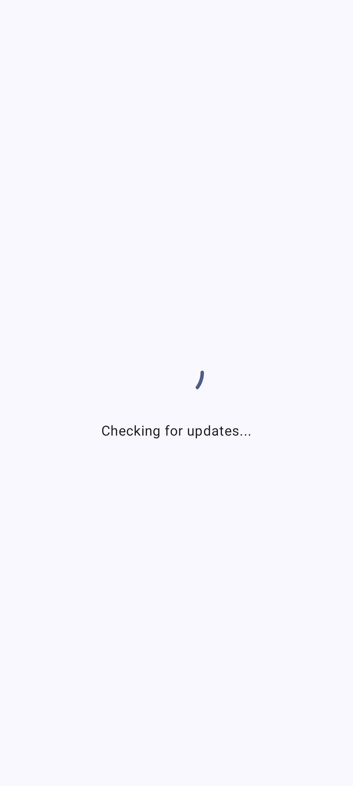
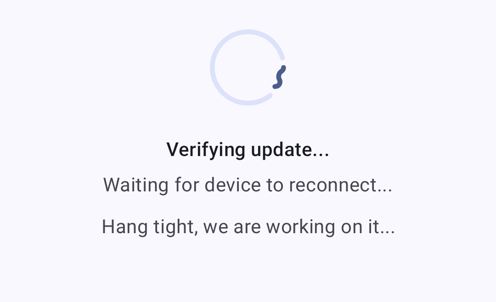
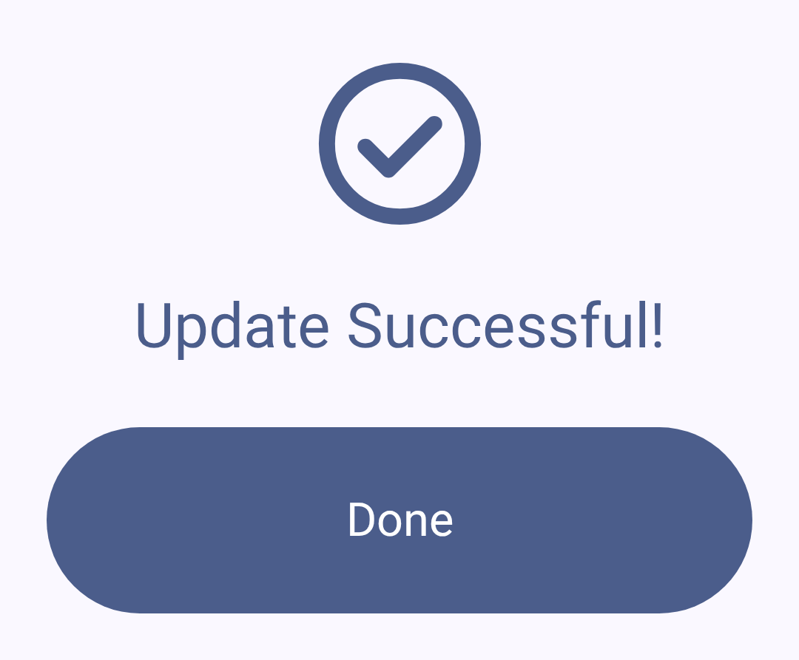
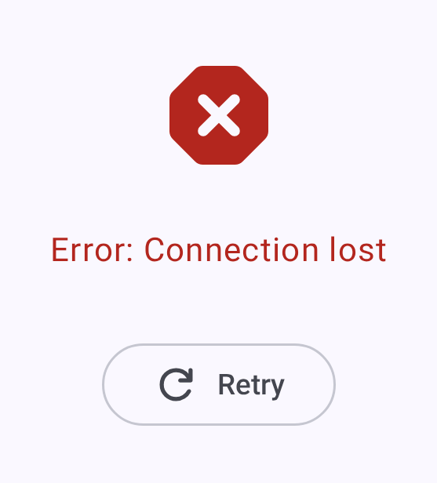

# ファームウェア更新

Keep your Meshtastic node up to date with the latest firmware for new features, bug fixes, and security improvements.

## 更新を確認する

1. Open **Settings** for the connected node and, under **Advanced**, tap **Firmware Update**. The entry appears only for OTA-capable nodes.
2. アプリが、利用可能なファームウェアバージョンを確認します。
3. Available updates show the version number and release notes.

The app also tells you when the connected node is behind the latest stable release. The **Connect** tab shows a **Firmware update available** card naming the installed and the stable version, and a notification says the same once per node and release. Its button reads **Open Firmware Updates** when the app can update the node over the current connection, or **Open Meshtastic Flasher** when it can't.

## 更新方法

The Firmware Update screen picks the method from how the node is connected, and its update button names it: **Update via BLE OTA**, **Update via Wi-Fi OTA**, or **Update via USB File Transfer**.

| 接続        | nRF52      | ESP32     | RP2040     |
| --------- | ---------- | --------- | ---------- |
| Bluetooth | BLE OTA    | BLE OTA   | —          |
| ネットワーク    | —          | Wi-Fi OTA | —          |
| USB       | USB ファイル転送 | —         | USB ファイル転送 |

Where the table has no method, the screen says firmware updates are not supported over this connection. Connect another way, or use the [Web Flasher](https://flasher.meshtastic.org).

### Bluetooth 経由の OTA（無線更新）

Android ユーザーにとって最も一般的な更新方法です：

> ⚠️ **Warning:** Interrupting a firmware update can leave the node unable to boot. Keep the phone nearby and both devices powered until the update completes.

1. Ensure your node is connected via Bluetooth.
2. ファームウェア更新画面に移動します。
3. 希望するファームウェアバージョンを選択します。
4. Tap **Update via BLE OTA**. An **Update Warning** dialog lists the pre-flight checks — read it, then tap **I know what I'm doing.** to start. This dialog appears for every update method, including Wi-Fi OTA, USB, and a local firmware file.
5. Wait for the update to complete. Do not disconnect during the update.

While the update downloads, uploads or verifies, you can tap **Play Chirpy Hop** to play a short runner game: tap to jump, swipe down to crouch. The update's progress stays visible above the game, and back returns to the update screen. When the update finishes or fails, the game stops and offers **Back to update**. Your best score is kept on this device.

Some boards ship with a bootloader that cannot take a Bluetooth update. For these, the screen shows a warning card before you start, with a hint for the board where one exists. **Don't show again for this device** hides it for that node. When a stock nRF bootloader limits how fast the upload can run, the screen says so during the upload, and again on the success screen, with a link to the Meshtastic nRF52 Bootloader, which makes Bluetooth updates much faster.

#### Erase device during update

Where the app offers it, an **Erase device during update** switch appears above the update button. It is a per-update opt-in and is never remembered.

| Method          | What erasing does                                                                                                                      |
| --------------- | -------------------------------------------------------------------------------------------------------------------------------------- |
| BLE / Wi-Fi OTA | Factory-resets the device once the update is verified. All settings and Bluetooth pairing are removed. |
| USB             | Wipes the device's flash completely, then installs the selected firmware from scratch.                                 |

It is not offered for a local firmware file, during a recovery update, or over USB in the desktop app — the USB erase runs the Android-only maintenance sequence below. Over USB it is offered for nRF52 and RP2040 nodes only, and when the app can't erase one safely, the switch is shown disabled with the reason. Afterwards the device needs setting up — and pairing — again.

### OTA via Wi-Fi (network-connected ESP32)

When an ESP32 node is connected over the network rather than Bluetooth, the app offers **Wi-Fi OTA**, which pushes the same update over TCP:

1. Connect to the node over the network (see [Connections](connections)).
2. Open the Firmware Update screen and pick a version.
3. Tap **Update via Wi-Fi OTA**. Keep the node and phone on the same network for the whole transfer.

Wi-Fi OTA installs the ESP32 app image, a `.bin` file, rather than the `.uf2` a USB update uses. The app selects the right file from the release for you.

### アプリ内での USB 更新

When your nRF52 or RP2040 node is connected over **USB/serial** (rather than Bluetooth), the Firmware Update screen offers **USB File Transfer**. アプリはデバイスを DFU モードで再起動し、システムのファイル選択画面を使って `.uf2` ファイルをデバイスの DFU ドライブに保存するよう促します。 This option appears only on a USB/serial connection. It is not available over Bluetooth, and ESP32 nodes have no USB update path in the app.

A vendor nRF bootloader supplied as a `.zip` (e.g. RAK WisBlock RAK4631) has to be flashed with a serial DFU tool such as `adafruit-nrfutil` — copying that `.zip` to the drive won't work. A bootloader supplied as an `update-....uf2` **can** be installed by copying it to the drive; that is how the app's own bootloader upgrade works. The app surfaces a hint when the serial-only route applies.

### Factory Erase and Bootloader Upgrade

On a **USB/serial** connection, nRF52 and RP2040 devices can be wiped as part of an update — that is the **Erase device during update** opt-in described earlier on this page. nRF52 devices additionally offer **Upgrade bootloader** where an upgraded bootloader is published for the board; RP2040 devices run no Adafruit bootloader, so they never see it. The upgrade installs the [Meshtastic nRF52 Bootloader](https://github.com/meshtastic/nRF52_Bootloader) release named on the card.

Both are Android-only. They depend on Android's update-drive checks, so the desktop app does not show them — use the [Web Flasher](https://flasher.meshtastic.org) there instead.

Select a firmware version before either one: the app hides both until a release is chosen, because the firmware is reinstalled after the device is wiped or the new bootloader is written.

Both a USB erase and a bootloader upgrade write two files in turn, so you are asked to select the device's update drive twice: once for the erase or bootloader image, then again for the firmware.

The app reads `INFO_UF2.TXT` from the drive you select to confirm it really is the device's update drive and to identify the board before writing anything.

For a bootloader upgrade, the app also reads the installed bootloader version from `INFO_UF2.TXT` and shows it next to the latest release before writing anything. The running firmware doesn't report its bootloader, so the installed version appears only once the device has restarted into update mode, never on the firmware screen while connected. If the two match, the bootloader is left as it is and the app moves straight on to reinstalling the firmware. Otherwise choose **Upgrade bootloader** to write it, or **Skip** to reinstall the firmware without changing it.

On nRF52 the app must already know which Bluetooth stack your device uses before it starts, because it can't read the bootloader until the device has rebooted. If it can't confirm the stack, it refuses to erase and points you at the [Web Flasher](https://flasher.meshtastic.org) instead. In the Web Flasher, choosing the wrong Bluetooth stack can leave the node recoverable only with a hardware programmer.

Once the drive is readable, how an nRF52 device is erased depends on its bootloader:

- **Newer bootloaders erase themselves.** A bootloader that advertises factory-erase support in `INFO_UF2.TXT` (OTAFIX 2.4 and later) takes a single, board-agnostic erase file. The bootloader wipes your settings, channels, keys and the stored node list itself, leaves the installed firmware in place, and comes back as an update drive a second or two later for the firmware file. There is no Bluetooth-stack choice to get wrong on this path.
- **Older bootloaders need a Bluetooth-stack-specific erase.** On these the app writes a small erase program matched to your device's Bluetooth stack, then starts it over the serial port. If the drive reports a different stack than expected, the app refuses rather than guessing.

The app picks the path from what the drive reports; you don't choose it.

### What the nRF52 bootloader does

Version 2.6.0 and later of the Meshtastic nRF52 Bootloader does the following while the update drive is up.

- **Backup.** `CURRENT.UF2` on the drive is a copy of the installed firmware. Copy it off to back up, or back onto the drive to reinstall.
- **Screen.** On a node with a screen, the title reads BOOTLOADER, ERASE, WRONG FILE or NO FIRMWARE, and a progress bar shows the copy.
- **Wrong file.** A firmware file the board cannot take is refused as WRONG FILE.
- **Interrupted copy.** If the cable is pulled mid-copy, the node has no firmware. Plug it in again and copy the firmware once more.
- **Idle.** After 6 minutes with no update activity, a node with firmware boots it. A node with no firmware keeps waiting.
- **Single-button boards.** The T1000-E and the MeshTracker X1 have no reset button. Hold the button for about 3 seconds while the node powers on to enter update mode. Eject the drive from the computer to leave without copying a file. The app's USB update needs no button.

### その他の書き込み方法

復旧時、または OTA とアプリ内 USB のどちらも使えない場合：

- [Meshtastic Web Flasher](https://flasher.meshtastic.org) を使用する
- または、デスクトップで [Meshtastic CLI ツール](https://meshtastic.org/docs/getting-started/flashing-firmware) を使用する

## バージョンチャンネル

| チャンネル    | 説明                                                                                                                                                                                                |
| -------- | ------------------------------------------------------------------------------------------------------------------------------------------------------------------------------------------------- |
| 安定版      | ほとんどのユーザーに推奨。テスト済みのリリース                                                                                                                                                                           |
| アルファ版    | プレビューリリース。バグを含む場合があります                                                                                                                                                                            |
| ローカルファイル | Flash a firmware file you select yourself, instead of a downloaded release. The button reads **Select Local File**, and the app asks you to confirm the file name before flashing |

## 更新前のチェックリスト

更新する前に：

- [ ] Battery above 50%, recommended. The app itself refuses to start an update only when the node reports 10% or less
- [ ] A stable connection over the method you're updating with: Bluetooth, Wi-Fi, or USB
- [ ] 現在の設定を控えておく（メジャーバージョンの変更時にリセットされることがあります）
- [ ] 破壊的変更がないか、リリースノートを確認する
- [ ] Update the Meshtastic app itself, before or alongside firmware updates, to ensure compatibility

## 更新後

ファームウェアの書き込み後、アプリは更新を検証し、デバイスが再びオンラインになるのを待ちます：

更新が成功すると：

- The node reboots automatically
- The Bluetooth connection re-establishes
- 設定が保持されているか確認します
- ファームウェア更新画面の「**現在インストール済み**」で新しいバージョンを確認します。バージョンは、ノードの詳細ページや接続画面にも表示されます

## トラブルシューティング

### 更新が止まる

更新が固まったように見える場合：

- Give it a minute. After writing the image the app waits up to **60 seconds** for the node to come back and report its new version, so a pause at the verify step is expected.
- If it is still stuck after that, power-cycle the node.
- Attempt the update again.

The message **Verification timed out. Device did not reconnect in time.** means the image was written but the node did not come back within that window. Power-cycle it and check the version under **Currently Installed** before re-running the update.

### Radio Won't Boot After Update

A Bluetooth update that stops partway can leave the node waiting in bootloader mode. While the app is disconnected, the **Connect** tab then shows a **Finish updating** card naming the node. Tap **Resume firmware update** and keep the node nearby so the app can re-flash it, or dismiss the card if the update can't be finished from the phone.

If the app told you the Bluetooth update could not be finished, follow the instruction it gave: connect the node to a computer over USB and re-flash it with the vendor's serial DFU tool, such as `adafruit-nrfutil`. A stock nRF bootloader cannot reliably complete an interrupted over-the-air update.

On the Meshtastic nRF52 Bootloader 2.6.0 and later, a dropped Bluetooth update can start over, and where the node waits depends on its power:

- On battery, it waits for the Bluetooth update, so **Resume firmware update** can reach it.
- Plugged into a computer, it shows NO FIRMWARE and comes up as its update drive, not over Bluetooth. Copy your board's firmware `.uf2` onto the drive, or use the [Web Flasher](https://flasher.meshtastic.org). Unplug it to resume over Bluetooth. The app's USB update cannot start here.

Otherwise, if your node fails to boot:

1. USB でコンピューターに接続してみる
2. リカバリー／DFU モードで Web Flasher を使用する
3. 動作確認済みのファームウェアバージョンを書き込む
4. デバイス固有の復旧手順については、Meshtastic の Discord を確認する

### 互換性の警告

On connecting, the app compares the node's firmware against two thresholds and reacts differently to each:

| ファームウェアバージョン                                                                                                    | What you see                                  | What happens                                                                                                                                                                                                                                                                                         |
| --------------------------------------------------------------------------------------------------------------- | --------------------------------------------- | ---------------------------------------------------------------------------------------------------------------------------------------------------------------------------------------------------------------------------------------------------------------------------------------------------- |
| Below **2.3.15**                                                                | **Firmware update required.** | The app disconnects from the node. It does not operate against firmware this old.                                                                                                                                                                                    |
| **2.3.15** up to, but not including, **2.5.14** | **Firmware update required**                  | The node stays connected, but the dialog blocks the rest of the app until the firmware is updated. It names the installed, minimum, and latest stable versions. **Update firmware** opens the Firmware Update screen; **Disconnect** drops the node. |
| **2.5.14** or newer                                                             | Nothing                                       | —                                                                                                                                                                                                                                                                                                    |

A version string the app cannot parse is ignored rather than treated as too old, so a transient read never disconnects a working node.

## 関連トピック

- [コネクション](connections)：ファームウェア更新後の再接続
- [ファームウェア書き込みガイド](https://meshtastic.org/docs/getting-started/flashing-firmware)：meshtastic.org にあるファームウェア書き込みの完全な手順
- [対応デバイス](https://meshtastic.org/docs/hardware/devices)：デバイスごとのファームウェア互換性を確認
- [FAQ](https://meshtastic.org/docs/faq/)：meshtastic.org のよくある質問
