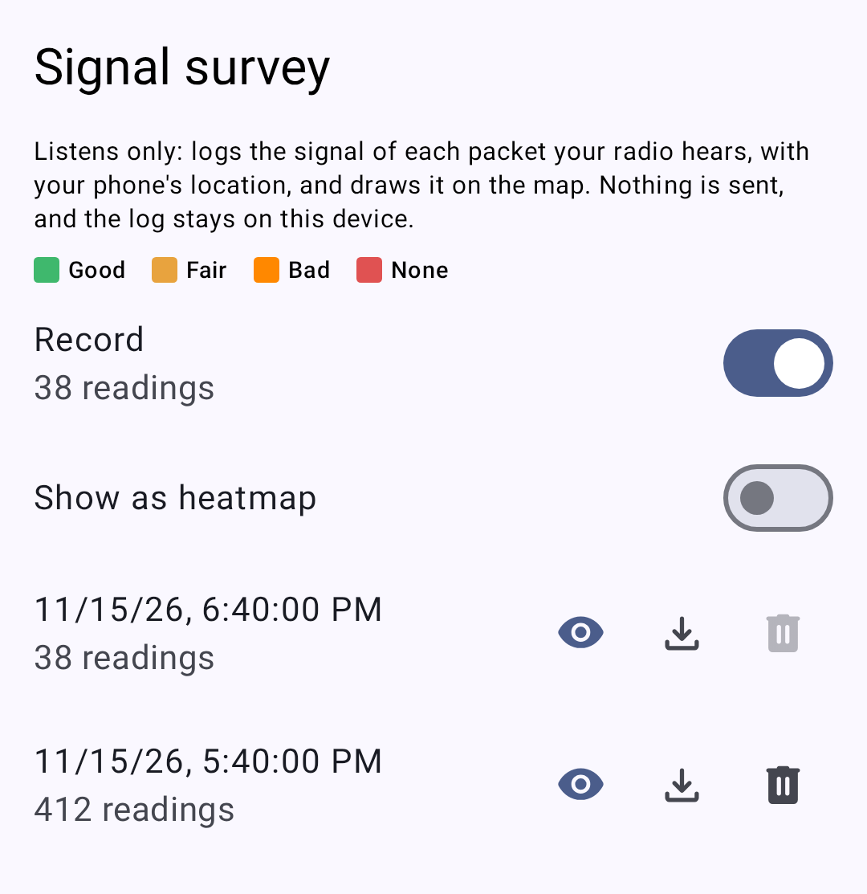

# マップとウェイポイント

マップ画面には、メッシュ上のノードの地理的な位置が、共有されたウェイポイントとともに表示されます。

## マップビュー

マップには次のものが表示されます：

- **ノードの位置：** 位置を報告している各ノードの色付きマーカー
- **ウェイポイント：** 共有された注目地点
- **自分の位置：** 現在の GPS 位置

### ノードのマーカー

位置を報告している各ノードは、そのノードの短縮名を表示する**ノードチップ**マーカーとして表示されます。チップは、そのノード固有のアイデンティティカラー（ノード番号から導かれる一定の色）で色付けされます。ノードリストで使われるのと同じチップなので、どこでも同じ見た目になります。マーカーの色は、オンライン／オフラインの状態を**表しません**。ノードの位置がライブで更新されると、そのマーカーが短く脈打つように点滅します。 Tapping a chip opens that node's details.

Nodes within 5 m of each other, which is common when they share a reduced position precision or sit at one site, are drawn as one chip with a count on its corner, showing a favorite or your own node when one is there. Tapping it lists every node at that spot, favorites first. 縮小すると、近くのマーカーはまとめて表示（クラスタリング）されます。 Tapping a cluster zooms in to fit its nodes, and a cluster whose nodes all share one spot lists them instead. With **Show Precision Circles** on, each spot's circle stays visible inside a cluster too.

### マップの操作

- **ズーム：** ピンチ操作、または +/− ボタンを使います
- **移動：** ドラッグして見て回ります
- **Center** — tap the location button to follow your position
- **ノードのタップ：** ノードのマーカーをタップすると詳細を表示します

The floating toolbar provides quick access to the compass, the map type and layers pickers, node filters, Site Planner, and location tracking. Tap the compass to reorient north-up, or tap the location button to follow your current position. While the map follows you, the compass instead turns heading lock on and off, so the map rotates with the phone. On **Google Play** builds a refresh button joins them while a network layer is showing; on **F-Droid** and **Desktop**, refresh a network layer from its own row in the layers sheet instead.


### Filtering the Map

Tap the filter button in the floating toolbar to open **Filter map**. **Display** controls what is drawn: **Only Favorites**, **Show Waypoints**, **Show Precision Circles**, and a slider that hides nodes not heard from recently. **Node roles** is a chip per device role, plus **All** to show every role; a selected chip means that role is shown. **Nodes** narrows the set further with **Hide offline nodes**, **Only show direct nodes**, **Signed only**, **Encrypted only**, **Exclude MQTT**, **Show ignored nodes**, and **Include unknown** — the same rules as the node list's [filter toggles](nodes).

A dot on the filter button means at least one filter is hiding nodes — check it before concluding the mesh is quiet. Turning **Show Waypoints** off hides every waypoint, including your own. **Show ignored nodes** adds them to the map rather than showing only them — unlike the node list's **Only show ignored Nodes**.

## AR mesh view

The mesh view draws nodes and waypoints over the phone's camera, each in the direction and at the height where it stands, with its distance and the age of its position. It needs a back camera and an orientation sensor, so it appears only on Android phones that have both, on Google Play and F-Droid builds alike. It isn't available on Desktop. On opening, it asks for camera access and then location.

Tap the mesh view button (**Open mesh view**) in the map's top bar to see the whole mesh, filtered by the same **Filter map** settings as the map. The node list's touch & hold menu, a node's detail page, its compass sheet, its position log, and a traceroute map open the view too. Opened from a node, it shows only that node, plus the track or route you came from.

- **Tap** a node to open its detail page, or a waypoint to open its info.
- **Touch & hold** a node or waypoint to find it. The view says how far to turn and tilt, the phone ticks as you turn closer, and it pulses once you are on target.
- A node whose position uncertainty covers your own spot has no meaningful direction, so it goes on the radar at the bottom instead. Point the phone down to enlarge the radar.
- Waypoint geofences are outlined, and the view says when you are inside one.
- [Signal survey](#signal-survey) sessions shown on the map are painted on the ground around you, in the same colors, out to about 300 m. While a survey records, the view says so with its reading count, so you can walk a route and watch coverage fill in.

When your phone's position has no altitude, targets sit level with you and the view says elevation is approximate. Without camera access, or while the phone is too hot, the view carries on as a compass.

## 3D map on Android XR

On an Android XR headset, the Google Play build adds a **Full Space** button. Full Space is the headset mode in which the app shares the room with 3D content. There the app stays as its own panel and gains **Home Space** and **3D map** buttons. F-Droid builds run on a headset as the flat app only.

**3D map** stands a terrain table beside the app, built from the positions your nodes have shared and anchored on your connected node. The table shows:

- the terrain in relief, with any of the 2D map's raster base maps draped over it, satellite first, or in elevation colors when you pick **Elevation**
- elevation contours when you turn on **Contours**, in meters or feet by your [units setting](units-and-locale)
- buildings, where a downloaded offline region reaches zoom 13 or closer
- nodes as chips like the 2D map's, with routers and other infrastructure nodes standing as towers
- comets that fly along the links from each node your node hears, colored by signal quality, and along both directions of the last traceroute that had a route

The table's control panel holds the base map and **Elevation** chips, **Contours**, **Buildings** and a **Zoom** slider, plus the credits for what is on the table. **Buildings** appears only when a downloaded region has them. The terrain downloads as the table builds, so it needs a network connection; if that fails the app says the terrain could not be loaded. With no positioned nodes there is no area to show. Where no terrain data exists, the ground is drawn flat.

## ウェイポイント

Waypoints are shared points of interest, visible to everyone on your mesh.

### ウェイポイントを作成する

Your node must be connected — the map ignores a touch & hold while it is not, because saving a waypoint means broadcasting it.

1. Touch & hold the map at the desired location.
2. 名前と、任意で説明を入力します。
3. ウェイポイントのアイコン／絵文字を選びます。
4. 「**送信**」をタップしてメッシュに共有します。

Waypoints always broadcast to the whole mesh on the primary channel. Unlike a message, a waypoint cannot be addressed to one channel or sent as a direct message.

### ウェイポイントのプロパティ

| プロパティ  | 説明                                                                             |
| ------ | ------------------------------------------------------------------------------ |
| 名前     | 短い識別子（最大 29 文字）                                                                |
| 説明     | 任意の、より詳しい説明                                                                    |
| アイコン   | マップ上の視覚的なマーカー絵文字                                                               |
| ロック済み  | ロックすると、作成者だけが編集・削除できます                                                         |
| 有効期限   | 任意の、自動削除する日時                                                                   |
| ジオフェンス | Optional enter/exit alert area — see [Waypoint Geofences](#waypoint-geofences) |

### ウェイポイントの有効期限

A waypoint stays until it is deleted unless you turn on **Expires** in the waypoint editor. The switch starts the expiry eight hours out; change it with the **Date** and **Time** pickers. Once that time passes, the waypoint is removed, which suits temporary markers such as rally points, hazards, or meeting locations.

期限切れのウェイポイントは、表示が煩雑にならないよう、自動的にマップから隠されます。有効期限のカウントダウンは、指定した絶対時刻を基準とし、ウェイポイントが作成または受信されてからの経過時間ではありません。

### ウェイポイントのジオフェンス

どのウェイポイントにも**ジオフェンス**（通知エリア）を設定できます。これにより、ノードがそのエリアに進入または退出したときに、あなたや他のメンバーに通知が届きます：

1. プリセットのチップから**ジオフェンスの半径**を設定する（無効にするには**オフ**）か、「**マップ上でエリアを設定**」をタップして、任意の四角形のエリアを描画します。
2. エリアを設定したら、「**進入時に通知**」や「**退出時に通知**」を切り替えます。
3. 任意で「**お気に入りのみ**」を有効にすると、通知をお気に入りのノードに限定できます。

ウェイポイント（およびそのジオフェンス）はメッシュ全体にブロードキャストされるため、デフォルトでは**作成者**だけに通知されます。 If someone else shares a geofenced waypoint with you, its detail view offers a **Notify me of crossings** opt-in so you can also receive enter/exit alerts for it.

### ウェイポイントを管理する

- Tap a waypoint to see its name, description, and geofence radius. On **Google Play** builds the first tap opens the marker's info bubble — tap the bubble to open the waypoint itself
- **Locked waypoints** can only be changed on the mesh by the node that locked them
- Unlocked waypoints can be edited by any mesh member while connected to a node — saving re-broadcasts the waypoint
- Confirming a delete removes your own copy. To remove it from everyone else's map too, select **Delete for everyone** in the delete dialog; that box appears only for a waypoint you may change (unlocked, or locked by you) and only while you are connected

## マップレイヤー

Tap the layers icon on the map to open **Manage Map Layers**. It imports your own overlays in `.kml`, `.kmz`, or GeoJSON format, including KMZ ground overlays (georeferenced images, such as exported topo or aerial tiles), which drape at their stated bounds. Add one by picking a file with **Add Layer**, opening a file with Meshtastic, or sharing it into the app from another app. A file opened or shared this way is refused if it is over 50 MB (10 MB for GeoJSON). **Add Network Layer** instead takes a name and an `https://` URL pointing at a KML or GeoJSON file (`http://` also works on Desktop, but on Android only for `localhost`); that layer then carries its own refresh button in the sheet. The sheet scrolls as one page, so the layer list stays reachable under a long list of downloaded regions. On **Google Play** builds the toolbar's refresh button re-fetches every visible network layer at once.

A layer's size is capped to protect memory: a GeoJSON layer over 10 MB and a KML or KMZ over 50 MB are refused at import and not drawn, and a `.json` file that isn't GeoJSON is refused. On **Google Play** builds, a layer with more detail than the map has room to draw is left undrawn, and a message names the layer.

インポートしたレイヤーは、それぞれ表示／非表示を切り替えるトグルと、削除するオプションとともに一覧表示されます。 Each layer — imported or built-in overlay — carries its own opacity slider while it is switched on, so an overlay can be faded back rather than only switched off. This works on the Google Play build, the F-Droid build, and **Desktop**, which shares the same layer store and file picker.

### サイトプランナー

**サイトプランナー**は、送信機の RF カバレッジを推定し、色分けされたオーバーレイとしてマップに描画します。 Open it from the Site Planner button in the map toolbar, or from a node's detail page with **Estimate coverage** (shown only for nodes with a known position). The form has four sections:

- **Site / Transmitter**: name, latitude and longitude, **TX power (W)**, **Frequency (MHz)**, **Antenna height (m)**, and **Antenna gain (dBi)**. Chips such as **Use current node location** and **Use map center** fill in the coordinates.
- **Receiver**: **Receiver sensitivity (dBm)** and **Receiver height (m)**.
- **Simulation Options**: **Max range (km)**, from 1 to 150.
- **Display**: **Color palette**.

Tap **Estimate coverage** to run it. The app computes the estimate itself, using the ITU-R P.1812 propagation model over Mapterhorn terrain, on Google Play, F-Droid, and Desktop alike. The terrain downloads the first time an area is estimated, so that step needs a network connection; if it fails, the form comes back with a note to check your connection. The finished estimate is added under **Manage Map Layers** as a coverage estimate layer, and the map moves to it.

### Signal Survey

Site Planner predicts coverage; **Signal survey** measures it. Turn on **Record** at the bottom of the layers sheet, then walk or drive with your radio. Each packet the radio hears over LoRa is logged with its signal strength (RSSI and SNR) and your phone's location at that moment. The survey only listens: it sends nothing onto the mesh.



Each time you turn **Record** on starts a new session, and turning it off ends it. The session draws on the map as it records: colored squares along your route, each standing for the clearest reading taken inside it. Squares are about 50 m across at street level and grow as you zoom out, so a survey stays visible at city scale.

- **Colors** rate the square's best SNR against the modem preset the session was recorded on, the same rating the signal meter uses: green is good, yellow fair, orange bad, and red too weak to rely on. See [How the Signal Meter Works](signal-meter).
- **Tap a square** for its SNR and RSSI, how many readings it holds, how many nodes were heard there, and when the last one arrived. Lines run from the square to each node heard there directly, in the color of that node's signal, so you can see which node covers which street. A line ends where the node reports its position, at the precision it shares; a node that shares no position gets no line.
- **Show as heatmap** swaps the squares for a smooth glow in the same colors. Each color glows where the route passed through squares of that rating, so a spot you stood at for a while glows no brighter than one you drove past. Squares cannot be tapped while the heatmap shows.
- **In the [AR mesh view](#ar-mesh-view)** the visible sessions are painted on the ground around you.
- **Sessions** are listed under the switch, newest first. The eye shows or hides a session on the map, the download button exports its readings as CSV to a file you choose, and the trash deletes it.

Recording is off until you turn it on, and stays on until you turn it off or the app shuts down, so it keeps using location while the app runs in the background. Readings are kept per radio. They stay on your device unless you export them, and they are included in a database backup. A reading is placed where the radio is: by the radio's own GPS while its last fix is under 15 seconds old, otherwise by your phone's fix if that is under 15 seconds old and accurate to 50 m, or reports no accuracy at all. A radio with a fixed position, or a GPS reporting it is standing still, is placed at that position. For a radio connected over the network the phone's location is used only while the radio reports no position of its own, since the radio may be somewhere else. With neither, nothing is logged; the line under **Record** says what is missing, with a button to grant access or open location settings. Recording is also paused while no radio is connected and for the first 15 seconds after connecting. Signal survey is on Android only.

## 位置の共有

### 位置の共有を有効にする

ノードは、次のいずれかに基づいて GPS 位置を共有します：

- **Broadcast Interval** — share the position on a fixed timer
- **Smart Position** — share only once you have moved far enough; **Minimum Interval** sets the shortest gap between broadcasts and **Minimum Distance** how far you must move
- **Fixed Position** — publish a latitude, longitude, and altitude you enter by hand instead of the GPS reading
- **GPS Mode** — **Enabled**, **Disabled**, or **Not Present** on this hardware; offered only while **Fixed Position** is off

Configure position behavior in **Settings → Device configuration → Position**, and saving it reboots the node. Without a connection the screen opens read-only, with a prompt to connect before changing anything. For the full field list, see [Settings — Radio & User](settings-radio-user).

### プライバシーに関する注意

> 🔒 **プライバシー：** 位置データは、チャンネル上のすべてのノードにブロードキャストされます。 If you don't want your location shared, set **GPS Mode** to **Disabled**, or use a **Fixed Position** somewhere else. To keep sharing a position without pinpointing yourself, edit the channel in **Settings → Channels**, turn **Precise location** off, and set the slider beneath it — the channel then publishes an approximate area, shown as ± a distance, instead of an exact point. A channel that is not securely encrypted (a one-byte key, the default key, or no key on the primary channel or on a secondary whose primary is one of these) cannot carry precise location: the switch is disabled with "Not available on a channel that is not securely encrypted", and the slider stops at 15 bits.

## マップソース

Every build offers a base map picker from the map toolbar. **Google Play** builds open on Google's own
map types; **F-Droid** and **Desktop** builds open on MapLibre's vector styles. Further down the base map
picker, all three offer the same raster base maps:

| Base map                              | 備考                                                                                                    |
| ------------------------------------- | ----------------------------------------------------------------------------------------------------- |
| Normal / Satellite / Terrain / Hybrid | Google Play only — Google's own map types                                                             |
| Liberty                               | Default on F-Droid and Desktop. Vector street map                                     |
| Positron                              | F-Droid and Desktop only. Low-contrast vector map; keeps node markers legible over it |
| ダーク                                   | F-Droid and Desktop only. Vector map suited to dark themes                            |
| OpenStreetMap                         | Classic raster street tiles                                                                           |
| OpenTopoMap                           | Raster topographic                                                                                    |
| USGS Topo / USGS Imagery              | US coverage only                                                                                      |
| Esri Topo / Esri Imagery              | Topographic and satellite imagery                                                                     |

Overlays can be toggled on top of any base map, from the layers sheet:

- **Weather radar** — NOAA NEXRAD reflectivity (US coverage)
- **Hillshade** — terrain relief from an online tile source, on **F-Droid** and **Desktop** only; Google
  Play draws hillshade from downloaded offline terrain instead. Useful for understanding why a link
  fails, since LoRa range is limited by terrain

### Adding your own tile source

Any XYZ tile endpoint can be added as a base map, on every flavor and on desktop. Open **Manage Custom
Tile Sources** at the foot of the base map picker and paste a URL template using `{z}`, `{x}` and `{y}`
— plus `{s}` if the provider uses rotating subdomains. A national mapping service, for example:

```text
https://wmts.geo.admin.ch/1.0.0/ch.swisstopo.pixelkarte-farbe/default/current/3857/{z}/{x}/{y}.jpeg
```

On **Android** the template must use `https://`; plain `http://` works only for `localhost`.

Tiles are cached on disk, so panning does not re-download what you were just looking at.

On **Android**, the same screen also imports a local `.mbtiles` archive for fully offline use.

On **F-Droid**, select a vector base map first — Liberty, Positron, or Dark — since a download is defined
against a vector style and **Start Download** stays disabled over a raster one. Frame the area you want on
screen, then tap **Start Download** in the layers sheet's **Cache Manager** section: that creates a paused pack
covering the current zoom plus two levels deeper. Press play on the pack's row to download it. While the offline
database opens, the section shows a progress bar. If it cannot be opened, the section reads **Offline maps are
unavailable on this device** and **Start Download** stays disabled. If the area cannot be saved, the section
reads **Couldn't save this area for offline use**.

On **Google Play**, the layers sheet's **Offline Manager** section downloads its own offline regions instead
— water, roads and administrative boundaries extracted from the public Protomaps basemap dataset, drawn
directly as map shapes rather than raster tiles. Frame the area you want, tap **Start Download**, and once
it finishes turn on **Show on map** to draw it. The switch is off by default, so a download never covers up the
live map unasked. With no network it also names the places and bodies of water in view. **Desktop** has no offline base map downloads, though the offline terrain described next
does work there.

### Offline terrain

Hillshade and elevation contours can be downloaded for offline use as well, so a downloaded area still
shows why a link fails when there is no network. The terrain data comes from Mapterhorn and is credited on
the map. On **Google Play**, each downloaded region in the **Offline Manager** list has a **Download Terrain**
button. Terrain attaches to that region and shares its storage limit, and an area too large for terrain asks
you to zoom in or pick a smaller region. Once the terrain is downloaded, the button gives way to **Hillshade**
and **Contours** switches, both off until you turn them on. Hillshade draws at full strength to one zoom level past
the deepest terrain downloaded for that spot, fades to half strength at two levels past and is gone at three; contours keep drawing.
On **Google Play**, turning on **Hillshade** also offers **Shade Valleys**, off by default, which darkens valleys and
gorges by how little sky they see, whichever way they face the light. On **F-Droid** and **Desktop**, the layers sheet
has an **Offline Terrain** section of its own: frame the area, tap **Start Download**, and the hillshade and
contours draw automatically from then on, whenever the downloaded area is in view.

### Going offline

A pill reading **Offline — showing cached map data** appears over the map whenever the device has no network connection. On **Google Play**
builds, if you've imported a local `.mbtiles` archive, the map switches to it automatically the moment the
network drops — no toggle to remember — and switches back once you're reconnected, as long as you haven't
picked a different base map yourself in between. On **F-Droid**, a downloaded offline area keeps rendering on
its own; the pill is purely informational there. **Desktop** downloads offline terrain but no base-map
packs, so the pill is informational there too.

## 関連トピック

- [ノード](nodes)：ノードリストの表示と絞り込み
- [ノードメトリクス](node-metrics)：各ノードの信号品質と位置履歴
- [Local Mesh Discovery](discovery) — traceroute and neighbor info for understanding mesh topology
- [単位とロケール](units-and-locale)：距離と座標の表示形式
