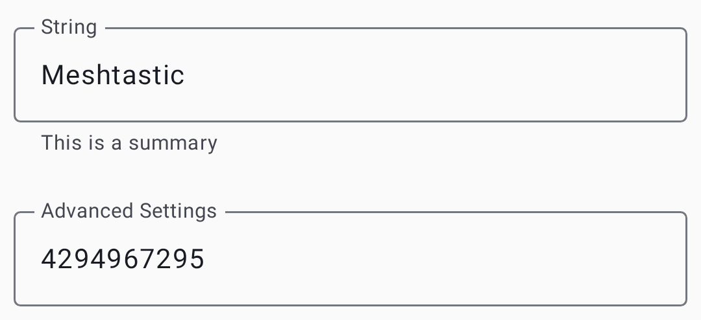

# 設定：モジュールと管理

オプションの機能モジュールを設定し、デバイスの管理を行います。モジュールは、専用の機能で Meshtastic を拡張します。それぞれ個別に有効・無効を切り替えられます。

Enable only the modules you use. 使わないモジュールを無効にすると、電波利用時間が減り、バッテリーを節約でき、設定もシンプルになります。 A module you expect can be missing for three reasons: your node's role doesn't enable it, your firmware is older than the release that added it, or the firmware build excludes it for this hardware.

モジュールの設定は、トグルスイッチ、ドロップダウン、テキストフィールド、スライダーを備えたカード形式のレイアウトを使用します：

## 追加機能の設定

Every module lives under **Settings → Module configuration**.

Saving a module screen restarts the node: the button reads **Save & restart**, and the node is unreachable for a few seconds afterwards. External Notification and Mesh Beacon are the exceptions: their button reads **Save**. External Notification may still restart the node for some changes, while a Mesh Beacon change applies without a restart.

### MQTT module

インターネット接続のために、メッシュのメッセージを MQTT サーバーとの間で橋渡しします。 This is how you extend your mesh beyond LoRa range or integrate with home automation systems.

| 設定項目                   | 説明                                                                                                                                                                                                                                                                               | デフォルト                 |
| ---------------------- | -------------------------------------------------------------------------------------------------------------------------------------------------------------------------------------------------------------------------------------------------------------------------------- | --------------------- |
| アドレス                   | MQTT サーバーのアドレス                                                                                                                                                                                                                                                                   | `mqtt.meshtastic.org` |
| 暗号化の有効化                | Publish packets still encrypted with the channel key                                                                                                                                                                                                                             | On                    |
| JSON出力の有効化             | Publish and consume MQTT messages as JSON. Shown only for a node on firmware older than 2.8, which removed JSON support, or while the setting is still on                                                                                        | オフ                    |
| マップ報告                  | Publish position to the public map — see the map reporting card that follows                                                                                                                                                                                                     | オフ                    |
| クライアントへのプロキシの有効化       | Let the connected app carry the node's MQTT traffic, instead of the node reaching the broker itself                                                                                                                                                                              | オフ                    |
| MQTTを有効化               | Turn the MQTT bridge on                                                                                                                                                                                                                                                          | オフ                    |
| MQTT proxy in this app | The app-side half of **MQTT Client Proxy**: whether this app acts as that relay. It shows whether the relay is running, and can be turned on only while **MQTT Enabled** and **MQTT Client Proxy** are both on. See [MQTT](mqtt) | —                     |
| パスワード                  | 認証用のパスワード                                                                                                                                                                                                                                                                        | The public broker's   |
| ルート トピック               | MQTT のベーストピックパス                                                                                                                                                                                                                                                                  | `msh`                 |
| TLS Enabled            | Use a secure connection                                                                                                                                                                                                                                                          | オフ                    |
| ユーザー名                  | 認証用のユーザー名                                                                                                                                                                                                                                                                        | The public broker's   |

Turning **Map Reporting** on reveals a consent card headed _Consent to Share Unencrypted Node Data
via MQTT_, with an **I agree.** switch under it. The rest of the card doesn't exist on screen
until you agree:

| 設定項目                 | 説明                                                                                                                                                                                       |
| -------------------- | ---------------------------------------------------------------------------------------------------------------------------------------------------------------------------------------- |
| 同意します。               | Explicit consent to transmit your node data, including an approximate position, unencrypted. Map reporting doesn't start without it                                      |
| Map Publish Interval | How often to report. A dropdown of fixed intervals from 1 hour to 72 hours — nothing shorter is offered                                                                  |
| Precision slider     | The slider has no label of its own. It sets how coarsely your position is published, from 12 to 15; the line beneath reads _±_ the resulting distance, in your own units |

暗号化、プライバシー、サーバーの設定を含む詳しい使い方は、[MQTT](mqtt) を参照してください。

### Serial module

外部デバイスとの連携（GPS モジュール、センサー、カスタムハードウェア）のために、シリアルポート通信を有効にします。有効にすると、ノードのシリアルポートで protobuf またはテキストデータを送受信でき、外部のマイコンやコンピューターがメッシュとやり取りできるようになります。

| 設定項目                                                                                             | 説明                                                                                                                                                                                                                                  | デフォルト |
| ------------------------------------------------------------------------------------------------ | ----------------------------------------------------------------------------------------------------------------------------------------------------------------------------------------------------------------------------------- | ----- |
| シリアルボーレイト                                                                                        | Port speed, from **110 Baud** to **921600 Baud**                                                                                                                                                                                    | デフォルト |
| Echoを有効化                                                                                         | Echo packets you send back over the serial port                                                                                                                                                                                     | オフ    |
| シリアルモード                                                                                          | Which protocol the port speaks: **Default**, **Simple**, **Protobufs**, **Text Message**, **NMEA Positions**, or **CalTopo**, plus `WS85`, `VE_DIRECT`, `MS_CONFIG`, `LOG` and `LOGTEXT` under their firmware names | デフォルト |
| コンソールのシリアルポートを上書き                                                                                | Take over the port the debug console normally uses                                                                                                                                                                                  | オフ    |
| Receive data (rxd) GPIO pin / Transmit data (txd) GPIO pin | GPIO pins for the serial connection                                                                                                                                                                                                 | 0     |
| シリアル通信を有効化                                                                                       | Turn serial communication on                                                                                                                                                                                                        | オフ    |
| タイムアウト                                                                                           | How long to wait before treating received data as a complete packet. 0 uses 250 ms                                                                                                                                  | 0     |

### External Notification module

Controls buzzer, LED, or vibration alerts on your node hardware. メッセージ到着時に物理的に知らせる必要があるデバイスに便利です。特に無人設置や屋外設置で役立ちます。

There are two independent triggers — an incoming **message**, and a received **bell** character —
and each can drive the LED, the buzzer and the vibration motor separately, giving six toggles. The
firmware turns the module on, and picks the outputs, on hardware that has a buzzer, vibration motor
or notification LED; elsewhere everything starts off.

| 設定項目                                                                                                                 | 説明                                                                                                                                     |
| -------------------------------------------------------------------------------------------------------------------- | -------------------------------------------------------------------------------------------------------------------------------------- |
| LED出力 アクティブハイ                                                                                                        | Whether the LED pin is active high or low. Shown once **Output pin GPIO** is set                                       |
| Alert when receiving a bell / Alert GPIO buzzer when receiving a bell / Alert GPIO vibra motor when receiving a bell | Which outputs fire on a received bell character                                                                                        |
| Alert when receiving a message / Alert GPIO buzzer when receiving a message / Vibra Motor Alert                      | Which outputs fire on an incoming message                                                                                              |
| 外部通知を有効化                                                                                                             | Master toggle for the module                                                                                                           |
| GPIO Output Duration                                                                                                 | How long a single alert lasts                                                                                                          |
| Nag Timeout                                                                                                          | Keep repeating the alert for this long until it is acknowledged. **Unset** disables nagging                            |
| LED出力 (GPIO)                                                                                      | Pin the LED is wired to                                                                                                                |
| ブザー出力(GPIO)                                                                                       | Pin the buzzer is wired to                                                                                                             |
| バイブレーション出力 (GPIO)                                                                                 | Pin the vibration motor is wired to                                                                                                    |
| 着信音                                                                                                                  | The tone played on a PWM buzzer, in RTTTL. Can be imported from a file                                                 |
| I2Sをブザーとして使用                                                                                                         | Send the alert through an I2S audio output instead                                                                                     |
| PWMブザーを使用                                                                                                            | Drive the buzzer with PWM, which allows tones rather than a single pitch. Shown once **Output pin buzzer GPIO** is set |

### Store & Forward module

一時的にオフラインだったノードのためにメッセージをバッファリングし、それらのノードが再接続したときに再送します。ノードが頻繁に圏内・圏外を行き来するメッシュに不可欠です。短時間の切断中にメッセージが失われないようにします。 A server needs an ESP32 with PSRAM or a Linux `meshtasticd` node. A node in the Router or Router Late role acts as a server even with the server setting off.

| 設定項目                                                   | 説明                                                                                 | デフォルト |
| ------------------------------------------------------ | ---------------------------------------------------------------------------------- | ----- |
| リクエスト可能な最大の履歴件数                                        | Most stored messages returned per request. 0 uses 25               | 0     |
| リクエスト可能な履歴の期間  (分)                  | How far back, in minutes, stored messages are returned. 0 uses 240 | 0     |
| サーバーの最大保管レコード数  (デフォルト 約11,000レコード) | Most messages to store. 0 uses three quarters of the free PSRAM    | 0     |
| ハートビート                                                 | Periodically announce that this node is a store-and-forward server                 | オフ    |
| サーバー                                                   | Act as a store-and-forward server for the mesh                                     | オフ    |
| ストアアンドフォワード有効                                          | Turn store and forward on                                                          | オフ    |

### Range Test module

ノード間のリンク品質を評価するための、自動レンジテストツールです。有効にすると、ノードはカウンターを増やしながらテストメッセージを定期的に送信します。受信側のノードがこれらのメッセージを記録するため、歩いたり車で移動したりして、後からどの距離でメッセージが届かなくなったかを分析できます。

Range Test only works on a secured primary channel. As long as your primary channel still uses the
default channel key, the interval and CSV controls stay disabled — you can still switch an
already-enabled module off — and saving force-disables the module if the channel has reverted to
public.

| 設定項目                                         | 説明                                                                                                                  | デフォルト |
| -------------------------------------------- | ------------------------------------------------------------------------------------------------------------------- | ----- |
| レンジテストを有効化                                   | Turn range testing on                                                                                               | オフ    |
| ストレージにCSVファイルを保存(ESP32のみ) | Log received test data as a CSV on the node's own filesystem. ESP32 nodes only                      | オフ    |
| Sender Interval                              | Time between test transmissions, chosen from a dropdown of fixed intervals. **Unset** stops sending | 未設定   |

### Telemetry module

ノードがメッシュと共有するテレメトリデータを制御します。テレメトリには、デバイスの状態（バッテリー、連続稼働時間）と環境センサーのデータ（温度、湿度、気圧）が含まれます。

Each of the four metric groups has its own enable toggle and its own interval, so you can report
battery health often and sensors rarely. The intervals run from 30 minutes to 72 hours.

| 設定項目             | 説明                                                                                                                                                                                          | デフォルト |
| ---------------- | ------------------------------------------------------------------------------------------------------------------------------------------------------------------------------------------- | ----- |
| 空気品質測定モジュールを有効化  | Report particulate and CO₂ sensor data                                                                                                                                                      | オフ    |
| 空気品質メトリクスの更新間隔   | How often to report them                                                                                                                                                                    | —     |
| デバイステレメトリを送信     | Send device metrics to the mesh. When it is off, they go only to connected clients. Only shown on firmware 2.7.13 and newer | オフ    |
| デバイスメトリクスの更新間隔   | How often to report battery, uptime and channel utilization                                                                                                                                 | —     |
| 環境メトリクスは華氏を使用    | Use °F on the device's display. This is the node's screen only — the app follows your phone's locale, see [Units & Locale](units-and-locale)            | オフ    |
| 環境メトリクスモジュールを有効化 | Report the attached environment sensors                                                                                                                                                     | オフ    |
| 環境メトリクスの更新間隔     | How often to report them                                                                                                                                                                    | —     |
| 電源メトリクスモジュール有効   | Report the per-channel voltage and current readings                                                                                                                                         | オフ    |
| 電源メトリクスの更新間隔     | How often to report them                                                                                                                                                                    | —     |
| 電源メトリクスを画面上で有効化  | Also show power readings on the device's display                                                                                                                                            | オフ    |
| 環境メトリクスを画面上で有効化  | Also show environment readings on the device's display                                                                                                                                      | オフ    |

対応センサーと設定の推奨事項については、[テレメトリとセンサー](telemetry-and-sensors) を参照してください。

### Canned Message module

Pre-configured messages accessible from the node's physical buttons (for nodes with rotary encoders, keypads, or similar input hardware). スマートフォンを接続していなくても送信できる、クイック送信メッセージのリストを定義します。フィールドでの使用に最適です。

| 設定項目                                                                         | 説明                                                                                                                                                 | デフォルト |
| ---------------------------------------------------------------------------- | -------------------------------------------------------------------------------------------------------------------------------------------------- | ----- |
| Clockwise Rotary Event / Counterclockwise Rotary Event / Encoder Press Event | Which key event each encoder action produces: **None**, **Up**, **Down**, **Left**, **Right**, **Select**, **Back**, or **Cancel** | なし    |
| メッセージ                                                                        | 改行で区切ったメッセージのリスト                                                                                                                                   | Empty |
| Pin A / Pin B / Press Pin                                                    | The three pins the rotary encoder is wired to                                                                                                      | 0     |
| ロータリーエンコーダー                                                                  | Use a rotary encoder as the input device                                                                                                           | オフ    |
| アラートメッセージ付きのベルを送信                                                            | Send a bell character alongside the message, so a receiving node's External Notification module can sound                                          | オフ    |
| Up/Down/Select Input                                                         | A separate, simpler input scheme using up/down/select buttons rather than an encoder                                                               | オフ    |

Some boards with built-in encoders or keys come with the input settings filled in. Two older
fields, **Canned message enabled** and **Allow input source**, appear only for a node on firmware
older than 2.7, or while they still hold a value.

### Audio module

メッシュ上での低帯域幅の音声通信のための、Codec2 音声サポートです。これは、Codec2 コーデックを使って音声を非常に小さなデータパケットにエンコードする、**実験的**な機能です。 It needs specific hardware, an I2S microphone and speaker, and the voice quality is low.

| 設定項目                | 説明                                                                                                                     | デフォルト |
| ------------------- | ---------------------------------------------------------------------------------------------------------------------- | ----- |
| CODEC2 サンプルレート      | Codec2 bitrate, from **450 bps** to **3200 bps**. Lower rates use less bandwidth and give poorer audio | デフォルト |
| CODEC 2 を有効化        | Turn the audio module on                                                                                               | オフ    |
| I2S Clock Pin       | GPIO pin for the I2S bit clock                                                                                         | 0     |
| I2S Data In Pin     | GPIO pin for I2S data in                                                                                               | 0     |
| I2S Data Out Pin    | GPIO pin for I2S data out                                                                                              | 0     |
| I2S Word Select Pin | GPIO pin for I2S word select                                                                                           | 0     |
| PTT端子               | GPIO pin for the push-to-talk button. 0 uses GPIO 39                                                   | 0     |

### Remote Hardware module

メッシュネットワーク経由での GPIO 制御です。リモートのノードが、別のノードの GPIO ピンを読み書きできるようにします。リレーの作動、スイッチの読み取り、離れた場所からの外部ハードウェア制御に便利です。

> ⚠️ **Warning:** Turning on **Allow undefined pin access** gives remote nodes access to all GPIO pins, which could interfere with the node's own hardware. Turn it on only on dedicated GPIO nodes.

| 設定項目            | 説明                                    | デフォルト |
| --------------- | ------------------------------------- | ----- |
| 未定義のピンへのアクセスを許可 | 任意の GPIO ピンへのアクセスを許可（セキュリティリスク）       | オフ    |
| 使用可能な端子         | このノードがリモートの読み書き用に公開する GPIO ピン（最大 4 個） | なし    |
| リモートハードウェアを有効化  | Turn remote GPIO access on            | オフ    |

### Neighbor Info module

直接受信した隣接ノードの情報をブロードキャストし、メッシュのトポロジーマッピングを可能にします。有効にした各ノードは、受信できる他のノードとその信号品質のリストを定期的に共有します。

| 設定項目        | 説明                                                                                                                           | デフォルト                                   |
| ----------- | ---------------------------------------------------------------------------------------------------------------------------- | --------------------------------------- |
| 近隣ノード情報を有効化 | Turn neighbor broadcasting on                                                                                                | オフ                                      |
| LoRaで送信     | Also broadcast neighbor info over LoRa, not just MQTT and the connected app. デフォルトの鍵と名前を使用しているチャンネルでは利用できません | オフ                                      |
| GPS ポーリング間隔 | How often to broadcast the neighbor list, in seconds. Minimum 4 hours                                        | 0 (firmware default) |

See [Local Mesh Discovery](discovery) for how to use neighbor data for mesh topology exploration.

### Ambient Lighting module

対応ハードウェア上の、オンボードの NeoPixel やその他のアドレサブル RGB LED を制御します。視覚的なステータス表示、通知ライト、装飾的な演出に使用できます。

Pick the color with the swatch's **Preset colors** row or the **Red**, **Green** and **Blue** sliders.
**Advanced** opens number fields for the same three values.

| 設定項目   | 説明                                        | デフォルト                        |
| ------ | ----------------------------------------- | ---------------------------- |
| 電流     | LED drive current, 0 to 31                | 10                           |
| LEDの状態 | LED のオン／オフを切り替え                           | オフ                           |
| 赤／緑／青  | Individual color channel values, 0 to 255 | Derived from the node number |

### Detection Sensor module

ノードを、動きやドアを検知するセンサーアラートシステムに変えます。 GPIO ピンが状態の変化（動きの検知、ドアの開放）を検出すると、ノードはメッシュ経由でアラートメッセージをブロードキャストします。

| 設定項目                                      | 説明                                                                                                                                                                | デフォルト                                                                                |
| ----------------------------------------- | ----------------------------------------------------------------------------------------------------------------------------------------------------------------- | ------------------------------------------------------------------------------------ |
| 検出センサーを有効化                                | Turn the detection sensor on. It also has to be on for nodes that receive its alerts or chart its log                                             | オフ                                                                                   |
| モニターのGPIOピン                               | GPIO pin connected to the sensor. 0 disables the module                                                                                           | 0                                                                                    |
| Minimum time between detection broadcasts | アラートのブロードキャスト間の最小時間                                                                                                                                               | 0, which the firmware treats as 1 hour (12 hours on Router roles) |
| 名前                                        | Custom name for this sensor, used in its messages                                                                                                                 | Empty                                                                                |
| アラートメッセージ付きのベルを送信                         | Include a bell character in alerts                                                                                                                                | オフ                                                                                   |
| State Broadcast Interval                  | How often to send the sensor's state whether or not anything was detected. **Unset** sends only on detection                                      | 未設定                                                                                  |
| Trigger Type                              | How the pin's state maps to a detection event: **High**, **Low**, **Rising Edge**, **Falling Edge**, **Either Edge High**, or **Either Edge Low** | 高                                                                                    |
| Use Internal Pull-up                      | ピンの内蔵プルアップ抵抗を有効にする                                                                                                                                                | オフ                                                                                   |

### Paxcounter module

People counter using Wi-Fi and BLE probe requests. スマートフォンやノートパソコンがネットワークを探すときに発するプローブ要求を受動的に受信して、近くのデバイスを数えます。 ESP32 デバイスでのみ利用できます。 Counts are approximate, since one person may carry several devices, so the module suits estimating foot traffic at trailheads or event venues.

| 設定                                      | 説明                                                                                                       | デフォルト                                   |
| --------------------------------------- | -------------------------------------------------------------------------------------------------------- | --------------------------------------- |
| BLE Threshold (dBm)  | The same cut-off for BLE advertisements                                                                  | 0, which the firmware treats as −80 dBm |
| Paxcounter を有効化                         | Turn people counting on. Wi-Fi and Bluetooth must both be off on the node for it to work | オフ                                      |
| GPS ポーリング間隔                             | カウントを報告する頻度                                                                                              | —                                       |
| WiFi Threshold (dBm) | Ignore Wi-Fi probes weaker than this, so distant devices aren't counted                                  | 0, which the firmware treats as −80 dBm |

### Status Message module

The status message has no module screen. It is edited with the rest of the node's identity, on
[Settings — Radio & User](settings-radio-user#user-profile).

### Mesh Beacon module

Broadcasts an invitation to your mesh, and receives invitations from others. The entry appears only
on nodes running firmware 2.8.0 or newer. See [Local Mesh Discovery](discovery) for the full
walkthrough.

### TAK module

ATAK および WinTAK と相互運用するための、Team Awareness Kit 連携です。 The entry is labeled
**TAK (ATAK)**. Two things have to be true before it appears in the module list: the node runs
firmware 2.8.0 or newer, and its **Device Role** on **Settings → Device configuration → Device** is
set to **TAK** or **TAK Tracker**. 詳しい設定と使い方は、[TAK 連携](tak) を参照してください。

## 管理

### リモート管理

Remote administration changes another node's settings over the mesh. The target node must list your node's public key as one of its **Admin Key** entries, set on its **Settings → Security** screen.

1. Tap the target node in the node list to open its detail screen.
2. In the **Administration** card, tap **Remote Administration**. The app first establishes a session with the node, showing _Establishing remote session…_, then opens its **Settings**.
3. 設定を変更します。
4. Tap **Save** or **Save & restart**. The changes are sent over the mesh.

### Device Actions

**Settings → Administration** holds one-shot actions, each behind a confirmation dialog:

| 操作                   | 内容                                                                                                                                                                                                                                                                                                                      |
| -------------------- | ----------------------------------------------------------------------------------------------------------------------------------------------------------------------------------------------------------------------------------------------------------------------------------------------------------------------- |
| 時刻を設定                | Sends your phone's clock to the node                                                                                                                                                                                                                                                                                    |
| 再起動                  | Restarts the node                                                                                                                                                                                                                                                                                                       |
| Reboot into DFU mode | Restarts an nRF52 node into its bootloader, where it stays off the mesh until new firmware is flashed or it is reset. On bootloader 2.6.0 and later it boots the installed firmware after 6 minutes with no update activity. Shown only for nRF52 nodes |
| シャットダウン              | Powers the node down                                                                                                                                                                                                                                                                                                    |
| 出荷時にリセット             | Returns every setting to its factory default                                                                                                                                                                                                                                                                            |
| NodeDBをリセット          | Clears the node database. This dialog carries a **Preserve Favorites?** switch                                                                                                                                                                                                                          |

> ⚠️ **Warning:** Factory reset erases all settings, channels, and keys, and cannot be undone. Before you reset, use **Export configuration** to save the node's settings and **Backup Keys** on the Security screen to save its keys, so you can put both back afterwards.

### バックアップと復元

**Settings → Backup & Restore** writes the connected node's whole configuration to a file with
**Export configuration**, and reads a saved file back in with **Import configuration**.
Traffic Management settings are exported but not applied on import. Export before a factory
reset, or to copy one node's setup onto another. The section is shown for your
own node only, not over remote admin.

The same section backs up the app's own data for a node: its messages and nodes as stored in the
app, not the node's settings.

- **Back up app data** saves that data to a file named after the node and the date.
- **Restore app data** replaces the app's messages and nodes for that node with a backup, after a
  confirmation. It accepts only an undamaged backup made by an app with the same database version.
  The restore takes effect after you restart the app and reconnect to that node.

Both disconnect the node first, after asking, and act on the data of the node that was connected.
With no node connected they act on the most recently connected node. They stay disabled, with
the line _Connect to a radio first. There is no app data to back up or restore yet._, until the
app has stored data for some node.

### 詳細設定

**Settings → Advanced** collects the tools that read or rewrite local state, and is likewise shown
for your own node only: **Firmware Update** on OTA-capable hardware, **Clean Node Database**,
**TAK Server**, **Local Mesh Discovery**, and the **Debug Panel**.

#### ノードデータベースの整理

Prunes nodes from your node database — from the app's copy _and_ from the node's own, so this is
not a display-only cleanup. The two filters combine rather than acting separately; the screen puts
it as _Selections are additive_.

- **Clean up nodes last seen older than N days** — always applied. The slider runs from 7 days to
  365 and starts at 30; with **Clean up only unknown nodes** turned on, its floor drops to 0.
- **Clean up only unknown nodes** — narrows the same purge to nodes that never sent their user
  info. The age limit still applies on top of it.

The screen lists the nodes queued for deletion as you move the filters. **Clean Now** carries the
purge out, after one more confirmation, and it can't be undone. Favorited nodes, ignored nodes,
and nodes with a public key heard in the last seven days are never removed, whatever the filters
say — that is why the queued list can be shorter than you expect.

#### デバッグ

診断出力の表示・絞り込み・エクスポートを行う「**パケット**」タブと「**アプリログ**」タブを開きます。詳しい手順は、[デバッグログ](debug-logs) を参照してください。

### App Settings

The **App** section of the **Settings** screen configures the app rather than the node, and
appears only when your own node is selected. It holds, in order:

- **Allow analytics and crash reporting.** — opt in or out of diagnostics. Google Play build only.
- **Provide phone location to mesh** — share this phone's position when the node has no GPS fix.
  It needs precise location: with approximate location allowed, turning it on asks for precise.
- **Compact encoding for Cyrillic** — how look-alike characters in names are handled.
- **Language**, **Theme**, and **Units**. **Units** is metric, imperial, or follow the system, and
  is the entry [Units & Locale](units-and-locale) sends you to.
- **Show full message timestamps**.
- **Device DB cache limit**, which sets how much history is kept.
- **Export rangetest packets**, **Export all packets** and **Export node database**.
- **Node Layout** — how much detail each row of the node list shows.
- **Wi-Fi Provisioning for mPWRD-OS** — see [Connections](connections).
- **Message Filter** — hides incoming messages that contain words you list. With no words
  configured it does nothing.
- **System AI** — appears only where app functions are available; see
  [App Functions](app-functions).

A **Permissions** section sits above **App**, so a user who skipped a permission during
onboarding can get back to it. **Information** sits below it, with **Show Introduction**,
**App Notifications**, **System Settings**, **About**, and the app version. **Help &
Documentation** closes the screen.

### 概要

**Settings → About** carries the app's own identity rather than the node's, in three sections:

- **What is Meshtastic?** — a short description of the project.
- **Apps** — opens with **Need Hardware?**, a rotating carousel of popular devices that links out
  to where to buy one. It also lists the GitHub repository, the running app version, and
  **Acknowledgements** (see the next section).
- **Project information** — links to the website, to this documentation, and to the GNU GPL v3
  license the app is released under.

The footer states the copyright and that the app is free software with no warranty, which you
may redistribute under the same license.

### 謝辞

Reached from **About**, this lists every open-source library the app ships, with its license,
generated at build time by AboutLibraries.

### Troubleshooting remote admin

- **"Could not reach node — try again or move closer."** The target may be out of range or offline, or it doesn't list your node's public key as an admin key. Check the **Admin Key** entries on the target node.
- **"Connect to a radio to administer remote nodes."** Your own node isn't connected. Reconnect it from the [Connections](connections) screen.
- **変更が適用されない**：一部の設定は、反映に再起動が必要です。保存後に「再起動」を実行してみてください。

## 関連トピック

- [Settings — Radio & User](settings-radio-user) — core node and user profile settings
- [モジュール設定リファレンス](https://meshtastic.org/docs/configuration/module)：meshtastic.org にある詳細なモジュールのドキュメント
- [FAQ](https://meshtastic.org/docs/faq/)：meshtastic.org のよくある質問
