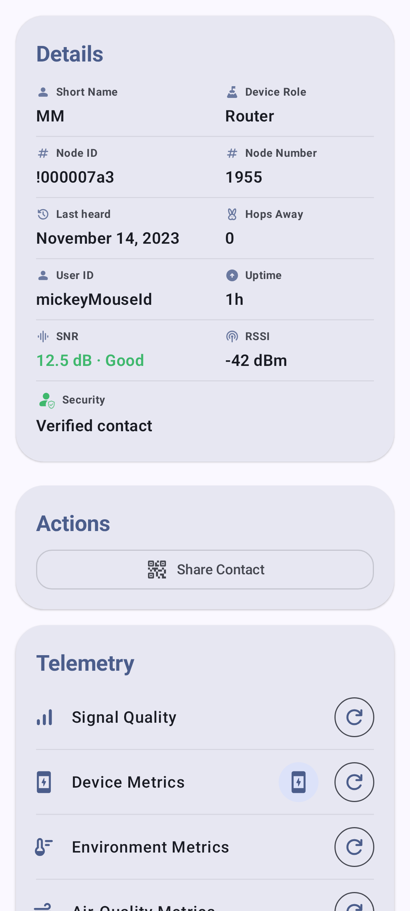
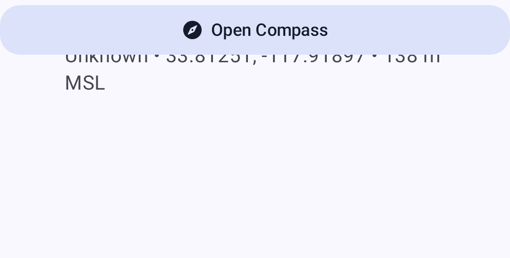
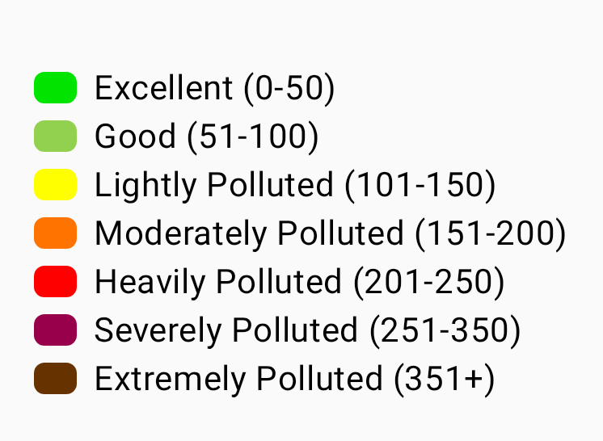
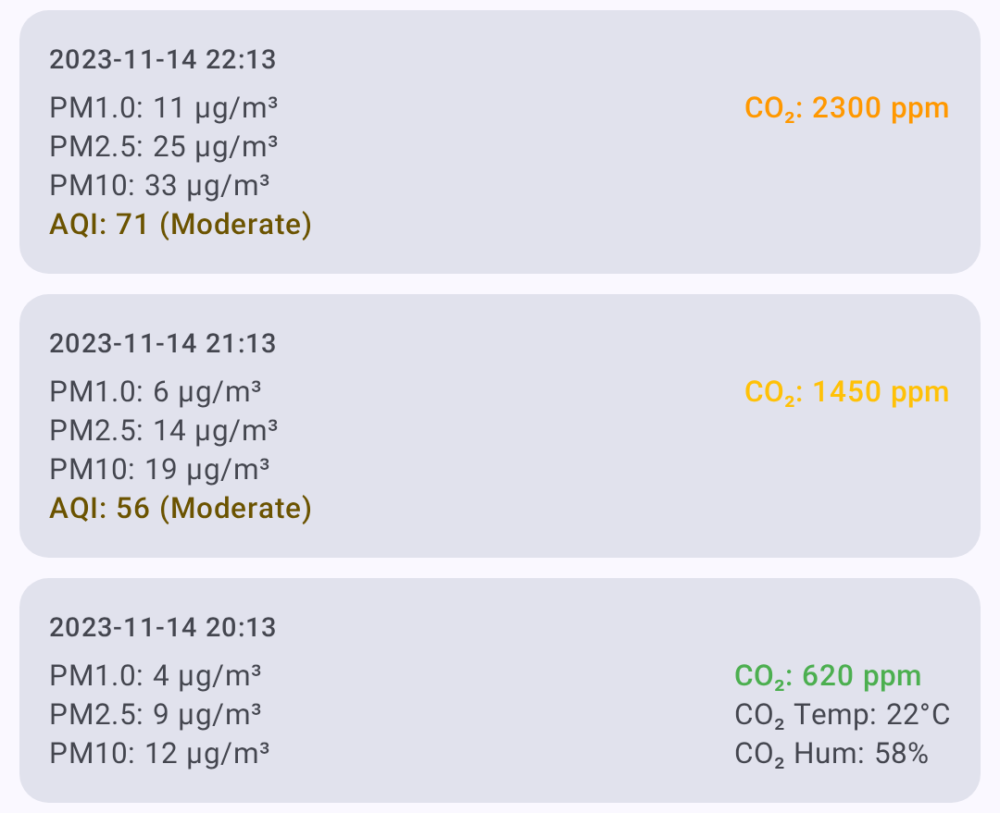

# Метрики ноды

Экран сведений о ноде предоставляет подробную телеметрию и метрики для каждой ноды твоей mesh-сети.

## Просмотр метрик

1. Перейдите в раздел **Ноды**.
2. Нажмите на ноду, которую хотите просмотреть.
3. Перейди в раздел "Телеметрия" и найди нужную категорию — "Качество сигнала", "Метрики устройства", "Метрики окружающей среды", "Метрики качества воздуха", "Метрики мощности", "Местоположение" и все остальное.
4. Нажми кнопку обновления в строке, чтобы получить от ноды свежие данные. Кнопка с графиком рядом с ним открывает историю по этой категории и появляется после того, как узел отправит данные такого рода.

Строка **Позиция** расширяется, чтобы отобразить данные о местоположении нод, использующих GPS.

> ℹ️ **Примечание.** Метрики доступны только после получения данных от удаленной ноды. Метрики обновляются с интервалами, настроенными в параметрах телеметрии каждой ноды.

## Интервал передачи

Основная информация о работе, сообщаемая каждой нодой:

| Метрическая    | Описание                                                     |
| -------------- | ------------------------------------------------------------ |
| Уровень заряда | Текущий процент заряда батареи                               |
| Напряжение     | Показания напряжения батареи                                 |
| ChUtil         | Процент использованного местного эфирного времени            |
| AirUtil        | Процент за последний час, затраченный этой нодой на передачу |
| Аптайм         | Время с момента последней перезагрузки                       |

Метрики устройства не имеют карт на экране детализации ноды. Используй кнопку "График" в соответствующей строке, чтобы открыть экран "Метрики устройства", на котором отображаются уровень заряда батареи, напряжение, ChUtil, и AirUtil с течением времени, а каждое показание, включая время безотказной работы, отображается с отметкой времени под ним. Выбери интервал времени в верхней части экрана и используй значок сохранения на панели приложений, чтобы экспортировать видимую историю в формате CSV.

> 💡 \*\* Совет:\*\* Где в категории отображаются карточки — Окружающая среда, качество воздуха и питание, — коснись и удерживай карточку, чтобы скопировать ее значение в буфер обмена. На экране с диаграммой для масштабирования оси времени используй жест «щипок».

## Метрики окружения

Данные датчиков окружающей среды (требуется совместимое оборудование):

| Метрическая                               | Примеры сенсоров      |
| ----------------------------------------- | --------------------- |
| Температура                               | BME280, BME680, SHT31 |
| Влажность                                 | BME280, BME680, SHT31 |
| Давление на барометре                     | BME280, BMP280        |
| Сопротивление газа                        | BME680                |
| IAQ (Качества воздуха) | BME680                |

Метрики окружающей среды отображаются на графике с течением времени, по одному графику на единицу измерения, в виде совокупности: температура, влажность, давление, и каждый другой пользователь, читающий отчеты ноды, получает свой собственный график с единицей измерения по оси Y. Влажность воздуха и почвы колеблется от 0 до 100%. Объект без данных не получает диаграммы.

BME680 **IAQ (качество воздуха в помещении)** представляет собой единое значение от 0 до 500+, полученное на основе сопротивления газа, показанное по семидиапазонной шкале. Каждый диапазон имеет свой цвет и этикетку:

| Относительное качество воздуха в помещении | Метка                    |
| ------------------------------------------ | ------------------------ |
| 0–50                                       | Отлично                  |
| 51–100                                     | Хороший                  |
| 101–150                                    | Слегка загрязненный      |
| 151–200                                    | Умеренно загрязненный    |
| 201–250                                    | Сильно загрязнённый      |
| 251–350                                    | Сильно загрязнённый      |
| 351 и выше                                 | Чрезвычайно загрязненный |

> 💡 **Совет:** Для получения метрик окружающей среды к удалённой ноде должен быть подключён датчик. Не все ноды передают данные об окружающей среде. См. [Телеметрия и датчики](telemetry-and-sensors) для получения полного списка поддерживаемых датчиков.

## Метрики качества воздуха

Качество воздуха — это отдельный экран метрик для нод, оснащённых датчиком взвешенных частиц и/или CO₂. Этот **экран отделён от показателя IAQ датчика BME680**, отображаемого в разделе "Метрики окружающей среды" — IAQ представляет собой единый индекс, основанный на сопротивлении газа, тогда как экран качества воздуха показывает графики исходных измерений взвешенных частиц и CO₂.

| Метрическая           | Единица    | Описание                                                                                                                                                                                                                                                       |
| --------------------- | ---------- | -------------------------------------------------------------------------------------------------------------------------------------------------------------------------------------------------------------------------------------------------------------- |
| PM1.0 | мкг/м³     | Взвешенные частицы размером до 1,0 микрона                                                                                                                                                                                                                     |
| PM2.5 | мкг/м³     | Взвешенные частицы размером до 2,5 микрона                                                                                                                                                                                                                     |
| PM10                  | мкг/м³     | Взвешенные частицы размером до 10 микронов                                                                                                                                                                                                                     |
| AQI                   | Индекс EPA | EPA \*\* NowCast\*\* AQI, рассчитанный на основе последней истории ноды PM2.5, с цветовой маркировкой уровня опасности. Отображается рядом с PM2.5, как только накопится достаточно показаний. |
| CO₂                   | ppm        | Концентрация углекислого газа                                                                                                                                                                                                                                  |
| Температура CO₂       | °C / °F    | Температура, сообщаемая самим датчиком CO₂ (например, SCD4x)                                                                                                                                                                                |
| Влажность CO₂         | %          | Относительная влажность, сообщаемая датчиком CO₂                                                                                                                                                                                                               |

Показания CO₂ окрашены по уровню опасности, чтобы качество воздуха можно было легко оценить с первого взгляда:

| Диапазон    | Диапазон CO₂ (ppm) | Цвет          |
| ----------- | ------------------------------------- | ------------- |
| Хороший     | < 1000       | Зеленый       |
| Душно       | < 2000       | Янтарный      |
| Плохо       | < 5000       | Оранжевый     |
| Небезопасно | < 30000      | Красный       |
| Эвакуация   | ≥ 30000                               | Тёмно-красный |

Строка **Показатели качества воздуха** всегда отображается на экране детализации ноды; ее кнопка диаграммы появляется после того, как нода сообщает о телеметрии качества воздуха. В режиме просмотра качества воздуха ты можешь:

- Выбрать **временной интервал** для графиков. Показатели концентрации твердых частиц масштабируются по одной оси, поэтому нулевые значения остаются видимыми, а CO₂ имеет свою собственную ось справа, поэтому они не могут быть сглажены.
- Фильтровать с помощью **кнопок метрик** — отображаются только те метрики, по которым есть данные.
- **Обновить / запросить** последнюю телеметрию о качестве воздуха.
- **Экспортировать в CSV** для анализа в электронных таблицах.

См. [Телеметрия и датчики](telemetry-and-sensors) для получения информации о поддерживаемом оборудовании.

## Качество сигнала

Информация о качестве радиосигнала:

| Метрическая               | Описание                                                                                                      |
| ------------------------- | ------------------------------------------------------------------------------------------------------------- |
| Сигнал/шум                | Отношение сигнал/шум (SNR) (чем выше, тем лучше)                        |
| RSSI                      | Индикатор уровня принимаемого сигнала (Rssi) (чем ближе к 0, тем лучше) |
| Уровень собственных шумов | Местный фоновый радиочастотный шум в дБм (чем более отрицательное значение, тем тише)      |

### Оценка качества сигнала

Signal quality is rated from **SNR relative to the active LoRa modem preset's demodulation floor**, not from fixed thresholds — a given SNR means different things on different presets (for example, −16 dB rates Good on Long Fast but None on Short Fast). When RSSI and a noise-floor reading are both available, the app also rates their difference against the preset limit and uses the worse rating. В противном случае RSSI отображается только на экране. In the table, _limit_ is the preset's SNR limit.

| Качество    | Критерии                         |
| ----------- | -------------------------------- |
| Хороший     | SNR выше предела пресета         |
| Средний     | менее чем на 5,5 дБ ниже предела |
| Плохой      | от 5,5 до 7,5 дБ ниже предела    |
| Отсутствует | более чем на 7,5 дБ ниже предела |

См. [Понимание измерителя сигнала](signal-meter) для полного объяснения.

Local Stats from your connected node are also shown in Signal Quality when available. These logs include noise floor, traffic counters, relay counters, online node counts, and uptime. The noise floor chart uses a dashed reference line at −85 dBm to help identify a busy RF environment.

- **Request** — ask the connected node for a fresh Local Stats telemetry report
- **Clear** — remove Local Stats logs for that node
- **Save** — export the visible Local Stats history as CSV

## Метрики питания

Телеметрия управления питанием (требуется датчик INA или совместимое оборудование):

| Метрическая | Описание                       |
| ----------- | ------------------------------ |
| Напряжение  | Per-channel voltage reading    |
| Ток         | Per-channel draw, in milliamps |

The node detail screen shows a card for every channel that reported data, up to eight, under the name you gave the channel or **Channel** _N_. A channel that reported only voltage or only current shows only that reading. The chart button on the **Power Metrics** row opens the chart screen. It lists a chip for every channel that reported data, up to eight, and charts the one you select. Use the label field under the chips to give a channel a name of your own, such as Solar or Battery. The app does not derive a wattage figure from voltage and current.

## Трассировка маршрута

Трассировка показывает путь сообщения через mesh-сеть:

1. From the node detail screen's **Telemetry** section, tap the refresh button on the **Traceroute** row. You cannot traceroute your own node. The app sends at most one traceroute every 30 seconds, to any node, and **Trace Route** in the node list's touch & hold menu shares that cooldown.
2. Приложение отправляет запрос трассировки целевой ноде. The request reads **Waiting for response** in the history until it settles.
3. Results show each hop with its SNR.

The ring on the traceroute button shows the seconds left until the next request is allowed, and the node list's **Trace Route** reads **Trace Route in** _N_ **s** over the same wait.

### Чтение результатов трассировки

A traceroute is a round trip, so each saved result carries a hop count in each direction, **Forward Hops** and **Return Hops**, plus the **Round Trip** time in seconds. A result marked **Direct** reached the target with no relay in between. Tap a result to read the route traced toward the destination and the route traced back to you, with the SNR of every hop. That view offers **View on map**, which draws the same path, as long as the start and destination nodes have both shared a position.

A relay that didn't record itself in the route shows as **Unknown hop**, and a relay your node has no record of shows as its node ID, such as `!a1b2c3d4`. A hop whose node was last heard over MQTT is marked `(MQTT)`.

The history also keeps traceroutes this app didn't request:

- **Observed** marks a response from this node to a request made elsewhere, such as one started from your node's own screen. It has hop counts but no round-trip time, and its points on the chart are hollow rings.
- **Traced by** _node_ marks a traceroute that node ran to yours. It shows the inbound route with the SNR of each hop, but no return route, no round-trip time, and no map, and it stays off the chart.

A result marked **No Response** means the target didn't answer within two minutes, or the mesh reported that the request couldn't be delivered. Цель может быть вне зоны досягаемости, спать или настроена не отвечать. Wait for the 30-second cooldown to clear and try again; if it keeps failing, send a direct message first to confirm the node is reachable at all.

A result marked **Rate limited** means your node refused the request because it sends one traceroute every 30 seconds. Дождись восстановления и повтори попытку.

## Журнал местоположения

The chart button on the **Position** row opens the node's position history: its track on a map, and a list of every position report with latitude, longitude, satellites in view, altitude, speed, heading, and timestamp. Из панели приложений ты можешь:

- **Экспорт GPX** для сохранения трека в файл GPX. Reports without a GPS fix are left out.
- Сохранить список как CSV.
- **Clear** the recorded track, after a confirmation. This can't be undone.
- Ask a remote node for a fresh position.

## Информация об окружении

Показывает, какие ноды данная нода может слышать напрямую — полезно для понимания топологии mesh-сети. The **Neighbor Info** row appears once that node's neighbor list has reached the app. See [Local Mesh Discovery](discovery#neighbor-info) for turning the module on.

## Метрики хоста

Nodes that run Meshtastic on a Linux host, such as a Raspberry Pi, report the host's own health — free memory, free disk space, one-, five-, and fifteen-minute load averages, and how long the host has been up. The **Host Metrics** row is always listed; its chart button appears once a node has reported them.

## Метрика прохожих

A node running the PAX counter module reports how many Wi-Fi and Bluetooth devices it saw nearby, as a crowd-size estimate, and charts the two counts alongside their total. The **PAX Metrics** row is always listed; its chart button appears once a node has reported them. The counts are of devices, not people.

## Связанные темы

- [Ноды](nodes) — список нод, фильтрация и сортировка
- [Телеметрия и датчики](telemetry-and-sensors) — поддерживаемые датчики и настройка
- [Измеритель сигнал](signal-meter) — как рассчитывается качество сигнала на основе SNR и RSSI
- [Local Mesh Discovery](discovery) — traceroute details and neighbor info
- [Единицы измерения и регион](units-and-locale) — форматы отображения температуры, расстояния и скорости
