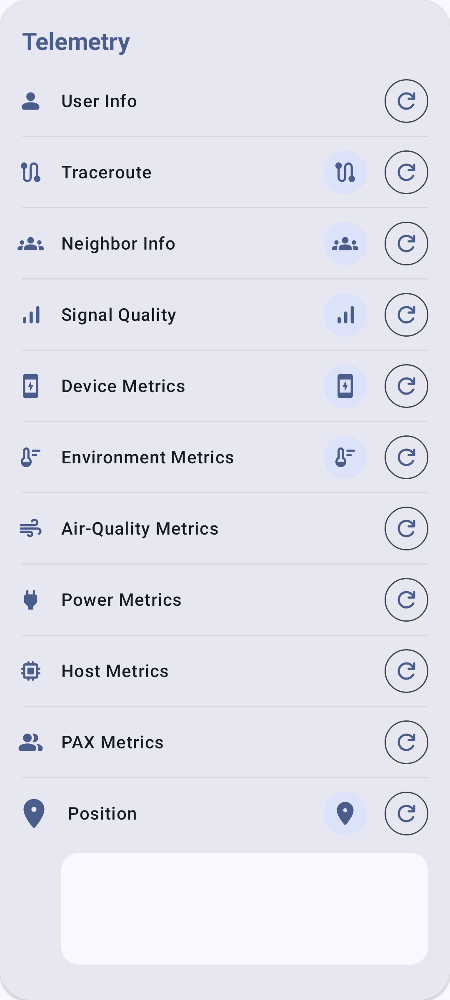

# Телеметрия и датчики

Ноды Meshtastic могут собирать и передавать данные датчиков по всей mesh-сети. Телеметрия позволяет нодам, оснащенным датчиками, транслировать информацию об окружающей среде, мощности и состоянии устройства, отображаемую на экране деталей ноды и записываемую во времени.

## Телеметрия устройства

Все ноды Meshtastic передают базовую телеметрию устройства:

| Метрика        | Описание                                            | Типичный диапазон                                                  |
| -------------- | --------------------------------------------------- | ------------------------------------------------------------------ |
| Уровень заряда | Процент заряда                                      | 0–100%                                                             |
| Напряжение     | Напряжение батареи                                  | 3.0–4.2V (LiPo) |
| ChUtil         | % эфирного времени в использовании                  | 0–100%                                                             |
| AirUtil        | % от последнего часа эта нода потратила на передачу | 0–100%                                                             |
| Аптайм         | Секунд с последней загрузки                         | Варьируется                                                        |

## Датчики окружающей среды

Поддерживаемые датчики окружающей среды:

### Температура и влажность

| Sensor  | Температура | Влажность | Давление | Заметки                          |
| ------- | ----------- | --------- | -------- | -------------------------------- |
| BME280  | ✓           | ✓         | ✓        | Рекомендуемый "всё в одном"      |
| BME680  | ✓           | ✓         | ✓        | Добавляет сопротивление газа/IAQ |
| SHT31   | ✓           | ✓         | —        | Высокая точность                 |
| MCP9808 | ✓           | —         | —        | Прецизионная температура         |
| LPS22   | —           | —         | ✓        | Только давление                  |

### Качество воздуха

| Sensor   | Метрика                                            | Заметки                                                                                                                                                                                                                    |
| -------- | -------------------------------------------------- | -------------------------------------------------------------------------------------------------------------------------------------------------------------------------------------------------------------------------- |
| BME680   | Сопротивление газа / IAQ                           | Летучие органические соединения                                                                                                                                                                                            |
| PMSA003I | PM1.0, PM2.5, PM10 | См. [Метрики качества воздуха](#air-quality-metrics)                                                                                                                                                       |
| SEN55    | PM, Темп, Влажность                                | Мультисенсор. Its NOx and VOC indices are recorded and included in a CSV export, but are not shown as cards or charts                                                                                      |
| SEN6x    | PM, CO₂, Темп, Влажность                           | Its status register is always exported; when it reports a fault (fan, RH&T, gas, CO₂, HCHO or PM), the fault names appear as a Sensor Status card and on each Air Quality log entry |

### Влажность почвы

| Метрика     | Единица | Заметки                                                         |
| ----------- | ------- | --------------------------------------------------------------- |
| Темп почвы  | °C / °F | Данные о влажности почвы, полученные с помощью почвенных зондов |
| Влажн почвы | %       | Объемное содержание воды                                        |

Both appear as info cards on the node detail screen, next to the other environment readings.

Soil probe and water-quality sonde chemistry (pH, conductivity, salinity, NPK, dissolved oxygen, ORP, turbidity, nitrate, ammonium, oxygen demand, solar irradiance) appears as a **Soil & Water** row of info cards on the node detail screen once a node reports any of it, and is included in the node database export. У него нет графика или экрана журнала, и строка не имеет кнопки запроса.

### Освещённость и УФ

| Sensor   | Метрика                                           |
| -------- | ------------------------------------------------- |
| OPT3001  | Окружающая освещённость (люкс) |
| VEML7700 | Окружающая освещённость (люкс) |
| LTR390   | УФ-индекс                                         |

### Погода и другие данные

| Метрическая                                        | Единица                  | Где он появляется                                                                                                                                                                                                         |
| -------------------------------------------------- | ------------------------ | ------------------------------------------------------------------------------------------------------------------------------------------------------------------------------------------------------------------------- |
| Скорость ветра                                     | км/ч или миль/ч          | Карта и график. Sensors report meters per second; the app converts to match your unit setting, and the chart uses the same unit as the card                                                               |
| Wind direction, gust, and lull                     | градусы, км/ч или миль/ч | Отображается вместе с каждым показанием на экране метрик среды; не отображается на графике                                                                                                                                |
| Дождь, последний час и за 24 часа                  | мм или дюймы             | Отображается вместе с каждым показанием на экране показателей среды; не отображается на графике                                                                                                                           |
| Молния, удары за последний час и расстояние шторма | количество км или ми     | Card and listed with each reading on the Environment Metrics screen; not charted. Из детектора AS3935. Storm distance is always in km or mi, since the detector resolves whole kilometers |
| Радиация                                           | μR/h                     | Карта и график                                                                                                                                                                                                            |
| Вес                                                | кг или фунт              | Только для карт — тензодатчики, такие как шкала для улья                                                                                                                                                                  |
| Расстояние                                         | мм или дюйм              | Только карта — уровень воды, от датчика расстояния                                                                                                                                                                        |
| Точка росы                                         | °C или °F                | Только карта — вычисленные из температуры и влажности                                                                                                                                                                     |
| 1-проводная температура                            | °C или °F                | Карта и график, до восьми DS18B20 зондов                                                                                                                                                                                  |
| Напряжение АЦП                                     | V                        | Карта и график, до восьми аналоговых каналов                                                                                                                                                                              |

## Метрики питания

Ноды с датчиками питания серии INA могут сообщать:

| Метрическая | Описание                                |
| ----------- | --------------------------------------- |
| Напряжение  | Считывание напряжения по каждому каналу |
| Ток         | Потребляемый ток на канал, мА           |

The node detail screen shows read-only cards for every channel that reported data, up to eight. Use the chart button on the **Power Metrics** row to open the chart screen, which lists a chip for every channel that reported data — up to eight — and charts the one you select. Rename a channel there, in the label field under the chips, to something like Solar or Battery. There is no separate wattage reading; the app charts voltage and current, and does not compute power from them.

Полезно для мониторинга солнечной зарядки или состояния батареи на удалённых нодах.

## Настройка телеметрии

1. Navigate to **Settings → Module configuration → Telemetry**.
2. Each metric group has its own enable toggle and its own interval:

   - **Device Metrics** — battery, voltage, uptime, ChUtil, and AirUtil. Its toggle, **Broadcast Device Metrics**, appears only on firmware 2.7.13 and later. Turned off, the node stops broadcasting these metrics to the mesh but still sends them to the connected app; on older firmware you can change the interval but not stop the broadcast
   - **Environment Metrics** — temperature, humidity, pressure and the other sensor readings
   - **Air Quality Metrics** — particulate and CO₂ readings
   - **Power Metrics** — the per-channel voltage and current readings

   Environment has an extra toggle, **Show on device screen**, to show its readings on the node's own
   screen, and **Display Fahrenheit** to show its temperatures there in Fahrenheit. Power has
   **Power Screen** for the same purpose.

### Choosing an Interval

These are nominal values, not hard schedules. On a congested mesh the firmware automatically
backs off to longer intervals based on how many nodes are online, so you do not need to
hand-tune them for mesh size. Lengthen them deliberately only to save battery.

## Метрики качества воздуха

Ноды с датчиками взвешенных частиц или CO₂ передают данные о качестве воздуха:

| Метрическая           | Единица | Описание                        |
| --------------------- | ------- | ------------------------------- |
| PM1.0 | мкг/м³  | Ультрамелкие взвешенные частицы |
| PM2.5 | мкг/м³  | Мелкие взвешенные частицы       |
| PM10                  | мкг/м³  | Крупные взвешенные частицы      |
| CO₂                   | ppm     | Концентрация углекислого газа   |

Датчики CO₂, такие как SCD4x, также сообщают собственную температуру и влажность, которые отображаются вместе с указанными выше показаниями. На основе истории PM2.5 приложение дополнительно вычисляет значение **AQI EPA по методу NowCast**.

Показания CO₂ окрашены по уровню опасности (Хорошо → Душно → Плохо → Опасно → Эвакуация). Точные диапазоны ppm, цвета и подробности AQI см. в разделе [Метрики нод — Качество воздуха](node-metrics#air-quality-metrics).

Данные о качестве воздуха можно просматривать в виде информационных карточек на экране сведений о ноде, строить графики за период и экспортировать в CSV.

## Просмотр телеметрии

1. Перейдите в **Ноды** и выберите ноду.
2. The **Telemetry** section lists a row for each metric type — Device, Environment, Air Quality, Power, Host, PAX, and the rest — whether or not this node has reported it. A row fills in with readings, and grows a chart button, once that node has sent that kind of telemetry. An empty row means nothing has arrived, not that the sensor is missing. **Soil & Water** is the exception: its row appears only after the node reports soil or water readings.
3. Use the chart button on a row to open that metric's history, where you can pick a time frame. The Device, Environment, Air Quality, Power, Signal Quality, and Position screens also export their readings as CSV.

## Устранение неполадок

- **Нет данных об окружающей среде?** К удалённой ноде должен быть физически подключён датчик (например, BME280 по I2C). Телеметрия устройства (заряд батареи, время работы) доступна всегда, но для метрик окружающей среды требуется оборудование.
- **Показания устарели?** Проверьте интервал передачи — очень большие интервалы (7200 с и более) означают, что данные обновляются редко. Также убедитесь, что удалённая нода всё ещё в сети.
- **Конфликт датчиков на шине I2C?** Некоторые датчики используют одинаковые адреса I2C. If you have multiple sensors on the same bus, check for address collisions in the node's serial debug output.

## Связанные темы

- [Метрики нод](node-metrics) — просмотр данных телеметрии на экране сведений о ноде
- [Настройки — Модули и администрирование](settings-module-admin) — конфигурация модуля телеметрии
- [Единицы измерения и регион](units-and-locale) — единицы отображения температуры и давления
