```mermaid
graph TB
  :feature:connections[connections]:::kmp-feature
  :feature:connections -.-> :core:common
  :feature:connections -.-> :core:datastore
  :feature:connections -.-> :core:di
  :feature:connections -.-> :core:model
  :feature:connections -.-> :core:navigation
  :feature:connections -.-> :core:resources
  :feature:connections -.-> :core:ui
  :feature:connections -.-> :core:ble
  :feature:connections -.-> :core:network
  :feature:connections -.-> :core:testing

classDef android-application fill:#CAFFBF,stroke:#000,stroke-width:2px,color:#000;
classDef android-application-compose fill:#CAFFBF,stroke:#000,stroke-width:2px,color:#000;
classDef compose-desktop-application fill:#CAFFBF,stroke:#000,stroke-width:2px,color:#000;
classDef android-feature fill:#FFD6A5,stroke:#000,stroke-width:2px,color:#000;
classDef android-library fill:#9BF6FF,stroke:#000,stroke-width:2px,color:#000;
classDef android-library-compose fill:#9BF6FF,stroke:#000,stroke-width:2px,color:#000;
classDef android-test fill:#A0C4FF,stroke:#000,stroke-width:2px,color:#000;
classDef jvm-library fill:#BDB2FF,stroke:#000,stroke-width:2px,color:#000;
classDef kmp-feature fill:#FFD6A5,stroke:#000,stroke-width:2px,color:#000;
classDef kmp-library-compose fill:#FFC1CC,stroke:#000,stroke-width:2px,color:#000;
classDef kmp-library fill:#FFC1CC,stroke:#000,stroke-width:2px,color:#000;
classDef unknown fill:#FFADAD,stroke:#000,stroke-width:2px,color:#000;

```

# `:feature:connections`

## Overview

The `:feature:connections` module provides the **device discovery and connection management screen**. It scans for and connects to Meshtastic nodes over BLE, USB serial, and TCP/NSD (network service discovery). The `ScannerViewModel` is platform-neutral; `AndroidScannerViewModel` adds Bluetooth bonding and the USB permission dialog, and `JvmScannerViewModel` registers the base behavior on Desktop.

**Targets:** Android · JVM (Desktop) · iOS (via `meshtastic.kmp.feature` convention plugin)

## Key Responsibilities

- Scan for BLE devices and merge results with previously bonded devices (bonded first, then discovery order)
- Enumerate USB serial devices, with permission gating on Android (`UsbScanner`; `JvmUsbScanner` on Desktop)
- Discover TCP/NSD services and manage recent manual TCP addresses
- Gate a TCP connect on Android's local-network permission without ever blocking it (`localNetworkGateAction`)
- Surface a single-choice transport selector (BLE / Network / USB) whose active pane persists through `UiPrefs`
- List the Demo Mode virtual devices (`Mock`, and `Replay` in debug builds) under whichever pane is showing
- Manage the full connection flow: bond → connect → disconnect
- Show connection status and progress while a device is being configured
- Show a recovery banner for a firmware update that left a device in bootloader mode, and an event firmware card
  (`EventFirmwareCard`) when the connected device runs an event edition

## Source Structure

```text
src/
├── commonMain/kotlin/org/meshtastic/feature/connections/
│   ├── ScannerViewModel.kt          ← platform-neutral ViewModel
│   ├── Constants.kt
│   ├── model/
│   │   ├── DeviceListEntry.kt       ← sealed: Ble | Usb | Tcp | Mock | Replay
│   │   └── DiscoveredDevices.kt     ← GetDiscoveredDevicesUseCase interface + result
│   ├── domain/usecase/
│   │   ├── CommonGetDiscoveredDevicesUseCase.kt
│   │   ├── TcpDiscoveryHelpers.kt
│   │   └── UsbScanner.kt            ← common USB scanner interface
│   ├── navigation/
│   │   └── ConnectionsNavigation.kt
│   ├── component/
│   │   └── ConnectionsPreviews.kt
│   ├── ui/
│   │   ├── ConnectionsScreen.kt
│   │   ├── LocalNetworkGateAction.kt ← pure classifier for the local-network permission gate
│   │   └── components/
│   │       ├── ConnectingDeviceInfo.kt
│   │       ├── ConnectionActionButton.kt / ConnectionActionButtonStyle.kt
│   │       ├── CurrentlyConnectedInfo.kt
│   │       ├── DeviceList.kt / DeviceListItem.kt / DeviceSectionHeader.kt
│   │       ├── DisconnectButton.kt
│   │       ├── EventFirmwareCard.kt
│   │       └── TransportSelector.kt
│   └── di/
│       └── FeatureConnectionsModule.kt
├── androidMain/kotlin/
│   ├── AndroidScannerViewModel.kt   ← overrides bond/permission requests
│   ├── model/AndroidUsbDeviceData.kt
│   └── domain/usecase/AndroidGetDiscoveredDevicesUseCase.kt
└── jvmMain/kotlin/
    ├── JvmScannerViewModel.kt
    ├── model/JvmUsbDeviceData.kt
    └── domain/usecase/
        ├── JvmGetDiscoveredDevicesUseCase.kt
        └── JvmUsbScanner.kt
```

## Key Types

### `DeviceListEntry` (sealed class)

```kotlin
sealed class DeviceListEntry(name: String, fullAddress: String, bonded: Boolean, node: Node?) {
    data class Ble(device: BleDevice, bonded: Boolean, node: Node?) : DeviceListEntry
    data class Usb(usbData: UsbDeviceData, name: String, fullAddress: String, bonded: Boolean, node: Node?) : DeviceListEntry
    data class Tcp(name: String, fullAddress: String, node: Node?) : DeviceListEntry
    data class Mock(name: String, node: Node?) : DeviceListEntry
    data class Replay(name: String, node: Node?) : DeviceListEntry   // debug-only packet-capture replay

    val address: String                   // fullAddress without its transport prefix
    abstract fun copy(node: Node?): DeviceListEntry
}
```

The prefix is the `InterfaceId` character: BLE → `x<MAC>`, USB → `s<path>`, TCP → `t<host:port>`, Mock → `m`, Replay → `r`.

### `ScannerViewModel`

Platform-neutral ViewModel. Exposes:

```kotlin
// Device lists
val bleDevicesForUi: StateFlow<List<DeviceListEntry>>
val usbDevicesForUi: StateFlow<List<DeviceListEntry>>
val virtualDevicesForUi: StateFlow<List<DeviceListEntry>>   // Demo Mode entries
val discoveredTcpDevicesForUi: StateFlow<List<DeviceListEntry>>
val recentTcpDevicesForUi: StateFlow<List<DeviceListEntry>>

// Scan state
val activeTransport: StateFlow<DeviceType>
val isBleScanning: StateFlow<Boolean>
val isNetworkScanning: StateFlow<Boolean>
val bleAutoScan: StateFlow<Boolean>
val networkAutoScan: StateFlow<Boolean>

// Connection
val connectionProgressText: StateFlow<String?>
val selectedAddressFlow: StateFlow<String?>
val pendingRecovery: StateFlow<PendingFirmwareRecovery?>   // drives the firmware recovery banner

// Actions
fun selectTransport(type: DeviceType)
fun startBleScan() / stopBleScan() / toggleBleScan()
fun startBleAutoScan()
fun startNetworkScan() / stopNetworkScan() / toggleNetworkScan()
fun startNetworkAutoScan()
fun persistBleAutoScanIntent(enabled: Boolean)
fun persistNetworkAutoScanIntent(enabled: Boolean)
fun connectToManualAddress(fullAddress: String)
fun onSelected(entry: DeviceListEntry): Boolean  // false if bond/permission still pending
fun changeDeviceAddress(address: String)
fun disconnect()
fun dismissRecovery()
fun addRecentAddress(address: String, name: String)
fun removeRecentAddress(address: String)
```

`AndroidScannerViewModel` overrides `requestBonding(entry)` and `requestPermission(entry)` to run OS-level Bluetooth pairing and the USB permission dialog. On Desktop the base defaults apply: `requestBonding` connects directly, since the OS Bluetooth stack pairs during the GATT connection.

## Navigation

```kotlin
// Registration (in androidApp / desktopApp nav graph)
fun EntryProviderScope<NavKey>.connectionsGraph(backStack: NavBackStack<NavKey>) {
    // Registers ConnectionsRoute.Connections entry
    // Injects ScannerViewModel via Koin
}
```

Route: `ConnectionsRoute.Connections(address: String? = null)`. A deep link to `connections?address=<prefixed address>` fills `address` and prompts to connect to that device.

## Dependency Graph

### Key Dependencies

```text
feature:connections
  ├── core:ble, core:network       (transports)
  ├── core:common, core:datastore, core:di, core:model
  ├── core:navigation, core:resources, core:ui
  ├── org.meshtastic:protobufs     (Maven artifact)
  └── usb-serial-android           (Android only)
```

<!--region graph-->

<!--endregion-->
