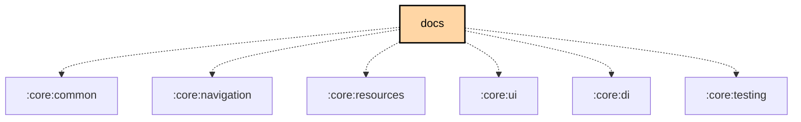

# `:feature:docs`

## Overview

The `:feature:docs` module is an **in-app documentation browser** with Compose Multiplatform UI. It bundles the Meshtastic user guide and developer guide as Compose resources at build time, provides full-text keyword search, Crowdin-backed multilingual content, optional ML Kit runtime translation (Google Play flavor), and a "Chirpy" AI Q&A assistant (Gemini Nano on Google Play; keyword fallback on F-Droid and Desktop).

**Targets:** Android · JVM (Desktop) · iOS (via `meshtastic.kmp.feature` convention plugin)

## Key Responsibilities

- Bundle `docs/en/user/**/*.md` and `docs/en/developer/**/*.md` as Compose resources at build time
- Sync Crowdin-translated locales into `composeResources/files/{locale}/docs/`
- Weighted keyword search across the full doc bundle (title, then keyword, alias and page-id matches)
- Locale-aware content loading with Crowdin → ML Kit fallback chain
- Adaptive list/detail layout (single pane on phones, split pane on tablets/desktop)
- Chirpy AI assistant: streaming Q&A against in-app docs via Gemini Nano; the keyword fallback suggests matching pages instead

## Source Structure

```text
src/commonMain/kotlin/org/meshtastic/feature/docs/
├── ai/
│   ├── AIDocAssistant.kt            ← interface (Gemini Nano / keyword fallback)
│   ├── ChirpySessionHolder.kt
│   └── KeywordFallbackAssistant.kt
├── data/
│   ├── DocBundleLoader.kt           ← interface + DefaultDocBundleLoader (the in-app page index)
│   └── KeywordSearchEngine.kt       ← weighted keyword search
├── di/
│   └── FeatureDocsModule.kt         ← Koin module
├── model/
│   └── DocModels.kt                 ← DocSection, DocPage, DocBundle, DocSearchResult, ...
├── navigation/
│   └── DocsNavigation.kt            ← docsEntries(), ChirpyUiState, rememberChirpyState()
├── translation/
│   ├── DocTranslationService.kt     ← ML Kit (Google) or no-op (fdroid/desktop)
│   ├── DocTranslationCache.kt
│   ├── MarkdownTranslationSegmenter.kt
│   └── NoOpDocTranslator.kt
└── ui/
    ├── DocsBrowserScreen.kt         ← list pane
    ├── DocsPageRouteScreen.kt       ← detail pane
    ├── DocsSearchBar.kt
    ├── ChirpyAssistantSheet.kt      ← AI assistant bottom sheet
    ├── ChirpyFab.kt                 ← floating action button that opens Chirpy
    ├── ComposeResourceImageTransformer.kt
    ├── DocPageIconResolver.kt
    └── DocsPreviews.kt
```

## Key Types

### `DocSection` (sealed interface)

```kotlin
sealed interface DocSection {
    data object UserGuide      : DocSection
    data object DeveloperGuide : DocSection
}
```

### `DocPage`

```kotlin
data class DocPage(
    val id: String,
    val title: String,
    val section: DocSection,
    val navOrder: Int,
    val resourcePath: String,
    val keywords: List<String>,
    val aliases: List<String> = emptyList(),
    val charCount: Int,
    val iconId: String? = null,   // maps to a MeshtasticIcons entry in the table of contents
)
```

### `DocBundleLoader`

`DefaultDocBundleLoader` is the in-app index. It holds a hardcoded entry per page (id, nav order, aliases, icon) and reads each page's Markdown from `files/docs/<section>/<id>.md`, or from `files/<locale>/docs/...` when a Crowdin translation exists. User guide titles and keywords come from `doc_title_*` / `doc_keywords_*` string resources so they translate; developer guide entries stay in English. A new page under `docs/en/` needs an entry here, and `scripts/check-doc-aliases.js` fails CI when a page's frontmatter `aliases` are missing from its entry.

### `AIDocAssistant` (interface)

```kotlin
interface AIDocAssistant {
    suspend fun isSupported(): Boolean
    val modelStatus: StateFlow<ModelReadiness>
    suspend fun answer(question: String, currentPageId: String? = null): AIDocAssistantResult
    fun answerStream(question: String, currentPageId: String? = null): Flow<AIDocAssistantResult>
    fun resetSession()
}
```

`AIDocAssistantResult` is a sealed interface: `Partial`, `Success`, `Fallback`, `Error`.

Platform bindings:
- **Google flavor**: `GeminiNanoDocAssistant` (`GoogleAiModule` in `:androidApp`), Gemini Nano on device
- **F-Droid / Desktop**: `KeywordFallbackAssistant`, which returns the best-matching pages as suggestions with no generated answer and no network

### `ChirpyMessage`

```kotlin
@Serializable
data class ChirpyMessage(
    val id: String,
    val role: ChirpyRole,   // USER | ASSISTANT | SYSTEM
    val text: String,
    val sources: List<SourceRef>,
)
```

## Gradle Tasks

`syncDocsToComposeResources` builds this module's commonMain compose-resources directory under
`build/generated/docsComposeResources/` and registers it with `compose.resources { customDirectory(...) }`, so every
Compose resource task depends on it and a normal build needs no manual invocation:

| Source | Resource path |
|---|---|
| `docs/en/user/**/*.md`, `docs/en/developer/**/*.md` | `files/docs/` |
| `docs/assets/screenshots/**/*.png` | `files/docs/assets/screenshots/` |
| `docs/{locale}/user/**/*.md` | `files/{locale}/docs/user/` |

The `{locale}` directory keeps Crowdin's name, which already matches the `values-*` qualifiers (for example `pt-rBR`,
`b+sr+Latn`).

The root project's `meshtastic.docs` convention plugin (`DocsTasks.kt` in `build-logic`) adds three tasks for the published site. They don't feed the in-app bundle:

| Task | Description |
|---|---|
| `generateDocsBundle` | Renders `docs/en/{user,developer}/*.md` and `docs/{locale}/user/*.md` to HTML under `build/generated/docs/common/`, with an `index.json` keyword index, `locales.json`, and a stylesheet. `-Pdocs.channel` and `-Pdocs.version` default to `beta`. |
| `validateDocsBundle` | Runs `generateDocsBundle`, then fails if `index.json` is missing or not a JSON array, if a `resourcePath` it lists has no file, or if the bundle exceeds 20 MB (warning above 16 MB). |
| `publishDocsSite` | Assembles the Jekyll source tree for one GitHub Pages channel into `build/_site/`. |

`docs-deploy.yml` and `docs-release.yml` run all three. Before a docs pull request, run `./gradlew generateDocsBundle validateDocsBundle`.

## Navigation

Routes are `SettingsRoute` keys, registered by `docsEntries()` from the Android (`Main.kt`) and Desktop (`DesktopNavigation.kt`) nav hosts:

| Route | Description |
|---|---|
| `SettingsRoute.HelpDocs` | Doc browser list pane |
| `SettingsRoute.HelpDocPage` | Individual doc page detail pane |

The `docsEntries()` extension uses Material3 adaptive `ListDetailSceneStrategy` to automatically provide a split-pane layout on large screens.

## Dependency Graph

### Key Dependencies

```text
feature:docs
  ├── core:common, core:navigation, core:resources, core:ui, core:di
  ├── coil                      (image loading in Markdown)
  ├── markdown-renderer, markdown-renderer-m3   (Compose Markdown rendering)
  └── compose.material3.adaptive, compose.material3.adaptive.navigation3
```

<!--region graph-->

<!--endregion-->
