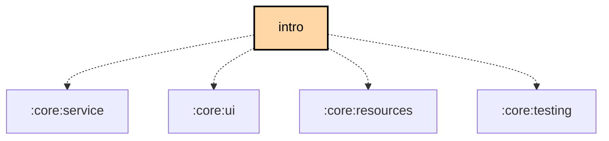

# `:feature:intro`

## Overview

**Targets:** Android · JVM (Desktop) · iOS

The `:feature:intro` module provides the onboarding experience for new users. It handles the initial welcome flow and explains and requests the Bluetooth, Location and Notifications permissions. Every permission screen can be skipped.

The screens and their logic are in `commonMain`, but only the Android app hosts the flow: `MainActivity` shows `AppIntroductionScreen` until the intro is completed. The `jvmMain` stubs (`JvmIntroPermissions`, `JvmIntroSettingsNavigator`) report every permission as granted.

## Key Components

### 1. `AppIntroductionScreen` (`androidMain`)
Hosts the multi-step onboarding flow and hoists the live permission states. The steps are Navigation 3 keys (`IntroNavKeys.kt`) registered by `introGraph()`, and `IntroViewModel.getNextKey()` picks each next step:

`Welcome` → `Bluetooth` → `Location` → `Notifications` → `CriticalAlerts`

`Bluetooth` is skipped on a device without Bluetooth. `Location` is skipped when the Bluetooth request already covered it, as on Android versions where BLE scanning needs the location permission. `CriticalAlerts` appears only when the notification permission was granted.

### 2. Permission Screens
Dedicated screens for explaining and requesting specific permissions:
- `BluetoothScreen`: Needed for finding and connecting to nodes.
- `LocationScreen`: Optional. Every location-backed feature asks again in context.
- `NotificationsScreen`: Needed for the foreground service and message alerts.
- `CriticalAlertsScreen`: Opens the system settings for emergency alerts that bypass Do Not Disturb.

`introPermissionAction()` maps each permission's status to the primary button's action: request it, advance, or open the app settings when it is blocked.

## Testing

`./gradlew :feature:intro:allTests` covers the step order (`IntroViewModelTest`) and the permission action mapping (`IntroPermissionActionTest`).

## Dependency Graph

<!--region graph-->

<!--endregion-->
