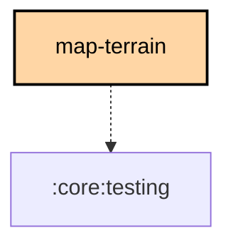

# `:feature:map-terrain`

## Overview

Offline terrain math and storage: Terrarium elevation decoding, hillshade shading, contour-line generation, and the
Mapterhorn tile download and on-disk store. It holds no Compose UI and no rendering primitives, so every map renderer
draws terrain from one definition.

Three modules consume it:

| Consumer | What it does with the terrain |
|---|---|
| `androidApp` (`google` flavor only, `googleImplementation`) | Pre-rendered hillshade tiles and polyline contours on Google Maps (`app/map/offline/terrain/`) |
| `:feature:map-maplibre` | Native raster-DEM hillshade and GeoJSON contours for the `fdroid` flavor and Desktop |
| `:feature:coverage` | Elevation for the Site Planner's on-device coverage estimate |

The build declares `jvm()` and `android()`. The `meshtastic.kmp.feature` convention plugin also adds the iOS
simulator target, so the `nativeMain` actuals of `decodeTerrariumTile` and `TerrainTileFetcher` exist only to compile,
and throw if called.

## Structure

All in `commonMain` unless noted:

| File | Role |
|---|---|
| `ElevationTile.kt` | `terrariumElevationMeters()` (`R×256 + G + B÷256 − 32768`), the `ElevationTile` grid, and `expect fun decodeTerrariumTile()` for WebP bytes. Android decodes with `BitmapFactory`, Desktop with Skia, both unpremultiplied so alpha never corrupts the elevation bits. |
| `Hillshade.kt` | Horn's-method shading: shadow-only output (alpha is shadow depth) under a fixed NW light at 45°, plus despike and noise-cleanup passes. Takes a tile padded by one pixel of real neighbor data on every side. |
| `ContourGenerator.kt` | Marching squares over an `ElevationTile`, chained into one polyline per contour line in tile-local `[0,1]` coordinates. |
| `ContourIntervals.kt` | The zoom-banded minor/index interval table, in metric or feet-derived round numbers; every fifth line is an index line. |
| `ContourStyle.kt` | Contour stroke color, width and opacity as simplestyle-spec values, which both renderers already apply to imported layers. |
| `MapterhornEndpoints.kt` | Mapterhorn's two-tier PMTiles layout: a global archive up to z12 and per-region high-resolution archives (z13 to z18) keyed by their z6 tile, plus the attribution string. |
| `TerrainTileFetcher.kt` | Range-request reads of single tiles from a remote PMTiles archive. The `jvmAndroidMain` actual wraps the `pmtiles-reader` Java library. |
| `TerrainRegionExtractor.kt` | Downloads a region: the global layer always, the regional layer where the bounds fit one z6 tile. Reports `TerrainDownloadState` and fails with `TILE_LIMIT_EXCEEDED` above `MAX_TILES` (3,000). |
| `TerrainTileStore.kt` | Raw WebP tiles as plain files under `<baseDir>/<global or regional>/<zoom>/<x>/<y>.webp`, through Okio so it works on Desktop too. The caller decides where `baseDir` lives. |
| `TerrainTileMath.kt`, `TerrainTileCount.kt` | Web Mercator tile math (`GeoBounds`, `TileIndex`) and `terrainTileCount()` for download estimates. |

## Things that will bite

- **Decode unpremultiplied.** Both platform decoders premultiply RGB by alpha by default, which corrupts the
  elevation encoded in the RGB channels wherever a tile is not fully opaque.
- **Hillshade needs real neighbors.** `Hillshade.shade()` reads a 3×3 kernel, so it takes a `(width+2)×(height+2)`
  tile. Fetching that margin from adjacent tiles, rather than clamping at the tile's own edge, is the caller's job.
- **The store knows only its own directory.** How a terrain download relates to a basemap region (shared storage
  budget, deleting one without the other) belongs to the caller.

## Testing

`./gradlew :feature:map-terrain:allTests` runs the pure-logic suite on JVM and as Android host tests: Terrarium
decoding, hillshade, contour generation and intervals, endpoint selection, tile math and counts, region extraction,
and the tile store against Okio's `FakeFileSystem`.

## Dependency Graph

<!--region graph-->

<!--endregion-->
