# `:feature:node`

## Overview

**Targets:** Android · JVM (Desktop) · iOS

The `:feature:node` module handles node-centric features, including the node list, detailed node information, telemetry charts, traceroutes, the compass, and the remote shell.

## Key Components

### 1. `NodeListScreen` and `NodeListViewModel`
Displays all nodes known to the application, with search and filters (`NodeFilterPreferences`, `GetFilteredNodesUseCase`). `AdaptiveNodeListScreen` pairs it with the detail pane.

### 2. `NodeDetailScreen` and `NodeDetailViewModel`
Shows the details of one node: hardware info and its 3D device model (`DeviceModelViewModel`), position, last heard, notes, device links, and the remote administration and request actions.

### 3. `MetricsViewModel`
Backs the telemetry screens, each a chart plus a log: device, signal, power, environment, air quality, PAX, host metrics, neighbor info, position (`PositionLogScreens.kt`, with its embedded track map), and traceroute logs. `TracerouteMapScreen` draws a traceroute through the host's `LocalTracerouteMapProvider`.

### 4. `CompassViewModel`
Backs the compass bottom sheet, which shows the bearing and distance to another node from the phone's heading (`CompassHeadingProvider`).

### 5. `RemoteShellViewModel`
A terminal session against the firmware's DMShell module (`metrics/terminal/`), in character mode (keystrokes streamed with local echo) or line mode (one frame per command).

## Navigation

`NodesNavigation.kt` registers `NodesRoute.Nodes` as the list pane and `NodesRoute.NodeDetail` as the detail pane. The metric, log and traceroute screens are `NodeDetailRoute` extra panes; `NodeDetailRoute.RemoteShell` takes the whole window.

## Testing

`./gradlew :feature:node:allTests` runs `commonTest` on JVM and as Android host tests, plus the Compose UI tests in `jvmTest`.

## Dependency Graph

```mermaid
graph TB
  :feature:node[node]:::kmp-feature
  :feature:node -.-> :core:common
  :feature:node -.-> :core:domain
  :feature:node -.-> :core:model
  :feature:node -.-> :core:navigation
  :feature:node -.-> :core:repository
  :feature:node -.-> :core:resources
  :feature:node -.-> :core:ui
  :feature:node -.-> :core:di
  :feature:node -.-> :core:testing

classDef android-application fill:#CAFFBF,stroke:#000,stroke-width:2px,color:#000;
classDef android-application-compose fill:#CAFFBF,stroke:#000,stroke-width:2px,color:#000;
classDef compose-desktop-application fill:#CAFFBF,stroke:#000,stroke-width:2px,color:#000;
classDef android-feature fill:#FFD6A5,stroke:#000,stroke-width:2px,color:#000;
classDef android-library fill:#9BF6FF,stroke:#000,stroke-width:2px,color:#000;
classDef android-library-compose fill:#9BF6FF,stroke:#000,stroke-width:2px,color:#000;
classDef android-test fill:#A0C4FF,stroke:#000,stroke-width:2px,color:#000;
classDef jvm-library fill:#BDB2FF,stroke:#000,stroke-width:2px,color:#000;
classDef kmp-feature fill:#FFD6A5,stroke:#000,stroke-width:2px,color:#000;
classDef kmp-library-compose fill:#FFC1CC,stroke:#000,stroke-width:2px,color:#000;
classDef kmp-library fill:#FFC1CC,stroke:#000,stroke-width:2px,color:#000;
classDef unknown fill:#FFADAD,stroke:#000,stroke-width:2px,color:#000;

```

<!--region graph-->

<!--endregion-->
