# `:feature:settings`

## Overview
The `:feature:settings` module manages all application and device-side configurations. This includes user preferences, channel configuration, and advanced node settings.

## Key Components

### 1. `SettingsScreen` and `DesktopSettingsScreen`
The main entry point for application-wide settings: `SettingsScreen` in `androidMain`, `DesktopSettingsScreen` in `jvmMain`. Both carry the settings search field (`search/`, `SettingsSearchViewModel`), which jumps to a matching setting.

### 2. `RadioConfigViewModel`
Handles reading and writing configuration to the Meshtastic device over the connected transport (BLE, USB, or TCP). The config and module screens are listed in `navigation/ConfigRoute.kt` and `navigation/ModuleRoute.kt`, with one `*ConfigItemList` or `*ConfigScreen` per section under `radio/component/`.

### 3. `AboutScreen`
Displays what Meshtastic is, a "Need Hardware?" row, version information, and project links.

### 4. `AcknowledgementsScreen`
Displays the open-source libraries the app is built on, with their licenses.

## Validation Reference
- See [settings-validation.md](settings-validation.md) for detailed radio/module settings validation rules used by this module.

## Features
- **Channel Configuration**: Manage encryption keys, channel names, and per-channel position precision. On a channel whose key is public, precise location is unavailable and the precision is capped at 15 bits (`Channel.usesPublicKey`, `withOnWirePrecision`).
- **Radio setup** (`radio/setup/`): `RadioSetupScreen`, a guided region, preset, name and nearby-meshes flow (intro, `RegionPage` with a searchable list, `PresetPage`, `NamePage`, `BeaconsPage`, summary). It is bound to the connected node's address and writes only while that node stays connected (`radioSetupCanWrite`). The Connections tab offers it for a node with no region, and **Settings** has a **Set up radio** row.
- **MQTT topic finder** (`MqttTopicFinderSheet`): samples the broker for a minute and lists the root topics in use nearby.
- **Node Database Management**: `CleanNodeDatabaseScreen` removes nodes not heard for a chosen number of days, from the app's database and from the connected node's.
- **Database backup and restore**: `DatabaseBackupViewModel` backs up the app database for the connected device and stages a restore that applies on the next launch.
- **App Preferences**: Theme selection, display units (follow the system, metric, or imperial), and notification settings.
- **Lockdown mode** (`lockdown/`): the passphrase-protected lockdown toggle on the security settings screen.
- **Debug panel** (`debugging/`): the mesh log viewer, with filters, search and export.
- **Device Links** (`DeviceLinkDirectoryScreen`): every imported msh.to link, sorted by short code.

## Testing

`./gradlew :feature:settings:allTests`. There are no Android host tests (`commonTest` holds Compose UI tests), so this runs the suite on JVM.

## Dependency Graph

```mermaid
graph TB
  :feature:settings[settings]:::kmp-feature
  :feature:settings -.-> :core:common
  :feature:settings -.-> :core:database
  :feature:settings -.-> :core:domain
  :feature:settings -.-> :core:model
  :feature:settings -.-> :core:navigation
  :feature:settings -.-> :core:network
  :feature:settings -.-> :core:repository
  :feature:settings -.-> :core:resources
  :feature:settings -.-> :core:ui
  :feature:settings -.-> :core:di
  :feature:settings -.-> :core:testing
  :feature:settings -.-> :core:takserver

classDef android-application fill:#CAFFBF,stroke:#000,stroke-width:2px,color:#000;
classDef android-application-compose fill:#CAFFBF,stroke:#000,stroke-width:2px,color:#000;
classDef compose-desktop-application fill:#CAFFBF,stroke:#000,stroke-width:2px,color:#000;
classDef android-feature fill:#FFD6A5,stroke:#000,stroke-width:2px,color:#000;
classDef android-library fill:#9BF6FF,stroke:#000,stroke-width:2px,color:#000;
classDef android-library-compose fill:#9BF6FF,stroke:#000,stroke-width:2px,color:#000;
classDef android-test fill:#A0C4FF,stroke:#000,stroke-width:2px,color:#000;
classDef jvm-library fill:#BDB2FF,stroke:#000,stroke-width:2px,color:#000;
classDef kmp-feature fill:#FFD6A5,stroke:#000,stroke-width:2px,color:#000;
classDef kmp-library-compose fill:#FFC1CC,stroke:#000,stroke-width:2px,color:#000;
classDef kmp-library fill:#FFC1CC,stroke:#000,stroke-width:2px,color:#000;
classDef unknown fill:#FFADAD,stroke:#000,stroke-width:2px,color:#000;

```

<!--region graph-->

<!--endregion-->
