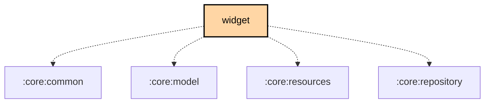

# `:feature:widget`

## Overview

The `:feature:widget` module is an **Android-only Jetpack Glance home-screen widget** (API 26+). It exposes a single widget — `LocalStatsWidget` — that displays live mesh statistics sourced from the running Meshtastic service.

**Target: Android only** (not KMP — uses `meshtastic.android.library` + `meshtastic.android.library.compose` convention plugins)

## Key Responsibilities

- Display live mesh statistics on the Android home screen via Jetpack Glance
- Combine four reactive data sources into a single `StateFlow<LocalStatsWidgetUiState>` for efficient re-renders
- Support three responsive widget sizes: small square, wide rectangle, and large square
- Fulfill the `AppWidgetUpdater` interface from `:core:repository` so the mesh service can trigger widget refreshes without depending on Android widget APIs

## Source Structure

```text
src/main/kotlin/org/meshtastic/feature/widget/
├── LocalStatsWidget.kt              ← GlanceAppWidget, 3 responsive sizes
├── LocalStatsWidgetReceiver.kt      ← GlanceAppWidgetReceiver
├── LocalStatsWidgetState.kt         ← LocalStatsWidgetUiState + StateProvider
├── AndroidAppWidgetUpdater.kt       ← implements AppWidgetUpdater (core:repository)
├── RefreshLocalStatsAction.kt       ← ActionCallback (refresh button)
├── WidgetResourceEnvironment.kt     ← bridges Compose resources into Glance
└── di/
    └── FeatureWidgetModule.kt
```

## Widget Content

The widget shows the following information when connected:

| Section | Data shown |
|---|---|
| Node identity | Short name chip with node colors |
| Battery | Level percentage + progress bar |
| Channel utilization | Percentage + progress bar |
| Air utilization | Percentage + progress bar |
| Traffic | TX / RX packet counts, duplicates, relay TX, relay canceled, dropped, bad RX |
| Diagnostics | Noise floor (dBm), free heap / total heap |
| Footer | Online nodes / total nodes, device uptime, last-updated timestamp |

When not connected, the widget shows the app icon (a progress spinner while connecting) and the connection status: **Disconnected**, **Connecting**, or **Device sleeping**.

## Key Types

### `LocalStatsWidgetUiState`

```kotlin
data class LocalStatsWidgetUiState(
    val connectionState: ConnectionState,
    val isConnecting: Boolean,
    val showContent: Boolean,
    // Node identity
    val nodeShortName: String?,
    val nodeColors: Pair<Int, Int>?,
    // Battery
    val batteryLevel: Int,
    val hasBattery: Boolean,
    val batteryProgress: Float,
    // Utilization
    val channelUtilization: Float, val channelUtilizationProgress: Float,
    val airUtilization: Float, val airUtilizationProgress: Float,
    // Traffic counters
    val hasStats: Boolean,
    val numPacketsTx: Int, val numPacketsRx: Int,
    val numRxDupe: Int, val numTxRelay: Int, val numTxRelayCanceled: Int,
    val numTxDropped: Int, val numPacketsRxBad: Int,
    // Diagnostics
    val noiseFloor: Int,
    val heapFreeBytes: Int, val heapTotalBytes: Int,
    // Footer
    val totalNodes: Int, val onlineNodes: Int,
    val uptimeSecs: Long,
    val updateTimeMillis: Long,
)
```

Every field has a default in the source; the listing leaves them out. Until the node has sent `LocalStats` (`hasStats` false), utilization and uptime fall back to the node's own device metrics.

### `LocalStatsWidgetStateProvider`

Koin `@Single` that eagerly combines four reactive flows (`ConnectionStateProvider` is injected as the constructor param `connectionStateProvider`):
- `ConnectionStateProvider.connectionState`
- `NodeRepository.nodeDBbyNum` (online/total counts)
- `NodeRepository.localStats`
- `NodeRepository.ourNodeInfo`

```kotlin
val state: StateFlow<LocalStatsWidgetUiState>
```

### `LocalStatsWidget`

```kotlin
class LocalStatsWidget : GlanceAppWidget(), KoinComponent {
    override val sizeMode = SizeMode.Responsive(
        setOf(DpSize(100.dp, 100.dp), DpSize(250.dp, 100.dp), DpSize(250.dp, 250.dp))
    )
}
```

The sizes are `SMALL_SQUARE`, `HORIZONTAL_RECTANGLE` and `BIG_SQUARE`. Tapping the widget opens the app. The refresh button fires `RefreshLocalStatsAction`, which asks the local node for fresh `LOCAL_STATS` and `DEVICE` telemetry through `CommandSender`; the new values then reach the widget through the state flow. A rejected or unanswerable request is logged and skipped.

Glance doesn't provide the Compose UI locals that Compose Multiplatform's `stringResource` reads, so `WidgetResourceEnvironment` bridges them into the widget's composition; every translated string in the widget depends on it. A composition failure shows the `widget_composition_error` layout through `onCompositionError` instead of crashing the app.

## `AppWidgetUpdater` integration

The mesh service holds a reference to `AppWidgetUpdater` (defined in `:core:repository`) without depending on Android widget APIs. `AndroidAppWidgetUpdater` in this module provides the concrete implementation:

```kotlin
// Simplified — the real updateAll() wraps the call in a try/catch
@Single
class AndroidAppWidgetUpdater(
    private val context: Context,
    stateProvider: LocalStatsWidgetStateProvider,
) : AppWidgetUpdater {
    override suspend fun updateAll() {
        LocalStatsWidget().updateAll(context)
    }
}
```

It also observes `stateProvider.state` itself (debounced 500 ms, ignoring timestamp-only changes) and re-renders whenever widget instances exist — Glance compositions are ephemeral, so re-renders must be driven externally. This keeps the service layer platform-agnostic while still enabling widget refresh on data changes.

## Dependency Graph

### Key Dependencies

```text
feature:widget (Android only)
  ├── core:common, core:model, core:resources, core:repository
  ├── androidx.glance.appwidget, glance.material3, glance.preview, glance.appwidget.preview
  ├── compose.multiplatform.ui (LocalConfiguration, LocalDensity), compose.multiplatform.resources
  └── kermit
```

## Testing

This is a plain Android library, so its unit tests run under `./gradlew :feature:widget:testDebugUnitTest` (or the root `test` task), with Robolectric and Glance's testing artifacts.

<!--region graph-->

<!--endregion-->
